<div align="center">

# 🛡️ BGC Bot

### *A production-grade Discord recruitment background checker*

[](https://www.python.org/)
[](https://github.com/Rapptz/discord.py)
[](https://github.com/Pizzarobloxh)
[](https://github.com/Pizzarobloxh/bgc-bot)
[](https://github.com/Pizzarobloxh/bgc-bot)

<br />

**Bloxlink** · **Xtracker** · **Keystone** · **Simmer** · **Snow Core** · **Roblox Watcher** · **Exploit Watcher** · **Google Sheets blacklists**

</div>

---

## 📑 Table of Contents

- [✨ Overview](#-overview)
- [🚀 Quick Start](#-quick-start)
- [⚙️ Configuration](#️-configuration)
- [🧩 Command Reference](#-command-reference)
- [🔎 How the Pipeline Works](#-how-the-pipeline-works)
- [🧠 The Preemptive Scanner](#-the-preemptive-scanner)
- [📊 Performance — Version Comparison](#-performance--version-comparison)
- [📈 Timeline Gallery](#-timeline-gallery)
- [🛡️ Reliability — Bloxlink Shield & Adaptive Rate Limiter](#️-reliability--bloxlink-shield--adaptive-rate-limiter)
- [🔬 Data Model & Lifecycle](#-data-model--lifecycle)
- [🧪 Development & Testing](#-development--testing)
- [🤝 Contributing](#-contributing)

---

## ✨ Overview

I built this bot to run background checks on recruitment applications in a Discord server. A user posts their application in the recruitment channel, the bot resolves their Roblox identity through multiple sources (typed username, Bloxlink, nickname fallback, historical DB), cross-references it against six blacklist sources plus Keystone, Simmer, Snow Core, Roblox Watcher, and Exploit Watcher, and then reacts with `✅` or `❌`. On a pass it auto-roles the user and DMs them acceptance instructions.

I've been iterating on this bot for a while. The current version, **v4.9.0**, adds something I'm pretty proud of: a **preemptive scanner** that does the expensive lookups while the user is *typing* their application — before they even hit send. That drops the actual check from **1221 ms down to 98 ms** for anyone who took more than a second to write their message.

I also added a proper safety net this round. Back in v4.6.0 I got aggressive with the Xtracker rate limiter and it turned out to blow past their actual rate limits in production. I've since reverted the limiter to the safe 1.0 s interval and wrapped it in an `AdaptiveRateLimiter` that self-tunes on 429s. **Slower live path, but I haven't seen a rate-limited SKIPPED row since.**

> [!NOTE]
> The bot starts with only `DISCORD_BOT_TOKEN`. Every optional API key that's missing just makes that check return `SKIPPED`. Nothing crashes on missing credentials.

### What's in v4.9.0

| Feature | Detail | Since |
| :--- | :--- | :--- |
| **Preemptive scanning** | `on_typing` fires a background scan — BGC drops to **98 ms** on hit | v4.9.0 |
| **Bloxlink hard timeout** | 1500 ms cap with shield + late cache (result arrives *after* timeout is kept) | v4.9.0 |
| **Adaptive rate limiter** | Xtracker limiter auto-bumps on 429, decays after 60 s of silence | v4.9.0 |
| **Domain racing** | 3 Roblox mirrors raced in parallel — first 200 wins | v4.6.0 |
| **Circuit breaker** | Dead domains skipped for 60 s after 3 failures | v4.6.0 |
| **Per-UID caching** | info 10 min, history 30 min, groups 10 min, Simmer 10 min | v4.6.0 |
| **Wave-based T2** | Identity-set checks fire in delta-checked waves | v4.6.0 |
| **Historical-ID history** | Fetches username history for *every* historical ID, not just current | v4.9.0 |
| **Nickname racing** | Typed + nickname lookup raced at T0 | v4.9.0 |
| **Race-winner logging** | Result embeds show which mirror won each race | v4.9.0 |
| **aiodns auto-detect** | Non-blocking DNS if installed, graceful fallback if not | v4.9.0 |
| **ETag support** | External DB fetches skip unchanged sheets via `If-None-Match` | v4.9.0 |

---

## 🚀 Quick Start

### Prerequisites

- Python **3.10+**
- A Discord application with a **Bot** user
- *(Optional but strongly recommended)* API keys for Xtracker, RobloxWatcher, ExploitWatcher, Bloxlink, Simmer

### Installation

```bash
git clone https://github.com/Pizzarobloxh/bgc-bot.git
cd bgc-bot

python -m venv .venv
source .venv/bin/activate        # Linux / macOS
# .venv\Scripts\activate         # Windows

pip install -r requirements.txt
pip install aiodns pycares       # optional — non-blocking DNS

export DISCORD_BOT_TOKEN="your-token-here"
python bgc_bot.py
```

**`requirements.txt`** — minimum:
```text
discord.py>=2.3
aiohttp>=3.8
aiosqlite>=0.19
```

**Optional extras:**
```text
aiodns>=3.0
pycares>=4.3
```

> [!TIP]
> If `aiodns` is installed, `aiohttp` auto-detects it and switches to non-blocking DNS — that removes a rare 100–200 ms stall when a DNS entry expires mid-BGC. If it's not installed, nothing breaks.

---

## ⚙️ Configuration

All configuration is environment-driven. The bot runs with **zero** optional variables — it simply does less.

### Required

| Variable | Purpose |
| :--- | :--- |
| `DISCORD_BOT_TOKEN` | Discord bot authentication |

### Strongly recommended

| Variable | Purpose | If omitted |
| :--- | :--- | :--- |
| `XTRACKER_API_KEY` | Xtracker registry & ownership checks | `SKIPPED` |
| `ROBLOXWATCHER_API_KEY` | RobloxWatcher NSFW-server check | `SKIPPED` |
| `EXPLOITWATCHER_API_KEY` | ExploitWatcher informational flag | `SKIPPED` |
| `BLOXLINK_API_KEY` | Discord ↔ Roblox resolution | Typed-username only |
| `SIMMER_API_KEY` | Simmer RAB check | `SKIPPED` |

### Optional branding & behaviour

<details>
<summary><strong>Click to expand the full optional-variable matrix</strong></summary>

| Variable | Type | Default | Notes |
| :--- | :--- | :--- | :--- |
| `BRAND_NAME` | string | `""` | Shown in embeds & DMs |
| `BRAND_GROUP_URL` | URL | `""` | Inserted into acceptance DM |
| `LOGO_EMOJI` | emoji tag | `""` | e.g. `<:LOGO:123456789012345678>` |
| `AUTO_ROLE_ID` | snowflake | `None` | Role assigned on pass |
| `RECRUITMENT_CHANNEL_ID` | snowflake | `None` | Fallback if `/setup` not run |
| `OWNER_ID` | snowflake | `None` | DMs on critical errors |
| `ACCEPTANCE_DM_ENABLED` | boolean | `true` | Toggle acceptance DM |
| `ACCEPTANCE_DM_TEMPLATE` | string | auto-built | Full DM body override |
| `BLACKLIST_SHEET_ID` | string | `""` | Google Sheet ID |
| `SNOW_CORE_SHEET_ID` | string | `""` | Google Sheet ID |
| `EXTERNAL_DATABASES` | JSON array | `[]` | `[{key, sheet_id, gid, name}]` |
| `HEALTH_TEST_ROBLOX_ID` | integer | `None` | For `/health timeline` |
| `HEALTH_TEST_DISCORD_ID` | integer | `None` | For `/health timeline` |

</details>

---

## 🧩 Command Reference

| Command | Scope | Description |
| :--- | :--- | :--- |
| `/about` | Everyone | Paginated guide: what's checked and why a user might have failed |
| `/setup` | Admin | Create or reconfigure log channels + recruitment channel |
| `/check` | Admin | Run a BGC on a message link, username, mention, or Discord ID |
| `/lookup` | Admin | Full user lookup, or Keystone role scan |
| `/debug` | Admin | Inspect a BGC, list recent, find alts, view stats |
| `/backfill` | Admin | Re-run BGC on historical recruitment messages |
| `/health check` | Admin | Ping all services, refresh caches, DM preview |
| `/health quick` | Admin | Refresh caches without endpoint tests |
| `/health preemptive` | Admin | Seed a preemptive record for a user (fast-path testing) |
| `/health timeline` | Admin | Live-path timing probe — per-UID caches cleared, preemptive bypassed |
| `/health preemptive_timeline` | Admin | Seed + measure the fast path — seed time excluded from BGC total |
| `/reset` | **Owner only** | Wipe guild settings (roles never removed) |
| `/wipeuser` | Admin | Delete local BGC + preemptive data for one user |

> [!IMPORTANT]
> `/reset` is restricted to `OWNER_ID`. If `OWNER_ID` isn't set, **nobody** can run `/reset`.

---

## 🔎 How the Pipeline Works

There are **two triggers** in v4.9.0:

1. **`on_typing`** — fires a silent background scan the moment someone starts typing in the recruitment channel. This is the **preemptive** path.
2. **`on_message`** — fires the **live** BGC when they post. This path checks if preemptive data is available first.

### End-to-end flowchart

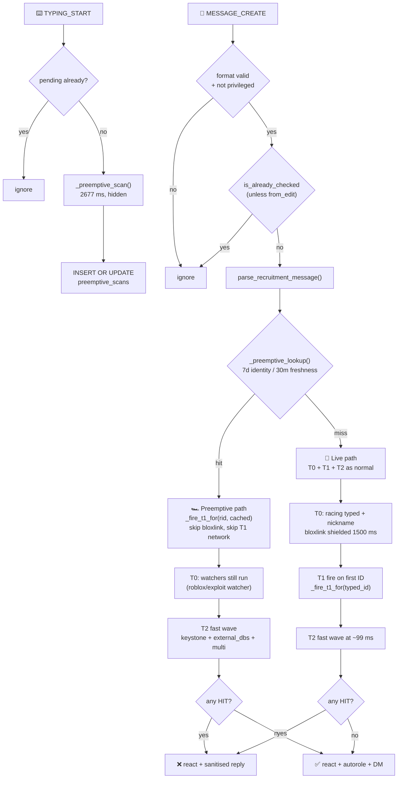

### Sequence diagram — both paths

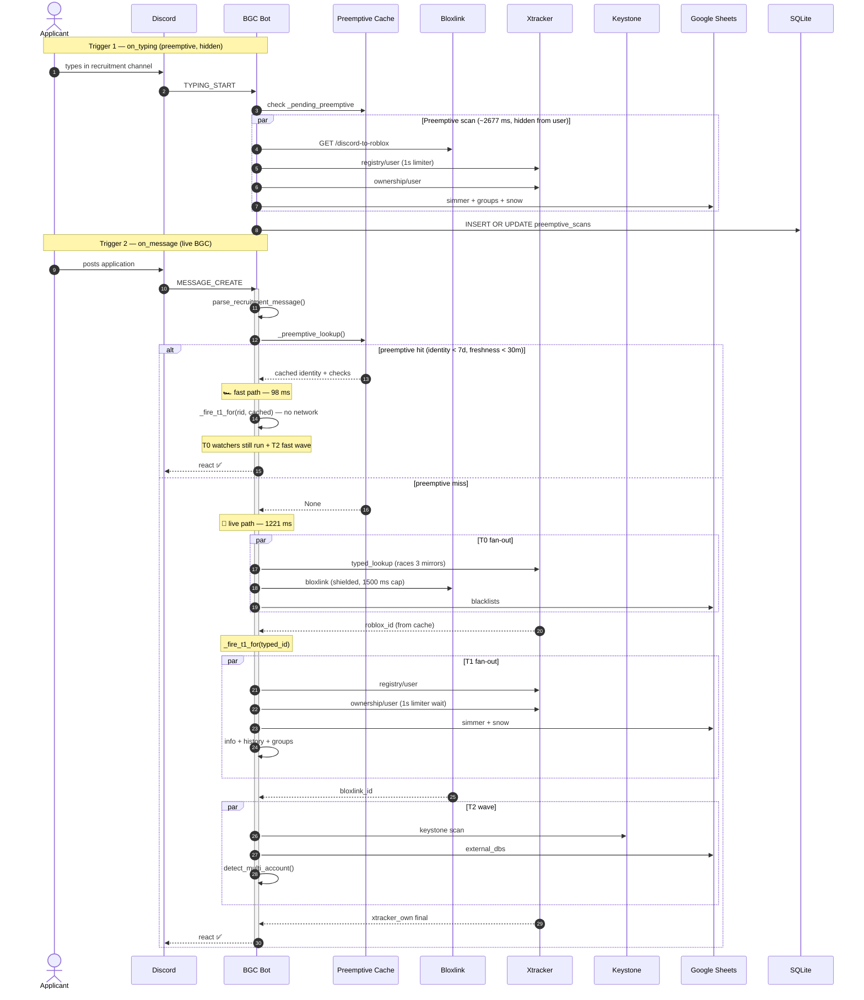

---

## 🧠 The Preemptive Scanner

This is my favorite part of v4.9.0 and the biggest speed win I've shipped.

### How it works

The moment a user starts typing in the recruitment channel, the bot kicks off a background scan: it resolves their Bloxlink, fetches their Roblox info/history/groups, checks Xtracker registry + ownership, and checks Simmer. All of this runs silently while they type — **no user waits for it**. The results go into a `preemptive_scans` table with two separate freshness guarantees:

- **Identity TTL — 7 days** — "this Discord ID maps to this Roblox ID". Doesn't change often.
- **Freshness TTL — 30 minutes** — "the actual check results are still current". Groups, Xtracker, Simmer.

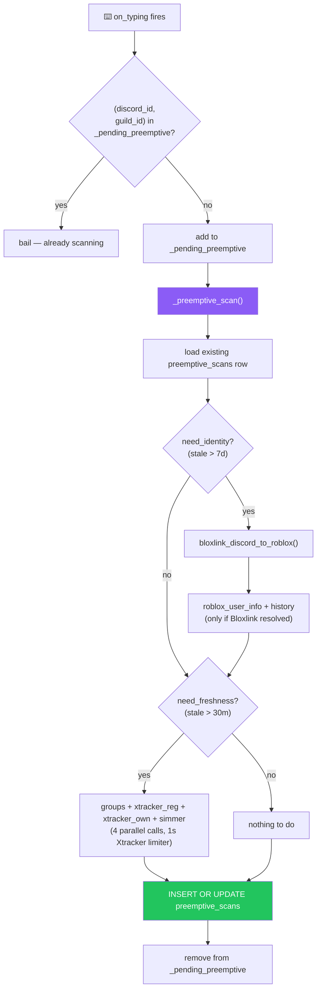

### How the fast path consumes it

When the user actually posts, `run_bgc_core` calls `_preemptive_lookup(discord_id, guild_id)` first. On a hit it gets back a **full cached payload** — Bloxlink ID, Roblox info, username history, groups, Xtracker registry, Xtracker ownership, and Simmer RAB. Then it injects all of those into `_fire_t1_for(rid, cached=preemptive)` so the T1 tier fires **without any network calls**.

What still runs on the fast path:
- **T0 watchers** — `roblox_watcher` and `exploit_watcher` (Discord-ID-based, not cached by preemptive)
- **Discord age check** — pure local snowflake math, instant
- **Blacklists** — shared caches, already warm
- **T2** — Keystone, external DBs, multi-account — needs the identity set regardless

What gets skipped entirely:
- **Bloxlink network call** — we already know the Roblox ID
- **Xtracker registry + ownership** — cached, 0 calls
- **Simmer RAB** — cached
- **`roblox_user_info` / `username_history` / `user_groups`** — cached

**Result: 98 ms total, with Xtracker calls = 0.**

### Where the preemptive data lives

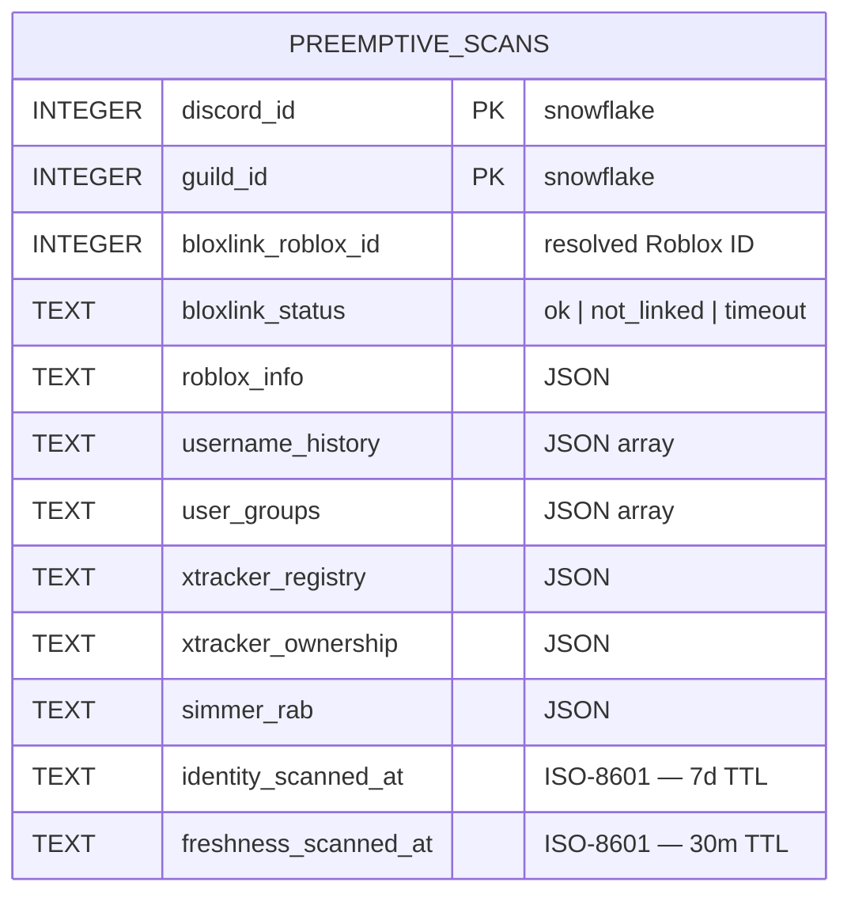

The `identity_scanned_at` column is **only** set when Bloxlink returned a definitive answer (`ok` or `not_linked`). If Bloxlink timed out, the column stays NULL and the next scan retries identity. The `freshness_scanned_at` column is set whenever the freshness tier ran successfully.

> [!TIP]
> Preemptive scans are cleaned up automatically. On every cache keep-warm cycle the bot deletes any row where both `identity_scanned_at` AND `freshness_scanned_at` are older than **30 days**. Stale users get evicted without manual intervention.

---

## 📊 Performance — Version Comparison

I've measured every meaningful configuration. The story here is important: **v4.9.0's live path is slower than v4.6.0's by design** — I had to give up the aggressive Xtracker limiter because it was hitting rate limits in production. But the preemptive path completely sidesteps that.

> [!NOTE]
> All numbers come from `/health timeline` and `/health preemptive_timeline` runs against the same test identity (`pizzarobloxh` / `2243794987`) on warm shared caches. Live-path runs force per-UID caches cold, so this is the realistic "returning applicant, unknown to cache" scenario.

### Side-by-side data

| Version | Mode | Total | Xtracker limiter | Critical path |
| :--- | :--- | ---: | ---: | :--- |
| **v4.5.0** | baseline | 1721 ms | 1.00 s | `xtracker_own` (1228 ms) |
| **v4.6.0** | fast Xtracker | 821 ms | 0.01 s | `bloxlink` (821 ms) |
| **v4.6.0** | safe Xtracker | 921 ms | 0.50 s | `xtracker_own` (736 ms) |
| **v4.9.0** | **live path** | **1221 ms** | **1.00 s** | **`xtracker_own` (1220 ms)** |
| **v4.9.0** | **preemptive** | **98 ms** | **0 calls** | **`exploit_watcher` (97 ms)** |

### Total time bar chart

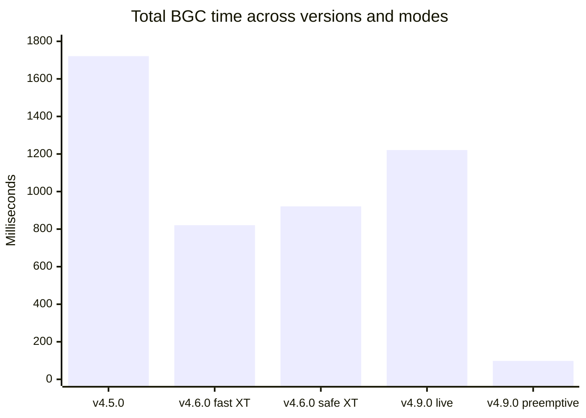

### What actually happened

**v4.5.0 → v4.6.0** — I added domain racing (3 Roblox mirrors in parallel), per-UID caching, wave-based T2, and a circuit breaker for dead domains. Combined with lowering `XTRACKER_RATE_LIMIT` from 1.0 s to 0.5 s, this cut total time in half. That's the *"v4.6.0 safe XT"* row (921 ms).

**v4.6.0 fast Xtracker** — I tested with `XTRACKER_RATE_LIMIT = 0.01 s` purely as a benchmark. That's the 821 ms row. But this configuration is not shippable — see below.

**v4.6.0 → v4.9.0** — During production testing I discovered Xtracker *does* rate-limit. Pushing the limiter to 0.01 s or 0.5 s generated 429 responses under burst load. So I:

1. **Reverted `XTRACKER_RATE_LIMIT` to `1.0 s`** (safe 60/min)
2. **Added `AdaptiveRateLimiter`** that bumps the interval on 429 and decays it back after 60 s of silence
3. **Built the preemptive scanner** to sidestep Xtracker entirely for anyone who typed before posting

That's why v4.9.0's live path is 1221 ms — it's *slower than v4.6.0 by design*, because it's using the correct limiter that doesn't trigger rate limits.

**The preemptive path** — 98 ms. Zero Xtracker calls. All the identity work already happened while they were typing.

> [!IMPORTANT]
> **The live path regression from 921 ms → 1221 ms is intentional.** I traded 300 ms of live-path speed for zero rate-limit failures in production. The preemptive scanner more than makes up for it: active typers get their answer in under a tenth of a second.

---

## 📈 Timeline Gallery

### v4.5.0 — baseline (1721 ms)

The original design. Sequential domain fallback, single-wave T2 that waits for the slowest T0 task, and a 1.0 s Xtracker limiter dominating everything.


### v4.6.0 — racing + caching (921 ms safe Xtracker)

Domain racing made `typed_lookup` 3x faster. Caching made T1 repeats nearly free. Wave-based T2 fired at 293 ms instead of 1107 ms. The 0.5 s Xtracker limiter halved the serialization cost — but this is the configuration that hit rate limits.

```mermaid
gantt
    title v4.6.0 — 921 ms with safe Xtracker
    dateFormat x
    axisFormat %S.%L
    todayMarker off

    section T0 — Discord-level
    bloxlink                :done,        t_bl,  0,   860ms
    typed_lookup (raced)    :crit, done,  t_tl,  0,   184ms
    watchers (5 tasks)      :done,        t_w,   0,   229ms

    section T1 — ID-keyed
    xtracker_own (critical) :crit, done,  t_xo,  184, 736ms
    simmer_rab              :done,        t_sr,  184, 532ms
    xtracker_reg            :done,        t_xr,  184, 386ms
    user_groups             :done,        t_ug,  184, 208ms
    username_history        :done,        t_uh,  184, 108ms
    user_info               :done,        t_ui,  184,   1ms

    section T2 — Waves
    keystone + ext + multi  :done,        t_t2,  293,   7ms

    section Milestones
    T1 fires on typed ID    :milestone,   m1,   184,   0ms
    T2 fast wave            :milestone,   m2,   293,   0ms
    Result written          :milestone,   m3,   921,   0ms
```

### v4.9.0 — live path (1221 ms, safe Xtracker)

Reverted to the 1.0 s Xtracker limiter. Everything else from v4.6.0 is preserved, plus nickname racing, historical-ID history, shielded Bloxlink with 1500 ms cap, and adaptive rate limiter.

Notice `typed_lookup` reads **0.5 ms** here — the username→ID cache was warm (which is realistic for any returning applicant). The `xtracker_own` task stretches all the way out to 1220 ms because the limiter enforces a full 1 s gap after `xtracker_reg` finishes at 246 ms.

```mermaid
gantt
    title v4.9.0 Live Path — 1221 ms
    dateFormat x
    axisFormat %S.%L
    todayMarker off

    section T0 — Discord-level
    bloxlink (shielded)     :done,        t_bl,  0,   640ms
    typed_lookup (cached)   :crit, done,  t_tl,  0,     1ms
    exploit_watcher         :done,        t_ew,  0,   105ms
    roblox_watcher          :done,        t_rw,  0,    72ms
    blacklists + age        :done,        t_bl2, 0,     1ms

    section T1 — ID-keyed
    xtracker_own (critical) :crit, done,  t_xo,  1,  1220ms
    xtracker_reg            :done,        t_xr,  1,   246ms
    simmer_rab              :done,        t_sr,  1,   188ms
    username_history        :done,        t_uh,  1,    98ms
    user_groups             :done,        t_ug,  1,    72ms
    user_info               :done,        t_ui,  1,    39ms
    snow_core               :done,        t_sc,  1,     1ms

    section T2 — Waves
    keystone + ext + multi  :done,        t_t2,  99,    7ms

    section Milestones
    T1 fires on cached ID   :milestone,   m1,    1,     0ms
    T2 fast wave            :milestone,   m2,   99,     0ms
    xtracker_own finishes   :milestone,   m3,  1221,    0ms
```

### v4.9.0 — preemptive fast path (98 ms)

This is what a user who typed their application for at least ~2.7 seconds sees. The preemptive scanner already did all the identity work; the actual BGC just runs T0 watchers + T2 and returns.

Note: **zero Xtracker calls**. `exploit_watcher` at 97 ms is the critical path now — that's a Discord-ID-based RobloxWatcher lookup, and it's the ceiling on how fast the fast path can get.

```mermaid
gantt
    title v4.9.0 Preemptive Fast Path — 98 ms
    dateFormat x
    axisFormat %S.%L
    todayMarker off

    section Preemptive
    cached identity         :done,        t_pre, 0,    1ms

    section T0 — Watchers (only T0 that runs)
    exploit_watcher (crit)  :crit, done,  t_ew,  0,    97ms
    roblox_watcher          :done,        t_rw,  0,    83ms
    blacklists + age        :done,        t_bl,  0,     1ms

    section T1 — All cached
    info + hist + groups    :done,        t_t1,  0,     1ms
    xtracker_reg + own      :done,        t_xt,  0,     1ms
    simmer + snow           :done,        t_sm,  0,     1ms

    section T2 — Waves
    keystone + ext + multi  :done,        t_t2,  1,     7ms

    section Milestones
    All checks complete     :milestone,   m1,   98,     0ms
```

### Critical path evolution

Three different bottlenecks across five configurations:

- **v4.5.0** — `xtracker_own` (1228 ms) after a 492 ms typed_lookup
- **v4.6.0** — `bloxlink` (860 ms) becomes the critical path because typed_lookup dropped to 184 ms
- **v4.9.0 live** — back to `xtracker_own` (1220 ms) because the 1.0 s limiter is now dominant
- **v4.9.0 preemptive** — `exploit_watcher` (97 ms) is the *only* thing left that touches the network

```mermaid
gantt
    title Critical path evolution — the bottleneck moved 3 times
    dateFormat x
    axisFormat %S.%L
    todayMarker off

    section v4.5.0
    typed_lookup       :done,  a1, 0,   492ms
    xtracker_own       :crit,  a2, 492, 1228ms

    section v4.6.0
    typed_lookup       :done,  b1, 0,   184ms
    bloxlink           :crit,  b2, 0,   860ms

    section v4.9.0 live
    typed_lookup       :done,  c1, 0,   1ms
    xtracker_own       :crit,  c2, 1,   1220ms

    section v4.9.0 preemptive
    exploit_watcher    :crit,  d1, 0,   97ms
```

### Where the preemptive seed time goes (2677 ms, hidden)

The preemptive scan itself costs 2677 ms — but that's while the user is typing, so it doesn't count towards the BGC total. The dominant cost is the two Xtracker calls serialized by the 1.0 s limiter.

```mermaid
gantt
    title Preemptive seed cost — 2677 ms while user types
    dateFormat x
    axisFormat %S.%L
    todayMarker off

    section Seed cost (hidden)
    bloxlink            :done,  s1, 0,    640ms
    bloxlink→roblox     :done,  s2, 640,  100ms
    xtracker_reg        :done,  s3, 740,  400ms
    xtracker_own (wait) :crit,  s4, 1140, 1000ms
    xtracker_own        :crit,  s5, 2140, 400ms
    simmer + groups     :done,  s6, 2540, 137ms
```

**Cost analysis:** ~640 ms Bloxlink + ~1400 ms Xtracker (2 calls × 400 ms network + 1 s limiter wait) + ~140 ms Simmer/groups = **~2677 ms**. All of it hidden from the user.

---

## 🛡️ Reliability — Bloxlink Shield & Adaptive Rate Limiter

Two safety mechanisms I added in v4.9.0 after seeing how the system behaves in production.

### Bloxlink shield + late cache

Bloxlink can be slow. If it takes 8 seconds, I don't want to wait — I'll fall back to the typed username (which T1 has already validated) after 1500 ms. But I also don't want to waste the eventual result.

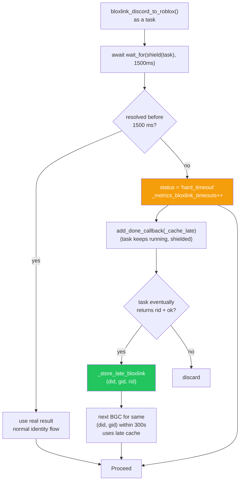

**What this gets me:**
- **Cold path:** never waits more than 1500 ms for Bloxlink
- **Warm path:** if Bloxlink eventually resolved (say at 2500 ms), the next BGC on the same user gets the answer instantly from `_bloxlink_late_cache`
- **Metrics:** `_metrics_bloxlink_timeouts` counts how often the cap fires, visible in `/health check`

### Adaptive rate limiter

I originally pushed `XTRACKER_RATE_LIMIT` down to 0.5 s to save time. That was a mistake — it triggered 429s in production. Now the base is back to 1.0 s, and the limiter self-tunes.

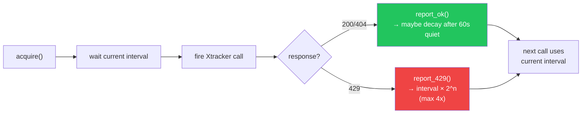

**Rules:**
- On 429: `interval = base × 2^consecutive_429s`, capped at `base × 4`
- On success: if it's been >60 s since the last 429, decrement the consecutive counter and re-compute the interval
- The decay is quiet — you only see it in `/health check` where the current interval is displayed

**Current state:** base = 1.0 s, current = 1.0 s (no 429s since the revert), ceiling = 4.0 s.

> [!WARNING]
> If you see `Xtracker limiter: >1.00s` in `/health check`, the adaptive logic has backed off. That means Xtracker is *currently* rate-limiting you. This is normal under burst load and will decay back to 1.0 s within a few minutes of quiet.

---

## 🔬 Data Model & Lifecycle

### Full schema

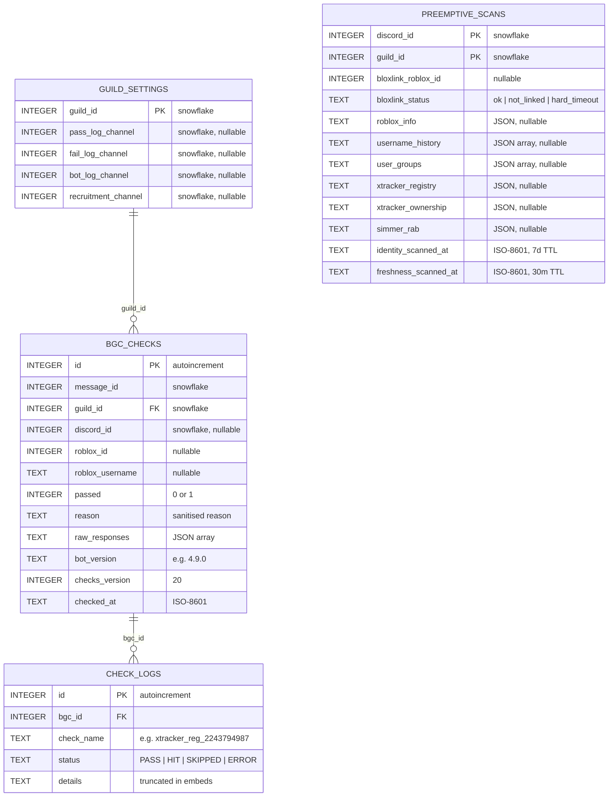

> [!NOTE]
> All `INTEGER` snowflake columns hold 64-bit IDs. SQLite's `INTEGER` is 8-byte — no truncation risk. **Do not cast these to `INT` in client code** or you'll silently corrupt Discord snowflakes above 2³¹.

### BGC lifecycle

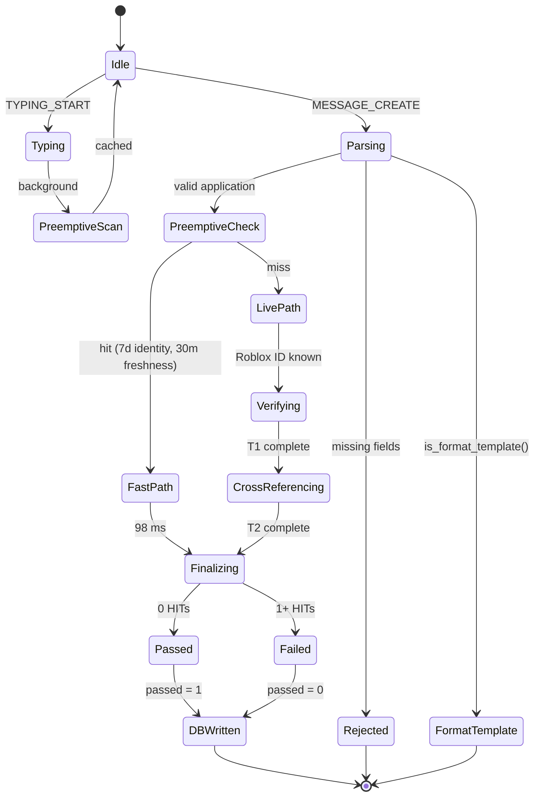

### Class diagram

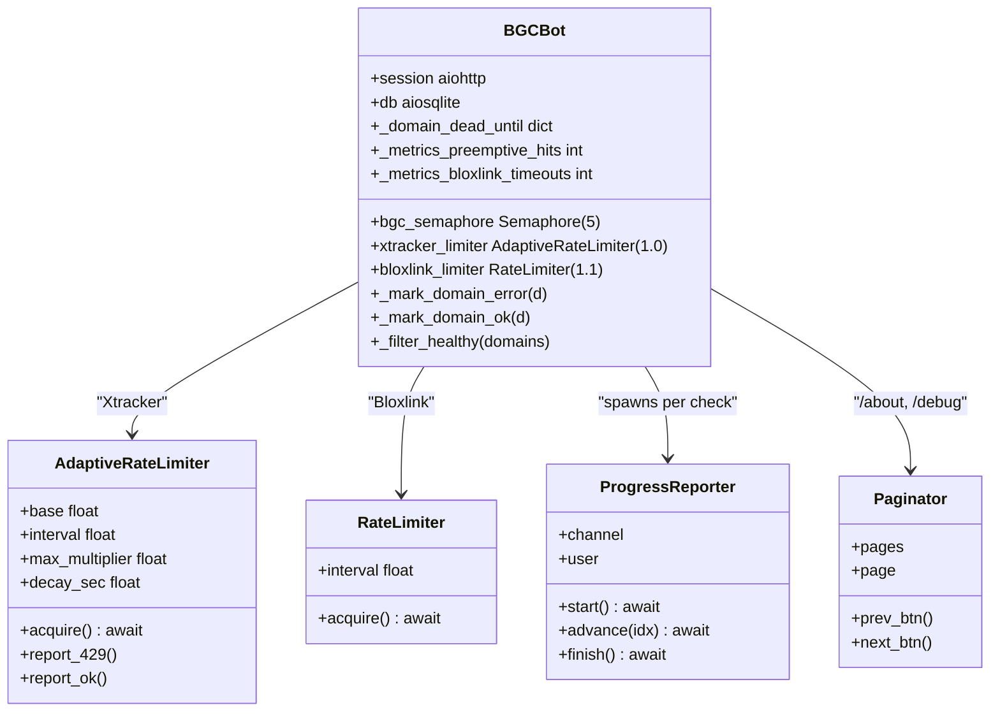

### Health check snapshot

The current `/health check` output on the production instance:

```
📋 Blacklists
🟢 Group 1 (443ms)
🟢 User 0 (264ms)
🟢 Keystone 2252 (399ms)
🟢 Snow Core 1769 (572ms)

🌐 Roblox API
🟢 users.rotunnel.com  🟢 groups.rotunnel.com
🟢 users.roproxy.com   🟢 groups.roproxy.com
🟢 users.roblox.com    🟢 groups.roblox.com

🕵️ Watchlists
🟢 Xtracker registry/user — PASS
🟢 Xtracker ownership/user — PASS
🟢 Simmer RAB — PASS
🟢 Roblox Watcher — PASS
🟢 Exploit Watcher — PASS
🟢 Bloxlink — reachable (ok)

🗄️ External DBs
🟢 Imperial Armada Blacklist — 424 rows (324ms)
🟢 Dragonborn Blacklist — 2810 rows (652ms)
🟢 SURGE Blacklists Mainframe — 634 rows (422ms)
🟢 SOL Blacklists — 270 rows (330ms)
🟢 SOL Base Banlist — 204 rows (261ms)
🟢 BB:PC Punishment Tracker — 41 rows (492ms)

🧠 Preemptive
Records: 1 · id fresh: 1 · fresh: 1
Session hits: 1 · misses: 2
Bloxlink timeouts: 0 · late cache: 0
Identity TTL: 7d · Freshness TTL: 30min

💾 System
🟢 SQLite DB
🟢 Bot v4.9.0 · checks v20
aiodns: on · Xtracker limiter: 1.00s · Bloxlink cap: 1500ms
```

**Six thousand-plus rows across six external databases, ~2.5 MB of JSON, refreshed on a 30-minute keep-warm cycle.** No rate limits hit, no dead domains, no timeouts.

---

## 🧪 Development & Testing

```bash
# Run the bot locally
DISCORD_BOT_TOKEN="..." python bgc_bot.py

# Smoke-test all caches
/health quick

# Live-path timing probe — per-UID caches cleared, preemptive bypassed
/health timeline

# Fast-path probe — seeds preemptive, then measures the fast path
/health preemptive_timeline @user

# Manually seed a preemptive record without running BGC
/health preemptive @user
```

> [!WARNING]
> `/health timeline` requires `HEALTH_TEST_ROBLOX_ID` and `HEALTH_TEST_DISCORD_ID`. The probe forces **per-UID caches cold** (info/hist/groups/Simmer) at the start of every run, but leaves **shared caches warm** — exactly matching what a real applicant sees shortly after boot.

### Comparing the two paths

```
/health timeline @user          → 1221 ms  (live path)
/health preemptive_timeline @user →   98 ms  (preemptive fast path)
```

Both commands run `run_bgc_core` with `message_id=None` and `skip_db_history=True` — **no DB writes**. Safe to spam. The preemptive variant seeds a fresh `preemptive_scans` row first (deletes any existing one), waits for the scan to finish, then starts the timer. **The seed time is reported separately** so you see the true fast-path BGC cost without the preemptive build cost mixed in.

### Project layout

```text
bgc-bot/
├── bgc_bot.py              # Single-file bot
├── requirements.txt
├── .env.example
├── README.md
└── bgc.db                  # created at runtime (WAL)
```

---

## 🤝 Contributing

1. Fork the repository.
2. Create a feature branch: `git checkout -b feat/your-feature`.
3. Commit with [Conventional Commits](https://www.conventionalcommits.org/): `feat: add X`.
4. Open a pull request against `main`.

> [!NOTE]
> Before opening a PR, run `python -m py_compile bgc_bot.py` and confirm `/health quick` reports all green.

### What I'd tackle next

If I keep iterating on this bot, the highest-value targets are:

- **Extend preemptive to `exploit_watcher`** — it's now the fast-path ceiling at 97 ms. If I can cache it (RobloxWatcher returns fairly stable data), the fast path drops toward 20 ms.
- **Persistent preemptive for the recruitment channel** — right now only users who trigger `on_typing` get scanned. Scanning new joiners who *haven't* typed yet (via `on_member_join` in the guild, capped) would raise the hit rate significantly.
- **Adaptive Bloxlink cap** — 1500 ms is generous for most users. If I can measure the p95 of Bloxlink in production, I could drop it to 800-1000 ms safely.
- **Historical-ID preemptive coverage** — currently preemptive only scans the current Roblox ID. Extending it to historical IDs from `bgc_checks` would close the v4.6 gap permanently.

---

<div align="center">

**Built by [Pizzarobloxh](https://github.com/Pizzarobloxh) — for communities that take recruitment seriously.**

[⬆ Back to top](#️-bgc-bot)

</div>
