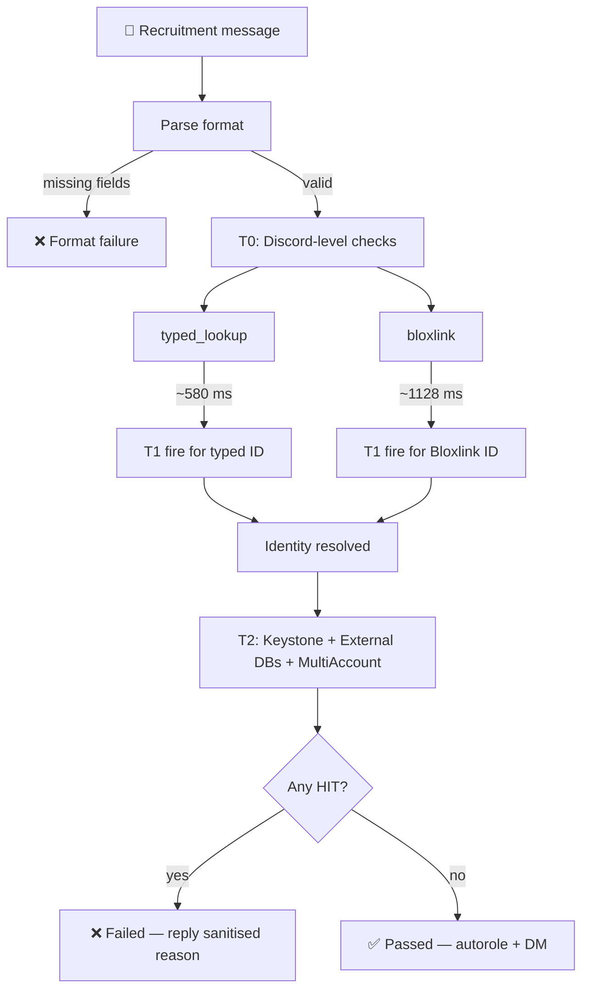
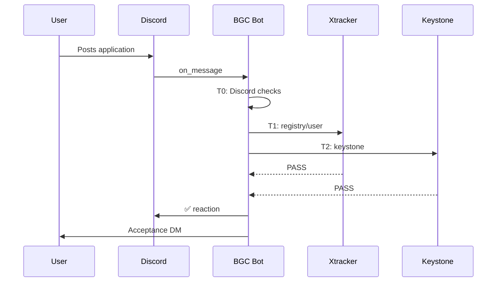

<div align="center">

# 🛡️ BGC Bot

### *A production-grade Discord recruitment background checker*

[](https://www.python.org/)
[](https://github.com/Rapptz/discord.py)
[](https://github.com/pizzarobloxh/bgc-bot/stargazers)
[](https://github.com/pizzarobloxh/bgc-bot/issues)

<br />

**Bloxlink** · **Xtracker** · **Keystone** · **Simmer** · **Snow Core** · **Roblox Watcher** · **Exploit Watcher** · **Google Sheets blacklists**

</div>

---

## 📑 Table of Contents

- [✨ Overview](#-overview)
- [🚀 Quick Start](#-quick-start)
- [⚙️ Configuration](#️-configuration)
- [🧩 Command Reference](#-command-reference)
- [🔎 How the Check Pipeline Works](#-how-the-check-pipeline-works)
- [🎨 Markdown Feature Showcase](#-markdown-feature-showcase)
- [🧪 Development & Testing](#-development--testing)
- [🤝 Contributing](#-contributing)
- [📜 License](#-license)
- [🔗 Footnotes](#-footnotes)

---

## ✨ Overview

`BGC Bot` is a self-hosted Discord bot that automatically screens recruitment applications. When a user posts in your designated recruitment channel, the bot resolves their Roblox identity, fans out dozens of checks in parallel, and reacts with `✅` or `❌` — then applies an auto-role and sends an acceptance DM on success.

> [!NOTE]
> This bot is **credential-light**. It will start with only a `DISCORD_BOT_TOKEN`. Every optional API key that is missing simply causes the corresponding check to return `SKIPPED` — it will not crash the bot.

### Core characteristics

| Characteristic | Detail | Status |
| :--- | :--- | :--- |
| **Tiered concurrency** | T0 (Discord-level) → T1 (Roblox-ID-level) → T2 (identity-set-level) | <kbd>Active</kbd> |
| **Idempotent ID checks** | `_fire_t1_for(rid)` fires exactly once per Roblox ID | <kbd>Active</kbd> |
| **Bloxlink-first identity** | Bloxlink is trusted over the typed username | <kbd>Active</kbd> |
| **Graceful degradation** | Missing keys → `SKIPPED`, never fatal | <kbd>Active</kbd> |
| **SQLite persistence** | WAL mode, per-guild isolation, check-log history | <kbd>Active</kbd> |

---

## 🚀 Quick Start

### Prerequisites

- Python **3.10+**
- A Discord application with a **Bot** user
- *(Optional but recommended)* API keys for Xtracker, RobloxWatcher, ExploitWatcher, Bloxlink, Simmer

### Installation

```bash
# 1. Clone
git clone https://github.com/your-username/bgc-bot.git
cd bgc-bot

# 2. Virtual environment
python -m venv .venv
source .venv/bin/activate        # Linux / macOS
# .venv\Scripts\activate         # Windows

# 3. Dependencies
pip install -r requirements.txt

# 4. Run
export DISCORD_BOT_TOKEN="your-token-here"
python bgc_bot.py
```

> [!TIP]
> Use a `.env` file with `python-dotenv` or your host's secret manager instead of exporting tokens in the shell. Never commit `.env` to Git.

---

## ⚙️ Configuration

All configuration is environment-driven. The bot is designed to run with **zero** optional variables — it simply does less.

### Required

| Variable | Purpose | Example |
| :--- | :--- | :--- |
| `DISCORD_BOT_TOKEN` | Discord bot authentication | `"MTA…"` |

### Strongly recommended

| Variable | Purpose | Default behaviour if omitted |
| :--- | :--- | :--- |
| `XTRACKER_API_KEY` | Xtracker registry & ownership checks | `SKIPPED` |
| `ROBLOXWATCHER_API_KEY` | RobloxWatcher NSFW-server check | `SKIPPED` |
| `EXPLOITWATCHER_API_KEY` | ExploitWatcher informational flag | `SKIPPED` |
| `BLOXLINK_API_KEY` | Discord ↔ Roblox resolution | Typed-username fallback only |
| `SIMMER_API_KEY` | Simmer RAB check | `SKIPPED` |

### Optional branding & behaviour

<details>
<summary><strong>Click to expand the full optional-variable matrix</strong></summary>

| Variable | Type | Default | Notes |
| :--- | :--- | :--- | :--- |
| `BRAND_NAME` | string | `""` | Shown in embeds & DMs |
| `BRAND_GROUP_URL` | URL | `""` | Inserted into acceptance DM |
| `LOGO_EMOJI` | emoji tag | `""` | e.g. `<:LOGO:123456789012345678>` |
| `AUTO_ROLE_ID` | snowflake | `None` | Role assigned on pass |
| `RECRUITMENT_CHANNEL_ID` | snowflake | `None` | Fallback if `/setup` not run |
| `OWNER_ID` | snowflake | `None` | DMs on critical errors |
| `ACCEPTANCE_DM_ENABLED` | boolean | `true` | Toggle acceptance DM |
| `ACCEPTANCE_INSTRUCTIONS_URL` | URL | `""` | Appended to auto-built DM |
| `ACCEPTANCE_DM_TEMPLATE` | string | auto-built | Full DM body override |
| `BLACKLIST_SHEET_ID` | string | `""` | Google Sheet ID |
| `GROUP_BLACKLIST_GID` | string | `"0"` | Tab gid |
| `USER_BLACKLIST_GID` | string | `"0"` | Tab gid |
| `SNOW_CORE_SHEET_ID` | string | `""` | Google Sheet ID |
| `SNOW_CORE_GID` | string | `"0"` | Tab gid |
| `EXTERNAL_DATABASES` | JSON array | `[]` | `[{key, sheet_id, gid, name}]` |
| `HEALTH_TEST_ROBLOX_ID` | integer | `None` | For `/health timeline` |
| `HEALTH_TEST_DISCORD_ID` | integer | `None` | For `/health timeline` |

</details>

---

## 🧩 Command Reference

| Command | Scope | Description |
| :--- | :--- | :--- |
| `/about` | Everyone | Paginated guide: what is checked and why a user might have failed |
| `/setup` | Admin | Create or reconfigure log channels + recruitment channel |
| `/check` | Admin | Run a BGC on a message link, username, mention, or Discord ID |
| `/lookup` | Admin | Full user lookup, or Keystone role scan |
| `/debug` | Admin | Inspect a BGC, list recent, find alts, view stats |
| `/backfill` | Admin | Re-run BGC on historical recruitment messages |
| `/health check` | Admin | Ping all services and refresh caches |
| `/health quick` | Admin | Refresh caches without endpoint tests |
| `/health timeline` | Admin | Timing probe of a real BGC (no DB writes) |
| `/reset` | **Owner only** | Wipe guild settings (roles never removed) |
| `/wipeuser` | Admin | Delete local BGC data for one user |

> [!IMPORTANT]
> `/reset` is restricted to `OWNER_ID`. If `OWNER_ID` is not set, **no one** can run `/reset` — configure it explicitly.

---

## 🔎 How the Check Pipeline Works

The BGC core is built around three concurrent tiers. T0 begins the moment the message is parsed; T1 fires as soon as any Roblox ID is known; T2 fires once the full identity set is assembled.



### Tier summary

- <span style="color:#3b82f6"><strong>T0 — Discord-level</strong></span>  
  User blacklist, Discord age, RobloxWatcher, ExploitWatcher, group blacklist, Bloxlink, typed lookup.
- <span style="color:#22c55e"><strong>T1 — ID-keyed</strong></span>  
  User info, username history, groups, Xtracker registry, Xtracker ownership, Simmer RAB, Snow Core.  
  Fired via `_fire_t1_for(rid)` — **idempotent per Roblox ID**.
- <span style="color:#f59e0b"><strong>T2 — Identity-set</strong></span>  
  Keystone, external Google Sheets databases, multi-account detection, plus historical-ID variants of T1 checks that were not already fired.

> [!TIP]
> Because T1 is idempotent, calling `_fire_t1_for` for the typed ID, the Bloxlink ID, and the DB-history ID does **not** duplicate network calls. Xtracker's rate limiter sees each unique ID exactly once.

---

## 🎨 Markdown Feature Showcase

This README intentionally exercises the full GFM feature set. Below is a live reference of what is possible.

### Colored text via LaTeX

GitHub supports `\color{…}` inside `$$…$$` blocks:

$$
{\color{#ef4444}\textbf{DANGER}} \quad
{\color{#f59e0b}\textbf{WARNING}} \quad
{\color{#22c55e}\textbf{SUCCESS}} \quad
{\color{#3b82f6}\textbf{INFO}} \quad
{\color{#8b5cf6}\textbf{BRAND}}
$$

You can also color inline: $\color{orange}\textsf{orange inline text}$.

### Alerts (2023+)

> [!NOTE]
> Supplementary information the reader should notice even when skimming.

> [!TIP]
> Optional advice for doing something better or more easily.

> [!IMPORTANT]
> Critical information needed to achieve the goal.

> [!WARNING]
> Urgent info needing immediate attention to avoid problems.

> [!CAUTION]
> Negative potential consequences of an action — irreversible harm.

### Task lists

- [x] Environment variables extracted
- [x] Personal identifiers removed
- [x] Simmer key rotated
- [x] Bugs fixed (`parse_clanning`, `check_banned`, empty-sheet guards)
- [ ] Publish to GitHub
- [ ] Add CI workflow

### Collapsible sections

<details>
<summary><strong>🔧 Troubleshooting matrix</strong></summary>

| Symptom | Likely cause | Fix |
| :--- | :--- | :--- |
| All checks `SKIPPED` | No optional API keys set | Set at least `XTRACKER_API_KEY` |
| `Bloxlink: invalid_key` | Wrong server API key | Regenerate in Bloxlink dashboard |
| `/health check` shows `🔴 User` | `BLACKLIST_SHEET_ID` unset | Set the Sheet ID and gids |
| `/reset` says "Owner only" | `OWNER_ID` unset | Set `OWNER_ID` to your Discord ID |
| No recruitment channel | `/setup` not run | Run `/setup` or set `RECRUITMENT_CHANNEL_ID` |

</details>

<details open>
<summary><strong>✅ Pre-flight checklist</strong></summary>

1. `DISCORD_BOT_TOKEN` set
2. Bot invited with **Manage Roles**, **Read Message History**, **Send Messages**
3. Bot role position **above** `AUTO_ROLE_ID`
4. Recruitment channel created and configured via `/setup`
5. *(Optional)* API keys populated

</details>

### Keyboard keys, subscript, superscript

Press <kbd>Ctrl</kbd> + <kbd>Shift</kbd> + <kbd>V</kbd> to open the Markdown preview in VS Code.

H<sub>2</sub>O is water. E = mc<sup>2</sup>.

### Math

Inline: $E = mc^2$.  
Block:

$$
\text{pass\_rate} = \frac{\text{passed}}{\text{total}} \times 100
$$

### Mermaid — sequence diagram



### Mermaid — gantt

```mermaid
gantt
    title BGC task timeline (illustrative)
    dateFormat  X
    axisFormat  %L ms
    section T0
    typed_lookup        :a1, 0, 580
    bloxlink            :a2, 0, 1128
    section T1
    xtracker_reg        :b1, 580, 1000
    simmer_rab          :b2, 580, 900
    section T2
    keystone            :c1, 1128, 1400
    external_dbs        :c2, 1128, 1600
```



### Footnotes

GitHub footnotes let you jump from a reference to the definition and back.

- The typed-username lookup is typically the fastest identity signal.[^1]
- Xtracker's two endpoints are serialised by a shared rate limiter.[^2]
- ExploitWatcher is informational by default and does not fail a user.[^3]

[^1]: Measured on a warm cache against `users.rotunnel.com`; proxy fallbacks extend the tail.
[^2]: `XTRACKER_RATE_LIMIT = 1.0 s` in `bgc_bot.py`.
[^3]: Controlled by `EXPLOIT_WATCHER_INFORMATIONAL`.

### Keyboard & typography

| Input | Renders as |
| :--- | :--- |
| `**bold**` | **bold** |
| `*italic*` | *italic* |
| `~~strikethrough~~` | ~~strikethrough~~ |
| `` `inline code` `` | `inline code` |
| `> quote` | > quote |
| `---` | horizontal rule |

### Tables with alignment

| Left | Centre | Right |
| :--- | :---: | ---: |
| `DISCORD_BOT_TOKEN` | required | `string` |
| `XTRACKER_API_KEY` | optional | `string` |
| `EXTERNAL_DATABASES` | optional | `JSON` |

### Emoji shortcodes

:shield: :robot: :mag: :white_check_mark: :x: :warning: :lock: :rocket:

---

## 🧪 Development & Testing

```bash
# Run the bot locally
DISCORD_BOT_TOKEN="..." python bgc_bot.py

# Smoke-test the health probe
# (in Discord, after the bot is online)
/health quick

# Timing probe
/health timeline
```

> [!WARNING]
> `/health timeline` requires `HEALTH_TEST_ROBLOX_ID` and `HEALTH_TEST_DISCORD_ID`. It runs a real BGC with `message_id=None` and `skip_db_history=True`, so it does **not** write to the database and is safe to spam.

### Project layout

```text
bgc-bot/
├── bgc_bot.py              # Single-file bot
├── requirements.txt
├── .env.example
├── README.md
└── bgc.db                  # created at runtime (WAL)
```

---

## 🤝 Contributing

1. Fork the repository.
2. Create a feature branch: `git checkout -b feat/your-feature`.
3. Commit with [Conventional Commits](https://www.conventionalcommits.org/): `feat: add X`.
4. Open a pull request against `main`.

> [!NOTE]
> Before opening a PR, run `python -m py_compile bgc_bot.py` and confirm `/health quick` still reports green.

---

## 📜 License

Distributed under the **MIT License**. See [`LICENSE`](LICENSE) for the full text.

---

## 🔗 Footnotes

[^1]: [Typed-lookup timing measurement](#-how-the-check-pipeline-works)
[^2]: [Xtracker rate limiter](#-how-the-check-pipeline-works)
[^3]: [Exploit Watcher informational flag](#-how-the-check-pipeline-works)

---

<div align="center">

**Built for communities that take recruitment seriously.**

[⬆ Back to top](#️-bgc-bot)

</div>
