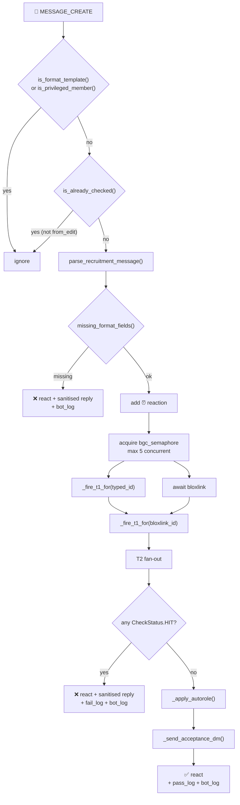
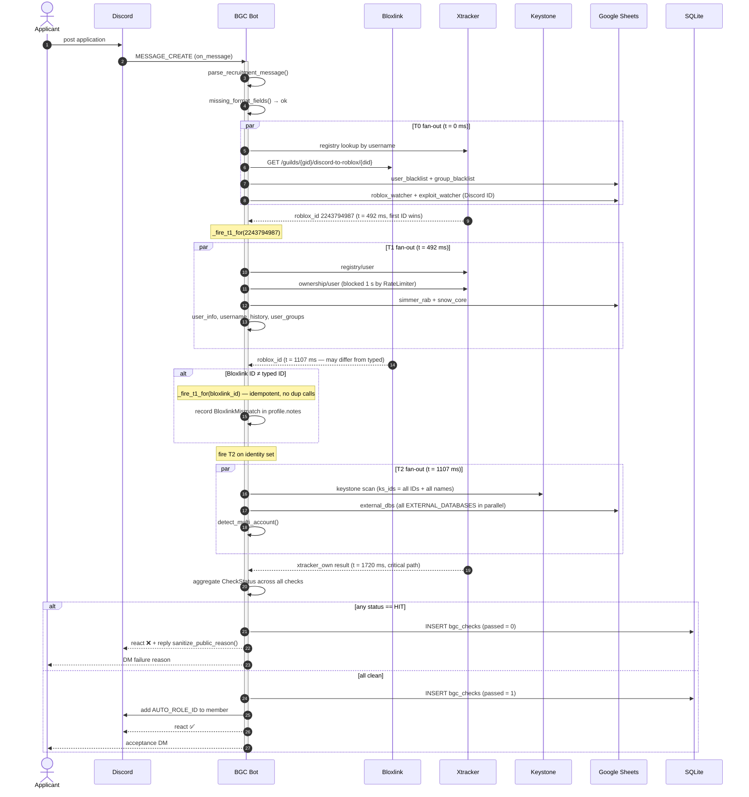
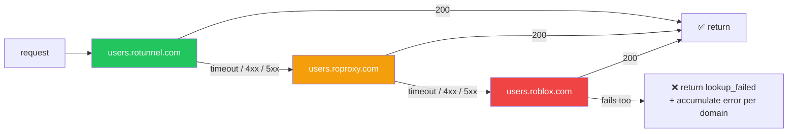
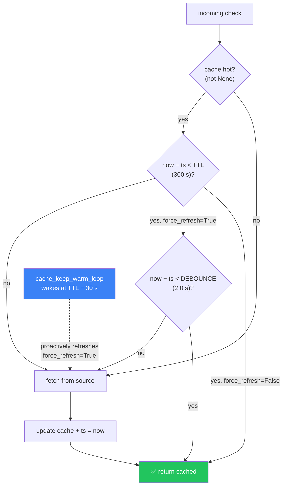
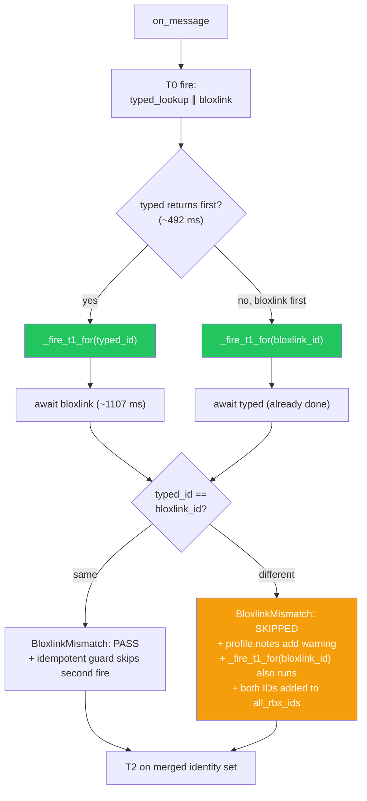
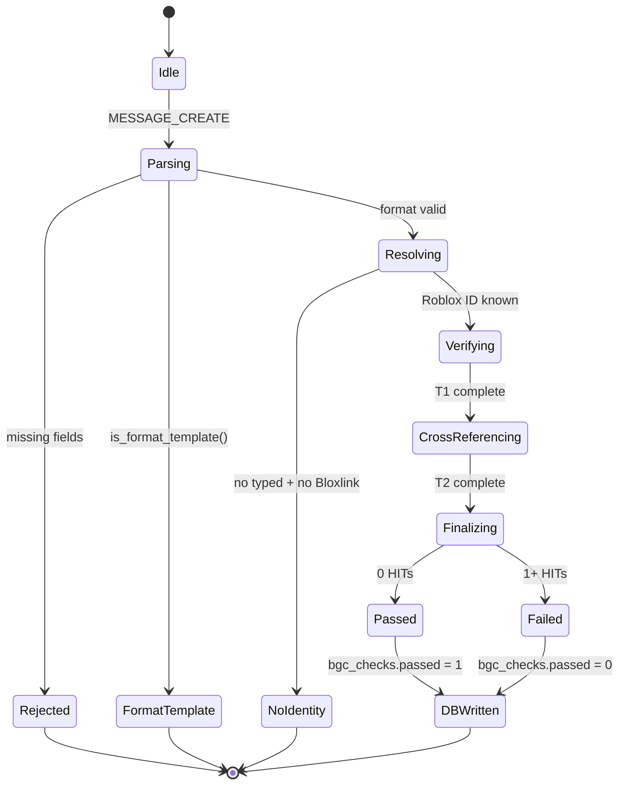
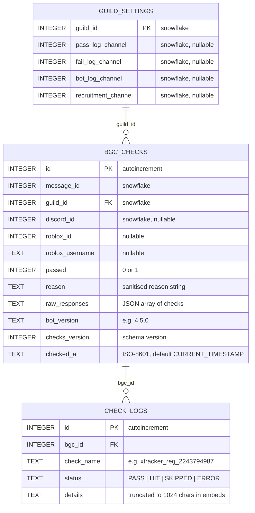
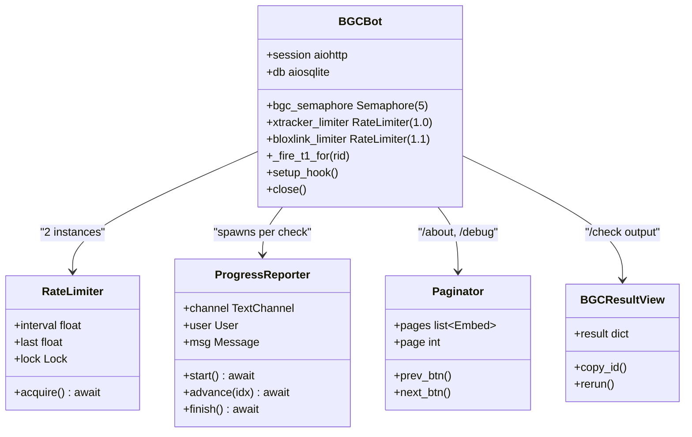

<div align="center">

# 🛡️ BGC Bot

### *A production-grade Discord recruitment background checker*

[](https://www.python.org/)
[](https://github.com/Rapptz/discord.py)
[](https://github.com/Pizzarobloxh)
[](https://github.com/Pizzarobloxh/bgc-bot/stargazers)
[](https://github.com/Pizzarobloxh/bgc-bot/issues)

<br />

**Bloxlink** · **Xtracker** · **Keystone** · **Simmer** · **Snow Core** · **Roblox Watcher** · **Exploit Watcher** · **Google Sheets blacklists**

</div>

---

## 📑 Table of Contents

- [✨ Overview](#-overview)
- [🚀 Quick Start](#-quick-start)
- [⚙️ Configuration](#️-configuration)
- [🧩 Command Reference](#-command-reference)
- [🔎 How the Check Pipeline Works](#-how-the-check-pipeline-works)
- [📊 Measured Performance](#-measured-performance)
- [🧵 Async Interaction Order](#-async-interaction-order)
- [🔁 Implementation Internals](#-implementation-internals)
- [🧪 Development & Testing](#-development--testing)
- [🤝 Contributing](#-contributing)
- [🔗 Footnotes](#-footnotes)

---

## ✨ Overview

`BGC Bot` is a self-hosted Discord bot that automatically screens recruitment applications. When a user posts in your designated recruitment channel, the bot resolves their Roblox identity, fans out dozens of checks in parallel, and reacts with `✅` or `❌` — then applies an auto-role and sends an acceptance DM on success.

> [!NOTE]
> This bot is **credential-light**. It will start with only a `DISCORD_BOT_TOKEN`. Every optional API key that is missing simply causes the corresponding check to return `SKIPPED` — it will not crash the bot.

### Core characteristics

| Characteristic | Detail | Status |
| :--- | :--- | :--- |
| **Tiered concurrency** | T0 (Discord-level) → T1 (Roblox-ID-level) → T2 (identity-set-level) | <kbd>Active</kbd> |
| **Idempotent ID checks** | `_fire_t1_for(rid)` fires exactly once per Roblox ID | <kbd>Active</kbd> |
| **Bloxlink-first identity** | Bloxlink is trusted over the typed username | <kbd>Active</kbd> |
| **Graceful degradation** | Missing keys → `SKIPPED`, never fatal | <kbd>Active</kbd> |
| **SQLite persistence** | WAL mode, per-guild isolation, check-log history | <kbd>Active</kbd> |

---

## 🚀 Quick Start

### Prerequisites

- Python **3.10+**
- A Discord application with a **Bot** user
- *(Optional but recommended)* API keys for Xtracker, RobloxWatcher, ExploitWatcher, Bloxlink, Simmer

### Installation

```bash
# 1. Clone
git clone https://github.com/Pizzarobloxh/bgc-bot.git
cd bgc-bot

# 2. Virtual environment
python -m venv .venv
source .venv/bin/activate        # Linux / macOS
# .venv\Scripts\activate         # Windows

# 3. Dependencies
pip install -r requirements.txt

# 4. Run
export DISCORD_BOT_TOKEN="your-token-here"
python bgc_bot.py
```

> [!TIP]
> Use a `.env` file with `python-dotenv` or your host's secret manager instead of exporting tokens in the shell. Never commit `.env` to Git.

---

## ⚙️ Configuration

All configuration is environment-driven. The bot is designed to run with **zero** optional variables — it simply does less.

### Required

| Variable | Purpose | Example |
| :--- | :--- | :--- |
| `DISCORD_BOT_TOKEN` | Discord bot authentication | `"MTA…"` |

### Strongly recommended

| Variable | Purpose | Default behaviour if omitted |
| :--- | :--- | :--- |
| `XTRACKER_API_KEY` | Xtracker registry & ownership checks | `SKIPPED` |
| `ROBLOXWATCHER_API_KEY` | RobloxWatcher NSFW-server check | `SKIPPED` |
| `EXPLOITWATCHER_API_KEY` | ExploitWatcher informational flag | `SKIPPED` |
| `BLOXLINK_API_KEY` | Discord ↔ Roblox resolution | Typed-username fallback only |
| `SIMMER_API_KEY` | Simmer RAB check | `SKIPPED` |

### Optional branding & behaviour

<details>
<summary><strong>Click to expand the full optional-variable matrix</strong></summary>

| Variable | Type | Default | Notes |
| :--- | :--- | :--- | :--- |
| `BRAND_NAME` | string | `""` | Shown in embeds & DMs |
| `BRAND_GROUP_URL` | URL | `""` | Inserted into acceptance DM |
| `LOGO_EMOJI` | emoji tag | `""` | e.g. `<:LOGO:123456789012345678>` |
| `AUTO_ROLE_ID` | snowflake | `None` | Role assigned on pass |
| `RECRUITMENT_CHANNEL_ID` | snowflake | `None` | Fallback if `/setup` not run |
| `OWNER_ID` | snowflake | `None` | DMs on critical errors |
| `ACCEPTANCE_DM_ENABLED` | boolean | `true` | Toggle acceptance DM |
| `ACCEPTANCE_INSTRUCTIONS_URL` | URL | `""` | Appended to auto-built DM |
| `ACCEPTANCE_DM_TEMPLATE` | string | auto-built | Full DM body override |
| `BLACKLIST_SHEET_ID` | string | `""` | Google Sheet ID |
| `GROUP_BLACKLIST_GID` | string | `"0"` | Tab gid |
| `USER_BLACKLIST_GID` | string | `"0"` | Tab gid |
| `SNOW_CORE_SHEET_ID` | string | `""` | Google Sheet ID |
| `SNOW_CORE_GID` | string | `"0"` | Tab gid |
| `EXTERNAL_DATABASES` | JSON array | `[]` | `[{key, sheet_id, gid, name}]` |
| `HEALTH_TEST_ROBLOX_ID` | integer | `None` | For `/health timeline` |
| `HEALTH_TEST_DISCORD_ID` | integer | `None` | For `/health timeline` |

</details>

---

## 🧩 Command Reference

| Command | Scope | Description |
| :--- | :--- | :--- |
| `/about` | Everyone | Paginated guide: what is checked and why a user might have failed |
| `/setup` | Admin | Create or reconfigure log channels + recruitment channel |
| `/check` | Admin | Run a BGC on a message link, username, mention, or Discord ID |
| `/lookup` | Admin | Full user lookup, or Keystone role scan |
| `/debug` | Admin | Inspect a BGC, list recent, find alts, view stats |
| `/backfill` | Admin | Re-run BGC on historical recruitment messages |
| `/health check` | Admin | Ping all services and refresh caches |
| `/health quick` | Admin | Refresh caches without endpoint tests |
| `/health timeline` | Admin | Timing probe of a real BGC (no DB writes) |
| `/reset` | **Owner only** | Wipe guild settings (roles never removed) |
| `/wipeuser` | Admin | Delete local BGC data for one user |

> [!IMPORTANT]
> `/reset` is restricted to `OWNER_ID`. If `OWNER_ID` is not set, **no one** can run `/reset` — configure it explicitly.

---

## 🔎 How the Check Pipeline Works

The BGC core is built around three concurrent tiers. T0 begins the moment the message is parsed; T1 fires as soon as any Roblox ID is known; T2 fires once the full identity set is assembled.

### Tier fan-out — real task graph

```text
t = 0 ms ──┬── user_blacklist ───────────────────────────── DONE 0.1 ms
           ├── discord_age ───────────────────────────────── DONE 0.1 ms
           ├── roblox_watcher ────────────────────────────── DONE 210 ms
           ├── exploit_watcher ───────────────────────────── DONE 197 ms
           ├── group_blacklist ───────────────────────────── DONE 0.2 ms
           ├── bloxlink ──────────────────────────────────── DONE 1107 ms ◄── T0 gate
           └── typed_lookup ──────────────────────────────── DONE 492 ms  ◄── T1 fire
                   │
t = 492 ms ────────┴──┬── user_info ─────────────────────── DONE 549 ms
                      ├── username_history ──────────────── DONE 1019 ms
                      ├── user_groups ───────────────────── DONE 1220 ms
                      ├── xtracker_reg ──────────────────── DONE 833 ms
                      ├── xtracker_own ──────────────────── DONE 1721 ms ◄── critical path
                      ├── simmer_rab ────────────────────── DONE 1003 ms
                      └── snow_core ─────────────────────── DONE 493 ms
                              │
t = 1107 ms ───────────────────┴──┬── keystone ───────────── DONE 1114 ms ◄── T2 fire
                                  ├── external_dbs ────────── DONE 1114 ms
                                  └── multi_account ───────── DONE 1114 ms
```

### Tier summary

- <span style="color:#3b82f6"><strong>T0 — Discord-level</strong></span>  
  User blacklist, Discord age, RobloxWatcher, ExploitWatcher, group blacklist, Bloxlink, typed lookup.
- <span style="color:#22c55e"><strong>T1 — ID-keyed</strong></span>  
  User info, username history, groups, Xtracker registry, Xtracker ownership, Simmer RAB, Snow Core.  
  Fired via `_fire_t1_for(rid)` — **idempotent per Roblox ID**.
- <span style="color:#f59e0b"><strong>T2 — Identity-set</strong></span>  
  Keystone, external Google Sheets databases, multi-account detection, plus historical-ID variants of T1 checks that were not already fired.

### Flowchart — end-to-end pipeline



> [!TIP]
> Because T1 is idempotent, calling `_fire_t1_for` for the typed ID, the Bloxlink ID, and the DB-history ID does **not** duplicate network calls. Xtracker's rate limiter sees each unique ID exactly once.

---

## 📊 Measured Performance

> [!NOTE]
> Data below is from a real `/health timeline` run for `pizzarobloxh` (`2243794987`) on a **warm cache**. Mode: `skip_db_history=True`, `message_id=None` — no DB writes, safe to repeat.

### Gantt — full task timeline

```mermaid
gantt
    title BGC Task Timeline — measured (pizzarobloxh, 2243794987, warm cache)
    dateFormat x
    axisFormat %S.%L
    todayMarker off

    section T0 — Discord-level (0 ms)
    bloxlink (gate)         :crit, done,  t_bl,  0,   1107ms
    typed_lookup (gate)     :crit, done,  t_tl,  0,    492ms
    watchers (5 tasks)      :done,        t_w,   0,    210ms

    section T1 — ID-keyed (492 ms)
    xtracker_own (critical) :crit, done,  t_xo,  492, 1228ms
    user_groups             :done,        t_ug,  492,  728ms
    username_history        :done,        t_uh,  492,  527ms
    simmer_rab              :done,        t_sr,  492,  511ms
    xtracker_reg            :done,        t_xr,  492,  341ms
    user_info               :done,        t_ui,  492,   57ms
    snow_core               :done,        t_sc,  492,    1ms

    section T2 — Identity-set (1107 ms)
    multi_account           :done,        t_ma, 1107,    8ms
    external_dbs            :done,        t_ed, 1107,    7ms
    keystone                :done,        t_ks, 1107,    7ms

    section Milestones
    T1 fires on typed ID    :milestone,   m1,   492,    0ms
    T2 fires on Bloxlink ID :milestone,   m2,  1107,    0ms
    Result written to DB    :milestone,   m3,  1720,    0ms
```



### Gantt — critical path only

```mermaid
gantt
    title Critical Path — typed_lookup → xtracker_own (1720 ms)
    dateFormat x
    axisFormat %S.%L
    todayMarker off

    section Critical path
    typed_lookup (gate)     :crit, done, c1, 0,    492ms
    xtracker_own (longest)  :crit, done, c2, 492, 1228ms

    section Overlapped (not on critical path)
    bloxlink                :done, n1, 0,   1107ms
    user_groups             :done, n2, 492,  728ms
    username_history        :done, n3, 492,  527ms
    simmer_rab              :done, n4, 492,  511ms
```



> [!IMPORTANT]
> **The 659 ms idle gap.** Xtracker's shared `RateLimiter` enforces `XTRACKER_RATE_LIMIT = 1.0 s` between calls. `xtracker_reg` starts at 492 ms; `xtracker_own` cannot start until 1492 ms. That 659 ms gap is the single largest *avoidable* cost in the pipeline — a per-endpoint semaphore or a batching call would recover most of it.

---

## 🧵 Async Interaction Order

The single most useful diagram for new contributors. Shows who talks to whom, when, and why — using the real timing gates from the measured run.



---

## 🔁 Implementation Internals

Three implementation details that have outsized impact on behaviour. Each is a self-contained piece of the bot.

### 1. Roblox API domain fallback chain

Every Roblox HTTP call tries three mirrors in order. This is why `users.rotunnel.com` is preferred over the canonical `users.roblox.com` — it survives Roblox rate-limiting.



**Source:** `USER_DOMAINS = ("users.rotunnel.com", "users.roproxy.com", "users.roblox.com")` and `GROUP_DOMAINS = ("groups.rotunnel.com", "groups.roproxy.com", "groups.roblox.com")` in `bgc_bot.py`. The `_health_endpoint` warm-up probes every domain on startup so the first real BGC doesn't pay the TLS handshake cost.

### 2. Cache lifecycle — TTL + debounce + keep-warm

Blacklists, Keystone, Snow Core, and external DBs are all cached. Three separate timers control their behaviour.



**Source:** `BLACKLIST_TTL = 300`, `BLACKLIST_DEBOUNCE = 2.0`, `KEYSTONE_TTL = 300`, `EXTERNAL_DB_TTL = 300`, `EXTERNAL_DB_DEBOUNCE = 2.0`. The keep-warm loop runs `_cache_keep_warm_loop()`, which wakes at `BLACKLIST_TTL - 30` (270 s) — 30 s before expiry so no live request ever pays a cold fetch.

### 3. Identity resolution — typed vs Bloxlink race

The bot has two independent sources of Roblox identity. It fires T1 as soon as **either** resolves, then reconciles.



**Source:** the `_fire_t1_for(rid)` helper carries its own idempotency guard (`if rid is None or f"info_{rid}" in t1: return`). `MISMATCHED_ALT_FAILS = True` in the current config controls whether both IDs get full T1 checks.

---

## 🧪 Development & Testing

```bash
# Run the bot locally
DISCORD_BOT_TOKEN="..." python bgc_bot.py

# Smoke-test the health probe
# (in Discord, after the bot is online)
/health quick

# Timing probe — safe to spam, no DB writes
/health timeline
```

> [!WARNING]
> `/health timeline` requires `HEALTH_TEST_ROBLOX_ID` and `HEALTH_TEST_DISCORD_ID`. It runs a real BGC with `message_id=None` and `skip_db_history=True`, so it does **not** write to the database and is safe to repeat indefinitely.

### Lifecycle state diagram



### Database schema



> [!NOTE]
> All `INTEGER` snowflake columns hold 64-bit IDs (up to 2⁶³−1). SQLite's `INTEGER` is 8-byte, so no truncation risk — but the type name in the diagram is intentional: **do not cast these to `INT` in client code** or you will silently corrupt Discord snowflakes above 2³¹.

### Architecture — component map

```mermaid
mindmap
  root((BGC Bot))
    Core
      run_bgc_core
      run_bgc
      process_message
    Tiers
      T0[Discord-level]
        user_blacklist
        discord_age
        roblox_watcher
        exploit_watcher
        group_blacklist
        bloxlink
        typed_lookup
      T1[ID-keyed]
        _fire_t1_for(rid)
        user_info
        username_history
        user_groups
        xtracker_reg
        xtracker_own
        simmer_rab
        snow_core
      T2[Identity-set]
        keystone
        external_dbs
        multi_account
    Infrastructure
      RateLimiter[Xtracker 1.0s / Bloxlink 1.1s]
      TTL[Cache TTL 300s / debounce 2s]
      Semaphore[MAX_CONCURRENT_BGC = 5]
    Persistence
      SQLite[(WAL mode)]
```

### Components — class diagram



---

## 🤝 Contributing

1. Fork the repository.
2. Create a feature branch: `git checkout -b feat/your-feature`.
3. Commit with [Conventional Commits](https://www.conventionalcommits.org/): `feat: add X`.
4. Open a pull request against `main`.

> [!NOTE]
> Before opening a PR, run `python -m py_compile bgc_bot.py` and confirm `/health quick` still reports green.

---

## 🔗 Footnotes

[^1]: [Typed-lookup timing measurement](#-measured-performance)
[^2]: [Xtracker rate limiter bottleneck](#-measured-performance)
[^3]: [Exploit Watcher informational flag](#️-configuration)
[^4]: [Domain fallback chain](#1-roblox-api-domain-fallback-chain)
[^5]: [Cache TTL / debounce / keep-warm](#2-cache-lifecycle--ttl--debounce--keep-warm)

---

<div align="center">

**Built by [Pizzarobloxh](https://github.com/Pizzarobloxh) — for communities that take recruitment seriously.**

[⬆ Back to top](#️-bgc-bot)

</div>
