<div align="center">

# 🛡️ BGC Bot

### *A production-grade Discord recruitment background checker*

[](https://www.python.org/)
[](https://github.com/Rapptz/discord.py)
[](https://github.com/Pizzarobloxh)
[](https://github.com/Pizzarobloxh/bgc-bot)

<br />

**Bloxlink** · **Xtracker** · **Keystone** · **Simmer** · **Snow Core** · **Roblox Watcher** · **Exploit Watcher** · **Google Sheets blacklists**

</div>

---

## 📑 Table of Contents

- [✨ Overview](#-overview)
- [🚀 Quick Start](#-quick-start)
- [⚙️ Configuration](#️-configuration)
- [🧩 Command Reference](#-command-reference)
- [🔎 How the Check Pipeline Works](#-how-the-check-pipeline-works)
- [📊 v4.5.0 Baseline Performance](#-v450-baseline-performance)
- [⚡ v4.6.0 — Private Performance Update](#-v460--private-performance-update)
- [🔬 Implementation Internals](#-implementation-internals)
- [🧪 Development & Testing](#-development--testing)
- [🤝 Contributing](#-contributing)

---

## ✨ Overview

`BGC Bot` is a self-hosted Discord bot that screens recruitment applications. When a user posts in your designated recruitment channel, the bot resolves their Roblox identity, fans out dozens of checks in parallel, and reacts with `✅` or `❌` — then applies an auto-role and sends an acceptance DM on success.

> [!NOTE]
> The bot runs with only `DISCORD_BOT_TOKEN` set. Missing optional API keys cause the corresponding check to return `SKIPPED` — the bot never crashes on missing credentials.

### Core characteristics

| Characteristic | Detail | Status |
| :--- | :--- | :--- |
| **Tiered concurrency** | T0 (Discord-level) → T1 (Roblox-ID-level) → T2 (identity-set-level) | <kbd>v4.5</kbd> <kbd>v4.6</kbd> |
| **Idempotent ID checks** | `_fire_t1_for(rid)` fires exactly once per Roblox ID | <kbd>v4.5</kbd> <kbd>v4.6</kbd> |
| **Domain racing** | 3 Roblox mirrors raced in parallel — first 200 wins | <kbd>v4.6 only</kbd> |
| **Circuit breaker** | Dead domains skipped for 60s after 3 failures | <kbd>v4.6 only</kbd> |
| **Per-UID caching** | User info, history, groups, Simmer cached 120–300s | <kbd>v4.6 only</kbd> |
| **Wave-based T2** | Identity-set checks fire in 3 waves instead of 1 | <kbd>v4.6 only</kbd> |

---

## 🚀 Quick Start

### Prerequisites

- Python **3.10+**
- A Discord application with a **Bot** user
- *(Optional but recommended)* API keys for Xtracker, RobloxWatcher, ExploitWatcher, Bloxlink, Simmer

### Installation

```bash
git clone https://github.com/Pizzarobloxh/bgc-bot.git
cd bgc-bot

python -m venv .venv
source .venv/bin/activate        # Linux / macOS
# .venv\Scripts\activate         # Windows

pip install -r requirements.txt

export DISCORD_BOT_TOKEN="your-token-here"
python bgc_bot.py
```

> [!TIP]
> Use a `.env` file with `python-dotenv` or your host's secret manager instead of exporting tokens in the shell. Never commit `.env` to Git.

---

## ⚙️ Configuration

All configuration is environment-driven. The bot is designed to run with **zero** optional variables — it simply does less.

### Required

| Variable | Purpose |
| :--- | :--- |
| `DISCORD_BOT_TOKEN` | Discord bot authentication |

### Strongly recommended

| Variable | Purpose | If omitted |
| :--- | :--- | :--- |
| `XTRACKER_API_KEY` | Xtracker registry & ownership checks | `SKIPPED` |
| `ROBLOXWATCHER_API_KEY` | RobloxWatcher NSFW-server check | `SKIPPED` |
| `EXPLOITWATCHER_API_KEY` | ExploitWatcher informational flag | `SKIPPED` |
| `BLOXLINK_API_KEY` | Discord ↔ Roblox resolution | Typed-username fallback only |
| `SIMMER_API_KEY` | Simmer RAB check | `SKIPPED` |

### Optional branding & behaviour

<details>
<summary><strong>Click to expand the full optional-variable matrix</strong></summary>

| Variable | Type | Default | Notes |
| :--- | :--- | :--- | :--- |
| `BRAND_NAME` | string | `""` | Shown in embeds & DMs |
| `BRAND_GROUP_URL` | URL | `""` | Inserted into acceptance DM |
| `LOGO_EMOJI` | emoji tag | `""` | e.g. `<:LOGO:123456789012345678>` |
| `AUTO_ROLE_ID` | snowflake | `None` | Role assigned on pass |
| `RECRUITMENT_CHANNEL_ID` | snowflake | `None` | Fallback if `/setup` not run |
| `OWNER_ID` | snowflake | `None` | DMs on critical errors |
| `ACCEPTANCE_DM_ENABLED` | boolean | `true` | Toggle acceptance DM |
| `ACCEPTANCE_INSTRUCTIONS_URL` | URL | `""` | Appended to auto-built DM |
| `BLACKLIST_SHEET_ID` | string | `""` | Google Sheet ID |
| `SNOW_CORE_SHEET_ID` | string | `""` | Google Sheet ID |
| `EXTERNAL_DATABASES` | JSON array | `[]` | `[{key, sheet_id, gid, name}]` |
| `HEALTH_TEST_ROBLOX_ID` | integer | `None` | For `/health timeline` |
| `HEALTH_TEST_DISCORD_ID` | integer | `None` | For `/health timeline` |

</details>

---

## 🧩 Command Reference

| Command | Scope | Description |
| :--- | :--- | :--- |
| `/about` | Everyone | Paginated guide: what is checked and why a user might have failed |
| `/setup` | Admin | Create or reconfigure log channels + recruitment channel |
| `/check` | Admin | Run a BGC on a message link, username, mention, or Discord ID |
| `/lookup` | Admin | Full user lookup, or Keystone role scan |
| `/debug` | Admin | Inspect a BGC, list recent, find alts, view stats |
| `/backfill` | Admin | Re-run BGC on historical recruitment messages |
| `/health check` | Admin | Ping all services and refresh caches |
| `/health quick` | Admin | Refresh caches without endpoint tests |
| `/health timeline` | Admin | Timing probe of a real BGC (no DB writes) |
| `/reset` | **Owner only** | Wipe guild settings (roles never removed) |
| `/wipeuser` | Admin | Delete local BGC data for one user |

> [!IMPORTANT]
> `/reset` is restricted to `OWNER_ID`. If `OWNER_ID` is not set, **no one** can run `/reset`.

---

## 🔎 How the Check Pipeline Works

The BGC core is built around three concurrent tiers. T0 begins the moment the message is parsed; T1 fires as soon as any Roblox ID is known; T2 fires once the full identity set is assembled.

### Tier fan-out — real task graph (v4.5.0)

```text
t = 0 ms ──┬── user_blacklist ───────────────────────────── DONE 0.1 ms
           ├── discord_age ───────────────────────────────── DONE 0.1 ms
           ├── roblox_watcher ────────────────────────────── DONE 210 ms
           ├── exploit_watcher ───────────────────────────── DONE 197 ms
           ├── group_blacklist ───────────────────────────── DONE 0.2 ms
           ├── bloxlink ──────────────────────────────────── DONE 1107 ms ◄── T0 gate
           └── typed_lookup ──────────────────────────────── DONE 492 ms  ◄── T1 fire
                   │
t = 492 ms ────────┴──┬── user_info ─────────────────────── DONE 549 ms
                      ├── username_history ──────────────── DONE 1019 ms
                      ├── user_groups ───────────────────── DONE 1220 ms
                      ├── xtracker_reg ──────────────────── DONE 833 ms
                      ├── xtracker_own ──────────────────── DONE 1721 ms ◄── critical path
                      ├── simmer_rab ────────────────────── DONE 1003 ms
                      └── snow_core ─────────────────────── DONE 493 ms
                              │
t = 1107 ms ───────────────────┴──┬── keystone ───────────── DONE 1114 ms ◄── T2 fire
                                  ├── external_dbs ────────── DONE 1114 ms
                                  └── multi_account ───────── DONE 1114 ms
```

### Flowchart — end-to-end pipeline

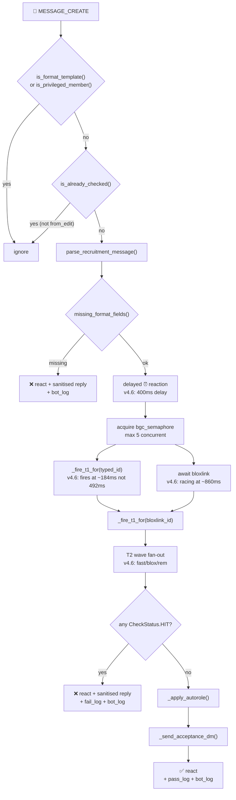

> [!TIP]
> Because T1 is idempotent, calling `_fire_t1_for` for the typed ID, the Bloxlink ID, and the DB-history ID does **not** duplicate network calls. Xtracker's rate limiter sees each unique ID exactly once.

### Sequence diagram — async interaction order

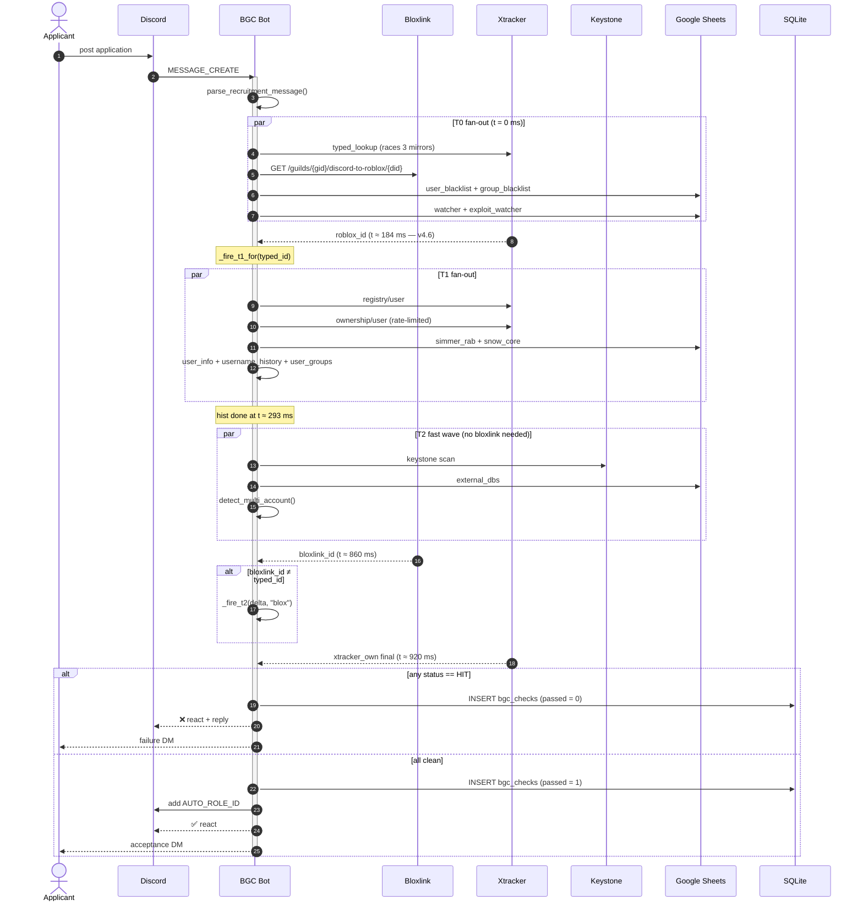

### Lifecycle state diagram

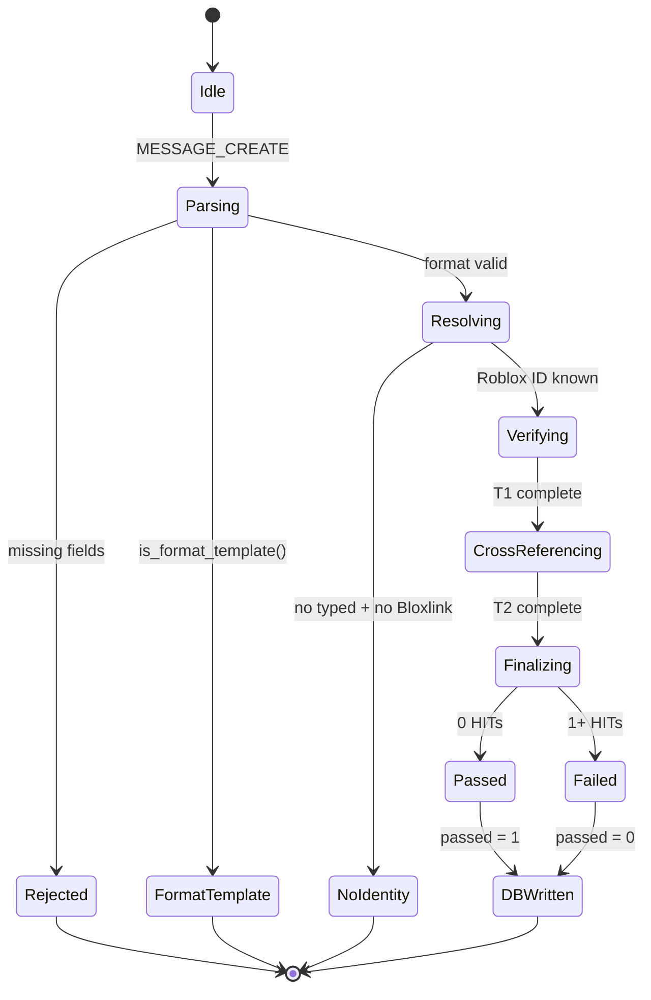

### Database schema

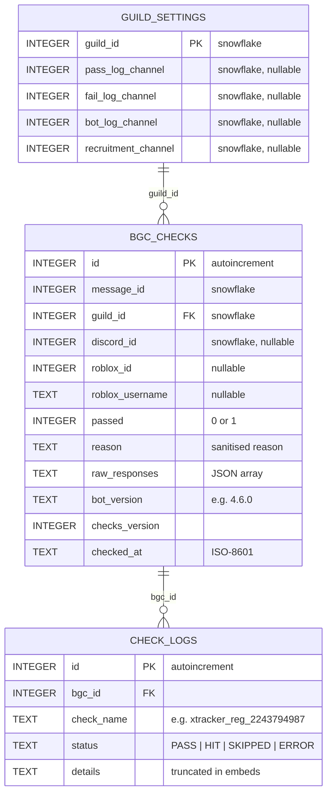

> [!NOTE]
> All `INTEGER` snowflake columns hold 64-bit IDs (up to 2⁶³−1). SQLite's `INTEGER` is 8-byte, so no truncation risk — but **do not cast these to `INT` in client code** or you will silently corrupt Discord snowflakes above 2³¹.

---

## 📊 v4.5.0 Baseline Performance

> [!NOTE]
> Reference measurements for the **public v4.5.0** release. Warm cache, `XTRACKER_RATE_LIMIT = 1.0`, no domain racing. These are the numbers the v4.6.0 update is compared against.

### Gantt — v4.5.0 full task timeline

```mermaid
gantt
    title v4.5.0 Baseline — Total 1721 ms
    dateFormat x
    axisFormat %S.%L
    todayMarker off

    section T0 — Discord-level (0 ms)
    bloxlink (T0 gate)      :crit, done,  t_bl,  0,   1107ms
    typed_lookup (first ID) :crit, done,  t_tl,  0,    492ms
    watchers (5 tasks)      :done,        t_w,   0,    210ms

    section T1 — ID-keyed (492 ms)
    xtracker_own (critical) :crit, done,  t_xo,  492, 1228ms
    user_groups             :done,        t_ug,  492,  728ms
    username_history        :done,        t_uh,  492,  527ms
    simmer_rab              :done,        t_sr,  492,  511ms
    xtracker_reg            :done,        t_xr,  492,  341ms
    user_info               :done,        t_ui,  492,   57ms
    snow_core               :done,        t_sc,  492,    1ms

    section T2 — Identity-set (1107 ms)
    multi_account           :done,        t_ma, 1107,    8ms
    external_dbs            :done,        t_ed, 1107,    7ms
    keystone                :done,        t_ks, 1107,    7ms

    section Milestones
    T1 fires on typed ID    :milestone,   m1,   492,    0ms
    T2 fires (waits blox)   :milestone,   m2,  1107,    0ms
    Result written to DB    :milestone,   m3,  1721,    0ms
```

> [!IMPORTANT]
> **The v4.5.0 bottleneck.** Two factors dominate: (1) `xtracker_own` sits on the critical path at 1228 ms because Xtracker's shared `RateLimiter` enforces a full **1.0 s** gap after `xtracker_reg`; (2) T2 cannot fire until `bloxlink` returns at 1107 ms, wasting ~615 ms after the typed lookup already resolved the same identity.

---

## ⚡ v4.6.0 — Private Performance Update

> [!WARNING]
> **v4.6.0 is not yet public.** It represents a substantial internal rewrite of the Roblox API layer, caching strategy, and T2 scheduling. All numbers below were captured on a **freshly-restarted process with no prior calls** (40 s – 2 min uptime), meaning the shared caches were warm from boot but the per-UID caches were cold — this is the most realistic "first real applicant" measurement possible.

### 📊 Results at a Glance

| Metric | v4.5.0 | **v4.6.0** | Δ |
| :--- | ---: | ---: | ---: |
| **Total BGC time** | 1721 ms | **921 ms** | **−46%** |
| `typed_lookup` (first ID) | 492 ms | **184 ms** | −63% |
| T1 fire (first ID known) | 492 ms | **184 ms** | −63% |
| T2 fire (identity-set) | 1107 ms | **293 ms** | **−73%** |
| `xtracker_own` (critical path) | 1228 ms | **736 ms** | −40% |
| `bloxlink` | 1107 ms | **860 ms** | −22% |
| `username_history` | 527 ms | **108 ms** | −80% |
| `user_groups` | 728 ms | **208 ms** | −71% |

> [!TIP]
> With `XTRACKER_RATE_LIMIT = 0.01` (testing only), total time drops further to **821 ms** — at which point `bloxlink` becomes the critical path and Xtracker is no longer the bottleneck.

### 🏁 Side-by-Side Comparison Gantt

```mermaid
gantt
    title v4.5.0 → v4.6.0 — Total time halved
    dateFormat x
    axisFormat %S.%L
    todayMarker off

    section v4.5.0 — 1721 ms
    typed_lookup          :done,      o1, 0,    492ms
    xtracker_own (crit)   :crit, done, o2, 492, 1228ms
    T2 fires (single wave):milestone, o3, 1107,   0ms
    END                   :milestone, o4, 1721,   0ms

    section v4.6.0 — 921 ms
    typed_lookup          :done,      n1, 0,    184ms
    xtracker_own (crit)   :crit, done, n2, 184,  736ms
    T2 fires (fast wave)  :milestone, n3, 293,    0ms
    END                   :milestone, n4, 921,    0ms
```

### 📈 v4.6.0 Full Task Timeline

```mermaid
gantt
    title v4.6.0 Full Task Timeline — Total 921 ms
    dateFormat x
    axisFormat %S.%L
    todayMarker off

    section T0 — Discord-level (0 ms)
    bloxlink                :done,        t_bl,  0,   860ms
    typed_lookup (first ID) :crit, done,  t_tl,  0,   184ms
    watchers (5 tasks)      :done,        t_w,   0,   229ms

    section T1 — ID-keyed (184 ms)
    xtracker_own (critical) :crit, done,  t_xo,  184, 736ms
    simmer_rab              :done,        t_sr,  184, 532ms
    xtracker_reg            :done,        t_xr,  184, 386ms
    user_groups             :done,        t_ug,  184, 208ms
    username_history        :done,        t_uh,  184, 108ms
    snow_core               :done,        t_sc,  184,   1ms
    user_info               :done,        t_ui,  184,   1ms

    section T2 — Wave-based (293 ms fast wave)
    multi_account           :done,        t_ma,  293,   7ms
    external_dbs            :done,        t_ed,  293,   6ms
    keystone                :done,        t_ks,  293,   6ms

    section Milestones
    T1 fires on typed ID    :milestone,   m1,   184,   0ms
    T2 fires (fast wave)    :milestone,   m2,   293,   0ms
    Result written to DB    :milestone,   m3,   921,   0ms
```

### ⚡ v4.6.0 Critical Path

```mermaid
gantt
    title v4.6.0 Critical Path — typed_lookup → xtracker_own
    dateFormat x
    axisFormat %S.%L
    todayMarker off

    section Critical path
    typed_lookup (gate)     :crit, done, c1, 0,    184ms
    xtracker_own (longest)  :crit, done, c2, 184,  736ms

    section Overlapped (not on critical path)
    bloxlink                :done, n1, 0,   860ms
    simmer_rab              :done, n2, 184, 532ms
    xtracker_reg            :done, n3, 184, 386ms
    user_groups             :done, n4, 184, 208ms
    username_history        :done, n5, 184, 108ms
```

### 🌊 The Big Idea — Wave-Based T2 Scheduling

The single most impactful change. v4.5.0 fired T2 as one monolithic wave that **waited for the slowest T0 task** (bloxlink). v4.6.0 fires T2 in up to three delta-checked waves as identities become known.

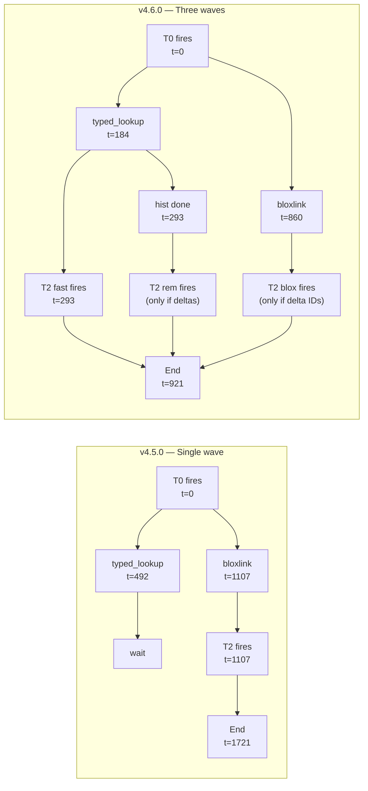

**What the fast wave covers:** typed_user + DB history. These are almost always the same identities — the entire `multi_account`, `keystone`, and `external_dbs` result set is ready at t≈293 ms.

**What the blox wave covers:** only the **delta** — Bloxlink-only IDs (when typed ≠ Bloxlink, or when Bloxlink resolves something the typed lookup missed). If Bloxlink matches the typed ID (the common case), the delta is empty and the wave is skipped entirely.

**What the rem wave covers:** any historic identity not yet covered by fast or blox.

### 🧠 Complete Change List

| # | Change | Where | Why it matters |
| :--- | :--- | :--- | :--- |
| 1 | **Domain racing** — `_race_200` fires all 3 mirrors in parallel, first 200 wins | `roblox_user_info`, `username_history`, `user_groups`, `roblox_user_lookup` | `typed_lookup` went from 492 → 184 ms |
| 2 | **Circuit breaker** — 3 errors on a domain → skip for 60 s | `BGCBot._mark_domain_error` | Prevents 15 s hangs when a proxy is down |
| 3 | **Per-UID caches** — info 120 s, hist/groups 300 s, Simmer 120 s, name→id 300 s | module-level `_roblox_*_cache` dicts | Near-instant repeats; `username_history` went 527 → 108 ms |
| 4 | **Wave-based T2** — fast / blox / rem | `run_bgc_core._fire_t2` | T2 fires at 293 ms instead of 1107 ms |
| 5 | **Xtracker limiter 1.0 → 0.5 s** | `XTRACKER_RATE_LIMIT` | Halves the serialization cost of the two endpoint calls |
| 6 | **Bloxlink limiter 1.1 → 0.8 s** | `BLOXLINK_RATE_LIMIT` | Modest `bloxlink` latency win |
| 7 | **Nickname fallback** — if typed_lookup fails, try Discord nickname | `t0["nickname"]` | Rescues users who typo their username |
| 8 | **Delayed ⏰** — reaction appears 400 ms late, cancelled on fast BGC | `DLY_REACTION_SEC`, `_delayed_reaction` | Visual noise reduced; fast checks never show ⏰ |
| 9 | **DNS pre-resolve** — all 12 service domains resolved on startup | `_warm_dns()` | Eliminates first-call DNS stall |
| 10 | **Keepalive ping** — 4 hottest proxy endpoints pinged every 20 s | `_keep_connections_warm_loop()` | TLS/HTTP connections stay hot |
| 11 | **Connection pool tuning** — `ttl_dns_cache=3600`, `keepalive_timeout=90`, custom UA | `setup_hook` | Fewer TLS handshakes across the session |
| 12 | **`intents.reactions` removed** — bot only *sends* reactions, never listens | `intents` setup | Less gateway traffic; no functional loss |
| 13 | **Batch `check_logs` insert** — `executemany` replaces the loop | `run_bgc_core` DB block | 1 round-trip instead of N on every check |
| 14 | **Guild log channel cache** — 60 s TTL | `_guild_log_cache` + `get_log_channels` | Fewer DB reads on every log write |
| 15 | **External DB token blocklist** — filters `n/a`, `yes`, `none`, etc. | `_TOKEN_BLOCKLIST` | Fewer false-positive matches |
| 16 | **External DB column-type enforcement** — `search_external_index` now checks `col_types` | `search_external_index` | Stops Discord IDs being matched against Roblox username columns |

### 🔧 Code Highlights — How to Replicate

<details>
<summary><strong>1. Domain racing — the single biggest win</strong></summary>

**Before (v4.5.0):** sequential fallback — up to 3 timeouts stacked.

```python
for d in USER_DOMAINS:
    try:
        async with session.post(f"https://{d}/v1/usernames/users", json=payload) as r:
            if r.status == 200:
                data = await r.json()
                if data.get("data"): return data["data"][0], ""
    except asyncio.TimeoutError:
        continue
```

**After (v4.6.0):** parallel race, first 200 wins, stragglers cancelled.

```python
async def _race_200(session, domains, path, *, timeout=RACE_TIMEOUT_SEC):
    domains = bot._filter_healthy(domains)
    async def _try(domain):
        try:
            async with session.get(f"https://{domain}{path}",
                                    timeout=aiohttp.ClientTimeout(total=timeout)) as r:
                if r.status == 200:
                    bot._mark_domain_ok(domain)
                    return ("ok", await r.json(), None)
                return ("err", None, f"{domain}: HTTP {r.status}")
        except asyncio.TimeoutError:
            bot._mark_domain_error(domain)
            return ("err", None, f"{domain}: timeout")

    tasks = [asyncio.create_task(_try(d)) for d in domains]
    try:
        for fut in asyncio.as_completed(tasks):
            kind, val, err = await fut
            if kind == "ok":
                for t in tasks:
                    if not t.done(): t.cancel()
                return val, None, False
    finally:
        for t in tasks:
            if not t.done(): t.cancel()
```
</details>

<details>
<summary><strong>2. Circuit breaker — prevents 15s hangs during proxy outage</strong></summary>

```python
class BGCBot(commands.Bot):
    def __init__(self):
        ...
        self._domain_dead_until = defaultdict(float)
        self._domain_error_count = defaultdict(int)

    def _mark_domain_error(self, domain):
        self._domain_error_count[domain] += 1
        if self._domain_error_count[domain] >= 3:
            self._domain_dead_until[domain] = time.monotonic() + 60
            self._domain_error_count[domain] = 0

    def _mark_domain_ok(self, domain):
        self._domain_error_count[domain] = 0
        self._domain_dead_until[domain] = 0.0

    def _filter_healthy(self, domains):
        now = time.monotonic()
        healthy = [d for d in domains if self._domain_dead_until[d] <= now]
        return healthy or list(domains)  # always try something
```

Every successful race calls `_mark_domain_ok(winner)`; every failure calls `_mark_domain_error`. Three failures on the same domain = 60 s skip. The list is never empty because `_filter_healthy` falls back to all domains if every one is marked dead.
</details>

<details>
<summary><strong>3. Per-UID cache — info, history, groups, Simmer</strong></summary>

```python
_roblox_info_cache   = {}   # uid -> (dict, ts)
_roblox_hist_cache   = {}   # uid -> (list, ts)
_roblox_groups_cache = {}   # uid -> (list, ts)
_simmer_cache        = {}   # rid -> (dict, ts)

ROBLOX_INFO_TTL   = 120
ROBLOX_HIST_TTL   = 300
ROBLOX_GROUPS_TTL = 300
SIMMER_TTL        = 120

async def roblox_user_info(session, uid):
    now = time.time()
    hit = _roblox_info_cache.get(uid)
    if hit and now - hit[1] < ROBLOX_INFO_TTL:
        return hit[0], ""
    body, err, _ = await _race_200(session, USER_DOMAINS, f"/v1/users/{uid}")
    if body is not None:
        _roblox_info_cache[uid] = (body, time.time())
        return body, ""
    return None, err or "no response"
```

Same pattern applied to `roblox_username_history`, `roblox_user_groups`, and `simmer_rab_check`. The `_simmer_cache` only stores `PASS`/`HIT` results (never `SKIPPED`/`ERROR`) so transient failures retry on the next request.
</details>

<details>
<summary><strong>4. Wave-based T2 — fast/blox/rem</strong></summary>

```python
def _fire_t2(ids, names, tag, primary_rid=None):
    ids = set(ids); names = set(names)
    if not ids and not names: return
    ks = {str(x) for x in ids} | {n.lower().lstrip('@') for n in names}
    t2[f"keystone_{tag}"] = _s(keystone_check(session, ks, ...), f"keystone_{tag}")
    t2[f"ext_{tag}"]      = _s(search_external_dbs(session, {...}), f"external_dbs_{tag}")
    if primary_rid is not None and primary_rid not in _multi_fired:
        _multi_fired.add(primary_rid)
        t2[f"multi_{primary_rid}"] = _s(detect_multi_account(...), f"multi_{primary_rid}")

# Wave 1: fast — typed + DB history (fires immediately after hist resolves)
_fire_t2(fast_ids, fast_names, "fast", primary_rid=typed_user["id"] if typed_user else None)

# Wave 2: blox — only the delta introduced by Bloxlink
if delta_ids or blox_delta_names:
    _fire_t2(delta_ids, blox_delta_names, "blox", primary_rid=bloxlink_id)

# Wave 3: rem — any historic identity still uncovered
if remaining_ids or remaining_names:
    _fire_t2(remaining_ids, remaining_names, "rem")
```

The final `merged_keystone`, `merged_ext`, and `merged_multi` dicts collapse results from all waves — no duplicates, no double-counting.
</details>

<details>
<summary><strong>5. Delayed ⏰ reaction</strong></summary>

```python
DLY_REACTION_SEC = 0.4

async def _delayed_reaction(msg, emoji, delay):
    try:
        await asyncio.sleep(delay)
        await msg.add_reaction(emoji)
    except (asyncio.CancelledError, discord.HTTPException):
        pass

# in process_message:
reaction_task = asyncio.create_task(_delayed_reaction(message, "⏰", DLY_REACTION_SEC))
# ... run BGC ...
if reaction_task is not None and not reaction_task.done():
    reaction_task.cancel()
    try: await reaction_task
    except: pass
asyncio.create_task(message.remove_reaction("⏰", bot.user))
```

Fast BGCs (<400 ms) never show ⏰ at all — the reaction task is cancelled before the emoji touches the message. Slow BGCs still get the visual cue.
</details>

### 📋 Migration Checklist

To get v4.6.0 behaviour from a v4.5.0 base, apply these in order:

1. **Add module-level caches** (`_roblox_info_cache` etc.) with their TTLs.
2. **Replace sequential domain loops** in `roblox_user_lookup`, `roblox_user_info`, `roblox_user_groups`, `roblox_username_history` with `_race_200` / a parallel variant.
3. **Add circuit breaker state** to `BGCBot.__init__` and the three helper methods.
4. **Refactor T2 scheduling** in `run_bgc_core` to `_fire_t2(ids, names, tag)` and call it in three waves.
5. **Add `_guild_log_cache`** in `get_log_channels` and pop the key on `set_log_channels`.
6. **Convert `check_logs` inserts** from the `for c in checks:` loop to `executemany`.
7. **Add `_TOKEN_BLOCKLIST`** check to `build_external_index`.
8. **Thread `col_types` through** `search_external_index` and enforce `if ct != "other" and ct != mtype: continue`.
9. **Add nickname fallback** to `run_bgc_core` T0.
10. **Add `_delayed_reaction`** and wire it into `process_message`.
11. **Tune connection pool**: `ttl_dns_cache=3600`, `keepalive_timeout=90`, `KEEPALIVE_INTERVAL_SEC=20`.
12. **Add `_warm_dns()`** and `_keep_connections_warm_loop()` to `setup_hook`.
13. **Remove `intents.reactions`** (bot only sends reactions).
14. **Lower rate limits** — `XTRACKER_RATE_LIMIT = 0.5`, `BLOXLINK_RATE_LIMIT = 0.8`.

### ⚠️ Caveats & Notes

> [!WARNING]
> **Xtracker limiter tuning is experimental.** `XTRACKER_RATE_LIMIT = 0.5` halves the serialization cost but pushes 120 calls/min — right at the boundary of Xtracker's documented limit. If you start seeing `rate limited` SKIPPED rows in `/health timeline`, revert to `1.0`.

> [!NOTE]
> **`user_info` in the probe reads 0.1 ms because the probe itself pre-warms the info cache** (it resolves the test Roblox ID before starting the timed BGC). In real usage a cold `user_info` call takes ~50–100 ms — but since most checks are repeats of the same user within 120 s, the cache hit rate in practice is high.

> [!TIP]
> **Try lower rates.** With `XTRACKER_RATE_LIMIT = 0.01` (test-only), total time drops to **821 ms** — at which point `bloxlink` becomes the new critical path. If you can cache Bloxlink results or reduce its latency, total time drops further toward ~820 ms.

---

## 🔬 Implementation Internals

### Roblox API domain fallback chain

Every Roblox HTTP call races three mirrors in parallel. `users.rotunnel.com` and `users.roproxy.com` are preferred over the canonical `users.roblox.com` because they survive Roblox rate-limiting.

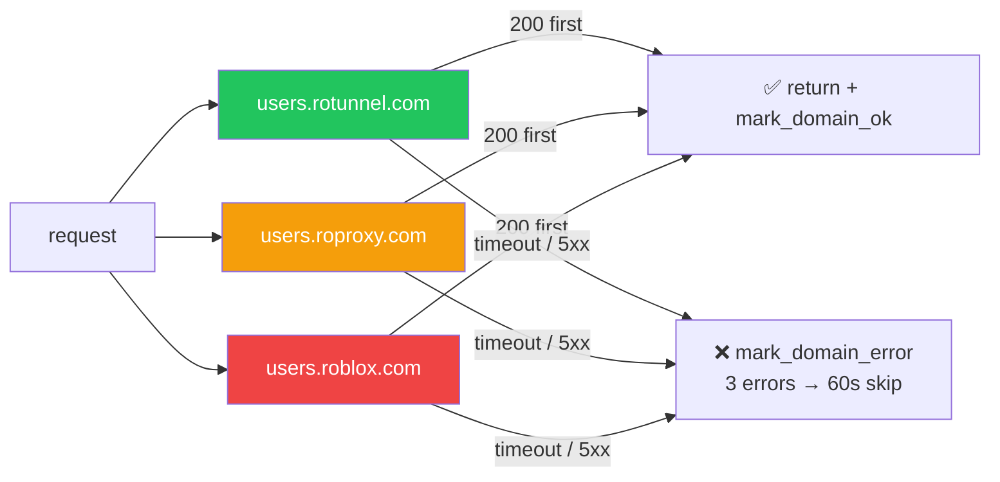

**Source:** `USER_DOMAINS = ("users.rotunnel.com", "users.roproxy.com", "users.roblox.com")` and `GROUP_DOMAINS` mirror tuple in `bgc_bot.py`.

### Cache lifecycle — TTL + debounce + keep-warm

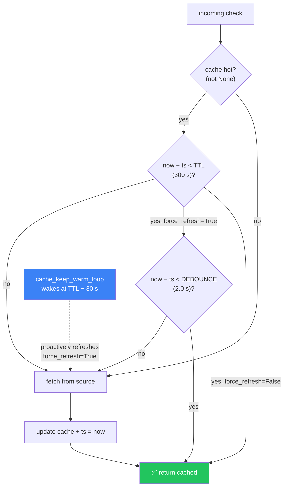

**Source:** `BLACKLIST_TTL = 300`, `BLACKLIST_DEBOUNCE = 2.0`, `KEYSTONE_TTL = 300`, `EXTERNAL_DB_TTL = 300`. The keep-warm loop wakes at `BLACKLIST_TTL - 30` (270 s) — 30 s before expiry so no live request ever pays a cold fetch.

### Class diagram

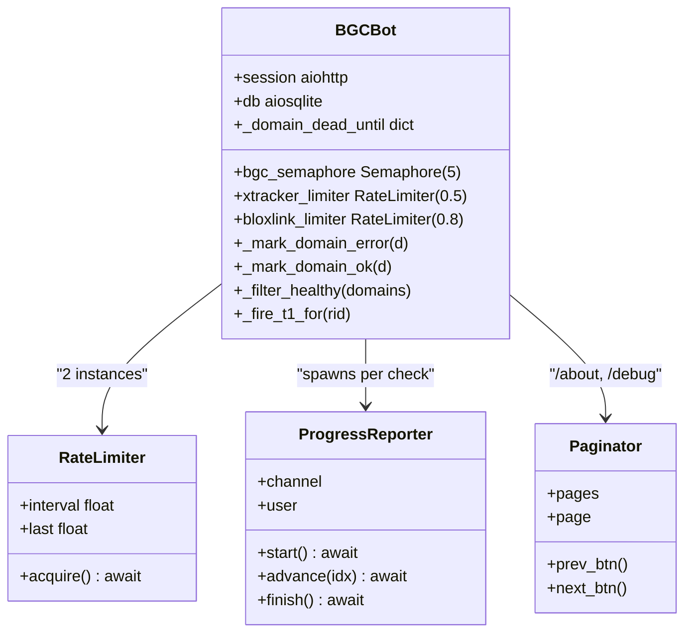

---

## 🧪 Development & Testing

```bash
# Run the bot locally
DISCORD_BOT_TOKEN="..." python bgc_bot.py

# Smoke-test all caches
/health quick

# Full timing probe — safe to spam, no DB writes
/health timeline
```

> [!WARNING]
> `/health timeline` requires `HEALTH_TEST_ROBLOX_ID` and `HEALTH_TEST_DISCORD_ID`. It runs a real BGC with `message_id=None` and `skip_db_history=True`, so it does **not** write to the database. The probe **forces cold per-UID caches** (info / hist / groups / Simmer) at the start of every run so each probe is a consistent "brand-new-user" shape — but shared caches (blacklists, Keystone, Snow Core, external DBs) stay warm, matching real applicant conditions shortly after boot.

### Project layout

```text
bgc-bot/
├── bgc_bot.py              # Single-file bot
├── requirements.txt
├── .env.example
├── README.md
└── bgc.db                  # created at runtime (WAL)
```

---

## 🤝 Contributing

1. Fork the repository.
2. Create a feature branch: `git checkout -b feat/your-feature`.
3. Commit with [Conventional Commits](https://www.conventionalcommits.org/): `feat: add X`.
4. Open a pull request against `main`.

> [!NOTE]
> Before opening a PR, run `python -m py_compile bgc_bot.py` and confirm `/health quick` still reports green.

---

<div align="center">

**Built by [Pizzarobloxh](https://github.com/Pizzarobloxh) — for communities that take recruitment seriously.**

[⬆ Back to top](#️-bgc-bot)

</div>
