

# BGC Bot v5.0.0

### Technical documentation

Technical documentation for BGC Bot, covering its architecture, performance measurements, data sources, caching strategy, reliability mechanisms, and development history.

The bot screens Discord recruitment applications against a Roblox identity, shared cheater databases, community watchlists, and multiple external ban lists. This document records how the implementation changed between versions, what was measured during performance testing, and which improvements are planned next.

---

## Performance summary

| Version | Execution path | Runtime | Source |
| :--- | :--- | ---: | :--- |
| v2.1.0 | live | ~6,000 ms | **Estimated** (inferred from code structure) |
| v3.3.0 | live | 5,965 ms | Measured |
| v3.6.0 | live | 5,961 ms | Measured |
| v4.0.0 | live | 7,989 ms | Measured |
| v4.5.0 | live | 1,721 ms | Measured |
| v5.0.0 | live | 801 ms | Measured |
| v5.0.0 | preemptive | 65 ms | Measured |

**Measurement caveats:**

- Every figure except v2.1.0 comes from a single `/health timeline` probe run per version, on warm shared caches and cleared per-UID caches. These are single observations, not statistical benchmarks — a repeat run on a different day would likely produce different numbers.
- The preemptive path (65 ms) measures marginal work after a cache hit. The work that populated that cache (~3,300 ms of preemptive scan in the same session) ran while the user was typing, before submission. It is not directly comparable to the live path.
- v2.1.0 is an estimate inferred from its code shape (fully sequential, no caching). It should not be treated as a controlled measurement.

### Runtime by version

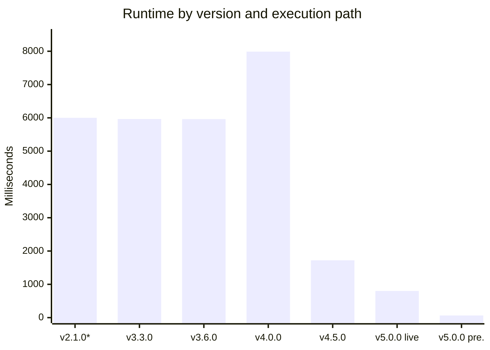

*\*v2.1.0 is estimated.*

### Zoomed view — v4.5.0 and later

The version bar chart above compresses the later versions into short bars. The same data on a smaller scale:

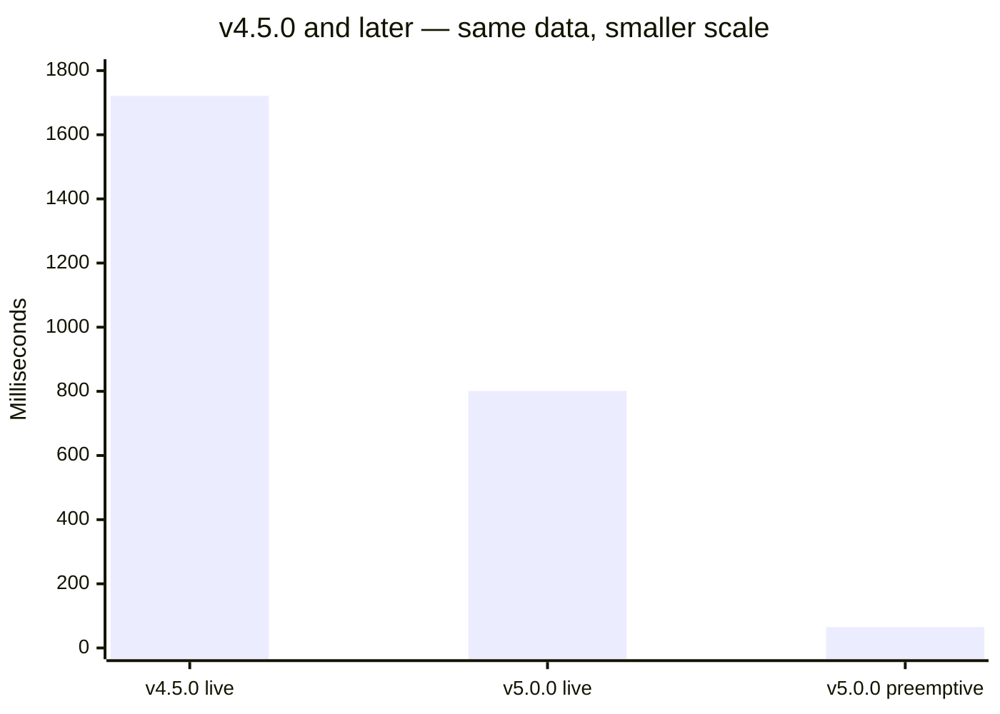

---

## What the bot checks

The bot queries 15 distinct data sources per application: 9 list-based sources (Google Sheets and one Keystone API returning a list of cases) plus 6 per-ID API lookups.

### Data sources by category

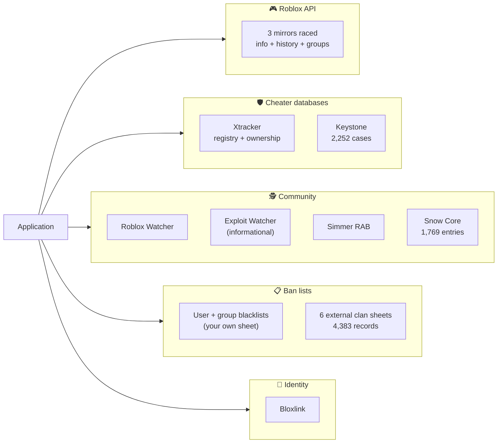

### Records available per source

Sorted by record count. The eight figures below total **8,404 rows across 8 sources**, measured in one `/health check` run. User and group blacklists are config-dependent and excluded from this chart.

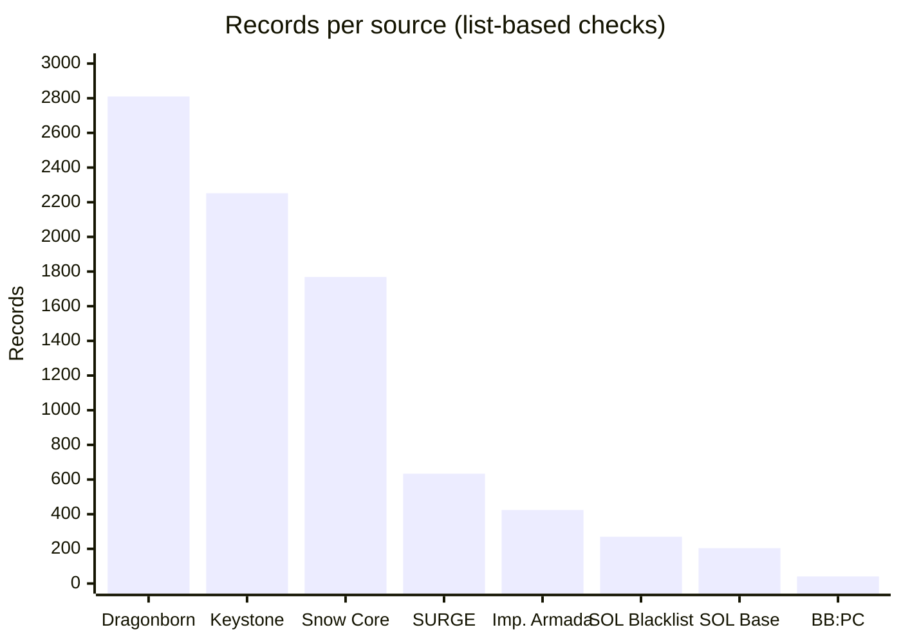

| Source | Records | Type |
| :--- | ---: | :--- |
| Dragonborn Blacklist | 2,810 | External clan (Google Sheet) |
| Keystone | 2,252 | Shared case database (API) |
| Snow Core | 1,769 | External community (Google Sheet) |
| SURGE Mainframes | 634 | External clan (Google Sheet) |
| Imperial Armada Blacklist | 424 | External clan (Google Sheet) |
| SOL Blacklists | 270 | External clan (Google Sheet) |
| SOL Base Banlist | 204 | External clan (Google Sheet) |
| BB:PC Punishment Tracker | 41 | External clan (Google Sheet) |
| **Total** | **8,404** | |

> Record counts are from a single health check and will drift as sheets are edited. They are row counts, not unique applicants — the same person may appear in multiple sources.

### Per-ID API checks

These have no fixed record count — they return a result for the specific applicant being checked:

| Source | What it returns | Check frequency |
| :--- | :--- | :--- |
| Roblox API | User info, banned status, created date, username history, groups | Once per unique Roblox ID |
| Xtracker (registry + ownership) | Cheater registry listing | 2 calls per unique Roblox ID |
| Bloxlink | Discord → Roblox ID resolution | Once per application |
| Roblox Watcher | NSFW/condo server membership | Once per Discord ID |
| Exploit Watcher | Exploit flag (informational only, does not fail) | Once per Discord ID |
| Simmer | RAB (Roblox Studio) activity | Once per unique Roblox ID |

---

## Request lifecycle

How a single application flows through the bot from message to reaction.

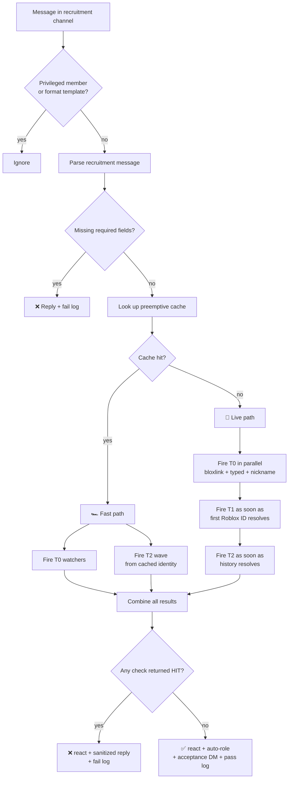

The fast path fires fewer tasks because most of T1 was already collected by the preemptive scan. The live path fires everything live.

---

## Cache lifecycle

The preemptive scanner runs when a user starts typing in the recruitment channel, populating three independent caches that the live check can reuse.

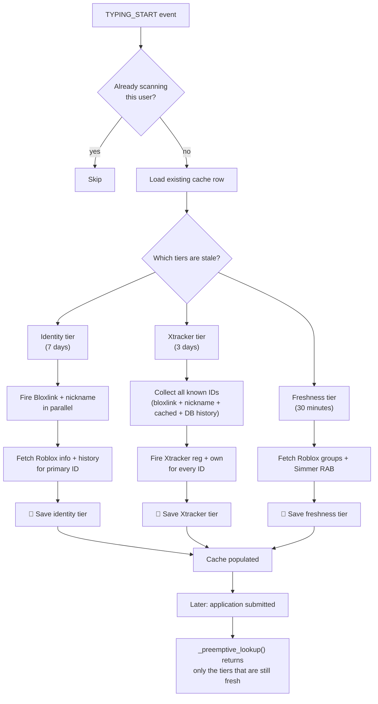

### Cache tiers

| Tier | Contents | TTL | Refreshed when |
| :--- | :--- | ---: | :--- |
| **Identity** | Bloxlink → Roblox ID, user info, username history | 7 days | `on_typing` if identity is stale |
| **Xtracker** | Registry + ownership results for every known Roblox ID | 3 days | `on_typing` if Xtracker is stale |
| **Freshness** | Roblox group memberships, Simmer RAB flag | 30 minutes | `on_typing` if freshness is stale |

Each tier expires independently. A user who reapplies after two days gets identity + Xtracker cache hits but a fresh groups check. A user who reapplies after ten days gets a full re-scan.

**When the preemptive path does not apply:**

- The user submits the application before the preemptive scan finishes (typical for very fast typers, under ~3 seconds)
- The preemptive scan failed (network error, API down)
- `skip_preemptive=True` is passed explicitly (used by `/check`, `/health timeline`, and re-runs)
- The applicant has no Discord member object cached (e.g. first message with a stale member cache)

In all of these cases the bot falls back to the live path automatically.

---

## v5.0.0 runtime breakdown

Two single-run measurements, broken down by task. These show which tasks run in parallel and which one determined the total.

### Live path — 801 ms

```mermaid
gantt
    title "v5.0.0 live path — 801 ms"
    dateFormat x
    axisFormat %L ms
    todayMarker off

    section T0 — Discord-level
    bloxlink               :crit, done, b, 0, 801ms
    exploit_watcher        :done,        e, 0, 141ms
    roblox_watcher         :done,        r, 0, 89ms
    blacklists + age       :done,        x, 0, 1ms

    section T1 — Roblox-ID-level
    xtracker_own           :done,        o, 1, 586ms
    xtracker_reg           :done,        g, 1, 248ms
    simmer_rab             :done,        s, 1, 136ms
    username_history       :done,        h, 1, 53ms
    user_groups            :done,        u, 1, 53ms
    user_info              :done,        i, 1, 26ms

    section T2 — Identity-set
    keystone + ext + multi :done,        t, 54, 6ms
```

**Where the 801 ms went.** In this measurement, `bloxlink` was the last task to complete at 800.5 ms. `xtracker_own` — the second-slowest — finished at 587.2 ms, 213 ms earlier. Total runtime is the duration of the single slowest task, not the sum of all tasks. If `bloxlink` had finished at 587 ms, total runtime would have been approximately 587 ms.

**What 801 ms does not mean.** The Bloxlink hard timeout is configured at **1500 ms** (`BLOXLINK_HARD_TIMEOUT_MS`). The 801 ms in this chart is an *observed duration in this specific run*, not the ceiling. On a slower Bloxlink response, the shield would fire at 1500 ms and the bot would fall back to the typed username.

### Preemptive path — 65 ms

```mermaid
gantt
    title "v5.0.0 preemptive path — 65 ms"
    dateFormat x
    axisFormat %L ms
    todayMarker off

    section Preemptive cache
    identity + xtracker + freshness :done, p, 0, 1ms

    section T0 — remaining network calls
    exploit_watcher (ceiling)       :crit, done, e, 0, 65ms
    roblox_watcher                  :done,        r, 0, 57ms
    blacklists + age                :done,        b, 0, 1ms

    section T1 — all served from cache
    info + history + groups         :done,        i, 0, 1ms
    xtracker (zero network calls)   :done,        x, 0, 1ms
    simmer + snow                   :done,        s, 0, 1ms

    section T2
    keystone + ext + multi          :done,        t, 1, 7ms
```

**Where the 65 ms went.** `exploit_watcher` was the last task to complete at 64.6 ms. `roblox_watcher` finished at 57.4 ms. Every other task completed in under 2 ms because it was served from the preemptive cache.

**What 65 ms does not include.** The preemptive scan that populated the cache took approximately **3,306 ms** in the same session. That scan ran while the user was typing, before they submitted. The 65 ms is the marginal work after cache hit — not the total work to process the application.

**What happens without the preemptive cache.** If the same user had submitted without a preemptive scan, the same application would have run through the live path and taken ~800 ms. The 65 ms figure depends on cache hit.

### Where the two paths differ

| Task | Live path | Preemptive path |
| :--- | :---: | :---: |
| Bloxlink | 🔴 801 ms (network) | ⚪ Cached |
| Xtracker (registry + ownership) | 🔴 834 ms (2 calls, 0.4s limiter) | ⚪ Cached |
| Roblox info + history + groups | 🔴 132 ms (3 network calls) | ⚪ Cached |
| Simmer RAB | 🔴 136 ms (network) | ⚪ Cached |
| Keystone | 🟢 ~6 ms (cached list) | 🟢 ~6 ms |
| 6 external DBs | 🟢 ~6 ms (cached records) | 🟢 ~6 ms |
| Roblox Watcher | 🟡 89 ms (network, always live) | 🟡 57 ms |
| Exploit Watcher | 🟡 141 ms (network, always live) | 🟡 65 ms |

Roblox Watcher and Exploit Watcher are always live because the preemptive scan does not cache Discord-ID-based watcher lookups. Caching them is on the roadmap.

---

## Reliability

Four independent mechanisms limit the impact of slow or failing external services.

### Domain circuit breaker

Every Roblox API call races three mirrors (`users.rotunnel.com`, `users.roproxy.com`, `users.roblox.com`). If a mirror fails 3 times in a row, it is skipped for 60 seconds.

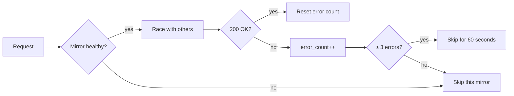

### Bloxlink shield

Bloxlink is capped at 1500 ms. A late response is not wasted — if the call eventually returns after the timeout, the result is stored in a late cache for 5 minutes and used by the next application from the same user.

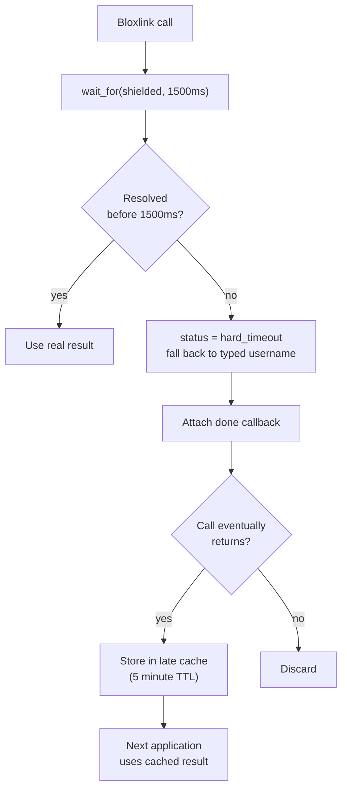

### Adaptive Xtracker rate limiter

The Xtracker rate limiter starts at 1.0 second between calls. On HTTP 429 responses it doubles the interval up to 4× (max 4.0 seconds). After 60 seconds without a 429, the interval decays back toward 1.0 second.

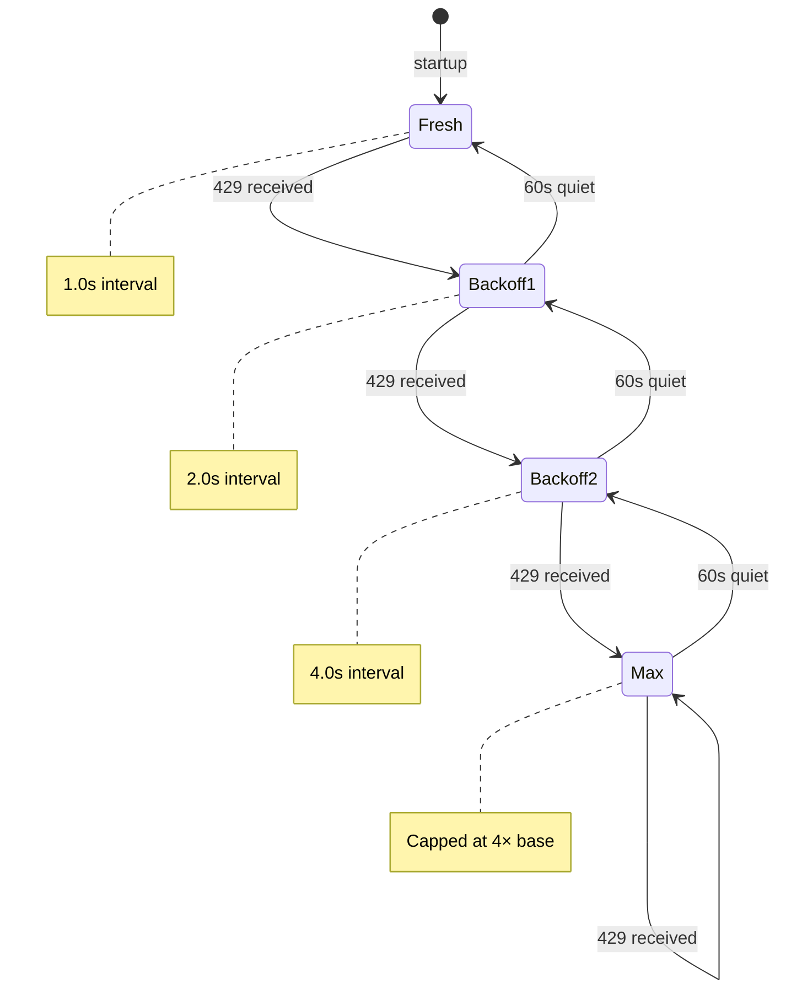

### Failure handling summary

| Failure type | Handler | User impact |
| :--- | :--- | :--- |
| Single mirror timeout | Circuit breaker skips it | None (other 2 mirrors raced) |
| All 3 mirrors fail | Retry with backoff | Check returns SKIPPED |
| Bloxlink timeout (>1500 ms) | Fall back to typed username | Slower resolution, still works |
| Xtracker 429 | Adaptive limiter bumps interval | Slightly slower calls, no 429s |
| Google Sheets 500 | Per-source error isolation | Other DBs still searched |
| Keystone down | Check returns ERROR, does not fail applicant | Applicant passes if no other HIT |
| Simmer down | SKIPPED (does not fail applicant) | Same |
| Roblox Watcher down | SKIPPED | Same |
| SQLite lock contention | Serialized via `db_lock` | No data loss, slower writes |

---

## Implementation history

The changes between versions, grouped by what motivated them.

### v2.1.0 → v3.6.0: initial working version

The bot did eight checks in sequence: Roblox lookup, user info, groups, Xtracker registry, Xtracker ownership, two watchers, Clanware banlist. One blacklist sheet.

- Fully sequential — every check waited for the previous
- No caching between applications
- No rate limiting on Xtracker (would 429 under load)
- No domain racing — sequential mirror fallback (could take 15+ seconds per API call)

Runtime: ~6 seconds.

### v4.0.0: coverage expansion

Added six new data sources and a Discord → Roblox resolver:

- Six external clan blacklists (Imperial Armada, Dragonborn, SURGE, SOL ×2, BB:PC) — 4,383 records total
- Keystone (2,252 cases)
- Snow Core (1,769 records)
- Bloxlink for Discord → Roblox identity
- Per-ID Xtracker + Simmer + Snow Core lookups for **historical** Roblox IDs (not just current)

Also added caching for blacklists, Keystone, Snow Core, and per-UID Roblox info/history/groups. But the additional network calls more than offset the caching gains.

Runtime: 7,989 ms — slower than v3.6.0 by 34%, but now checking 8 databases instead of 1.

### v4.5.0: first optimization pass

- Cached shared sources (blacklists, Keystone, Snow Core) with 5-minute TTL
- Fired the top-level checks in parallel instead of sequentially
- Added basic `aiohttp` connection pooling

Runtime: 1,721 ms. **4.6× faster than v4.0.0.**

### v5.0.0: racing, waves, and preemptive scanning

Three structural changes:

**Domain racing.** Every Roblox API call now races three mirrors in parallel and takes the first 200 response. Previously it tried them sequentially until one worked. Racing reduced `typed_lookup` from 492 ms (v4.5.0) to 114 ms (v5.0.0 live) to ~1 ms (v5.0.0 preemptive, cached).

**Wave-based T2.** Identity-set checks (Keystone, external DBs, multi-account) fire as soon as the primary identity is known, rather than waiting for all of T0 (including Bloxlink) to finish. This moved T2 firing from t=1107 ms to t=54 ms on the live path.

**Preemptive scanning.** When a user starts typing in the recruitment channel, the bot kicks off the expensive lookups in the background using three tiers of caching. When they submit, the check reuses whatever tiers are still fresh.

Also added:

- `AdaptiveRateLimiter` for Xtracker (bumps on 429, decays on silence)
- Bloxlink shield (1500 ms hard cap) with late-cache for eventual responses
- Domain circuit breaker
- `aiodns` non-blocking DNS resolution
- Three-tier cache split (identity 7d, Xtracker 3d, freshness 30m)

Runtime (live path): 801 ms. **2.15× faster than v4.5.0.**
Runtime (preemptive path): 65 ms — *but only after a ~3,300 ms background scan that ran before submission.*

### Feature evolution matrix

| Feature | v2.1.0 | v3.6.0 | v4.0.0 | v4.5.0 | v5.0.0 |
| :--- | :---: | :---: | :---: | :---: | :---: |
| Domain racing | ❌ | ❌ | ❌ | ❌ | ✅ |
| Per-UID caching | ❌ | ❌ | ✅ | ✅ | ✅ |
| Three-tier cache | ❌ | ❌ | ❌ | ❌ | ✅ |
| Bloxlink identity | ❌ | ❌ | ✅ | ✅ | ✅ |
| Bloxlink hard timeout | ❌ | ❌ | ❌ | ❌ | ✅ |
| Six external DBs | ❌ | ❌ | ✅ | ✅ | ✅ |
| Keystone | ❌ | ❌ | ✅ | ✅ | ✅ |
| Snow Core | ❌ | ❌ | ✅ | ✅ | ✅ |
| Historical ID checks | ❌ | ❌ | ✅ | ✅ | ✅ |
| Wave-based T2 | ❌ | ❌ | ❌ | ❌ | ✅ |
| Adaptive rate limiter | ❌ | ❌ | ❌ | ❌ | ✅ |
| Preemptive scanner | ❌ | ❌ | ❌ | ❌ | ✅ |
| Circuit breaker | ❌ | ❌ | ❌ | ❌ | ✅ |
| `aiodns` support | ❌ | ❌ | ❌ | ❌ | ✅ |

---

## Roadmap

### High impact

**1. Lower `BLOXLINK_HARD_TIMEOUT_MS` from 1500 ms → 700 ms.**
In the current measurement, Bloxlink determined the live-path total at 800 ms. Capping at 700 ms would drop live-path runtime to ~700 ms when Bloxlink is slow — a 100 ms improvement in the worst case, no change in the fast case. The shield already handles timeouts gracefully, so this is a config change rather than a code change.

**2. Cache `exploit_watcher` results.**
Currently the preemptive ceiling at 65 ms. Exploit Watcher flags are historical, not real-time, so a 30-minute cache is safe. Would drop the preemptive path from 65 ms → ~20 ms.

**3. Scan new members on join.**
Currently only users who type in the recruitment channel trigger a preemptive scan. An `on_member_join` handler would scan members who join but lurk before posting, raising preemptive hit rate. Requires rate-limiting to avoid scan bursts on raid.

### Medium impact

**4. Backfill `xtracker_by_id` for historical IDs.**
The preemptive scan collects Xtracker for all known IDs at scan time. A background job could pre-populate for IDs the current scan missed. Would close a gap where a newly discovered historical ID has no cached Xtracker result.

**5. Parallelize `/health check`.**
Currently sequential per-source. Parallelizing would drop ~4 seconds to ~1 second.

### Low impact

**6. `/debug search`** — filter historical BGCs by status, reason, or date range.

**7. Prometheus metrics endpoint.**

---

## Reference

### Full source inventory

| Source | Type | Records | Checked against |
| :--- | :--- | ---: | :--- |
| Roblox API (3 mirrors) | REST | ∞ | Username, ID, groups |
| Xtracker registry | REST | — | Every known Roblox ID |
| Xtracker ownership | REST | — | Every known Roblox ID |
| Keystone | REST | 2,252 | Every known ID + name |
| Snow Core | Google Sheet | 1,769 | Every known Roblox ID |
| Imperial Armada Blacklist | Google Sheet | 424 | Every known ID + name |
| Dragonborn Blacklist | Google Sheet | 2,810 | Every known ID + name |
| SURGE Mainframes | Google Sheet | 634 | Every known ID + name |
| SOL Blacklists | Google Sheet | 270 | Every known ID + name |
| SOL Base Banlist | Google Sheet | 204 | Every known ID + name |
| BB:PC Tracker | Google Sheet | 41 | Every known ID + name |
| User blacklist | Google Sheet | *(config)* | Discord ID + Roblox name + past names |
| Group blacklist | Google Sheet | *(config)* | Roblox group memberships |
| Bloxlink | REST | — | Discord → Roblox resolution |
| Roblox Watcher | REST | — | Discord ID |
| Exploit Watcher | REST | — | Discord ID |
| Simmer | REST | — | Every known Roblox ID |

### Domains contacted

**Raced (3 mirrors, first 200 wins):**
- `users.rotunnel.com`, `users.roproxy.com`, `users.roblox.com` — user lookups, info, history
- `groups.rotunnel.com`, `groups.roproxy.com`, `groups.roblox.com` — group memberships

**Direct:**
- `api.blox.link` — Bloxlink
- `api.xtracker.xyz` — Xtracker
- `api.keystone-swords.com` — Keystone
- `api.simmer.icu` — Simmer
- `api.robloxwatcher.com` — Roblox Watcher + Exploit Watcher
- `docs.google.com` — all Google Sheets via gviz

### Known limitations

- **Live-path runtime is not measured statistically.** Every figure here is a single observation. p50/p95/p99 measurements would require multiple repeated runs, which are not currently collected.
- **Bloxlink latency in the live-path probe is a single observation.** It happened to be 800 ms on the day of measurement. It could be 300 ms or 1400 ms on another day; the ceiling is 1500 ms.
- **Record counts drift.** The 8,404 figure was captured in one `/health check` run. Google Sheets are editable, so counts will change.
- **Preemptive hit rate is not measured.** The bot tracks session-level hit/miss counts (`_metrics_preemptive_hits`, `_metrics_preemptive_misses`) but these are not persisted across restarts, so a stable hit rate is not available.
- **The 65 ms and 801 ms figures are not directly comparable.** See the caveat under [Runtime breakdown](#v500-runtime-breakdown).
- **Historical IDs are not fully covered by the preemptive scan.** The scan collects Xtracker for the current `bloxlink_roblox_id` plus any IDs already in the DB. If a new historical ID is discovered during a live check, its Xtracker result is fetched live and not cached. This is item 4 on the roadmap.

---

**Built by [Pizzarobloxh](https://github.com/Pizzarobloxh)**

*Every figure in this document comes from an actual measurement. Estimates are labelled.*

