<div align="center">

# 📊 Operating Documents

### The complete technical breakdown of BGC Bot v5.0.0

*Every measurement, every diagram, every war story.*

[](https://github.com/Pizzarobloxh/bgc-bot)
[](https://github.com/Pizzarobloxh/bgc-bot)
[](https://github.com/Pizzarobloxh/bgc-bot)
[](https://github.com/Pizzarobloxh/bgc-bot)
[](https://github.com/Pizzarobloxh/bgc-bot)

</div>

---

## 📑 Contents

- [The one chart that matters](#-the-one-chart-that-matters)
- [Every version, measured](#-every-version-measured)
- [The three eras](#-the-three-eras)
- [What we actually search](#-what-we-actually-search)
- [Speed vs coverage tradeoff](#-speed-vs-coverage-tradeoff)
- [v5.0.0 in two Gantts](#-v500-in-two-gantts)
- [How we got here — code archaeology](#-how-we-got-here--code-archaeology)
- [Reliability](#-reliability)
- [Roadmap](#-roadmap)

---

## 📈 The one chart that matters

From **7989 ms** at v4.0.0 down to **65 ms** at v5.0.0 preemptive. That's a **123× speedup** in the version where the bot actually started doing *more* work.

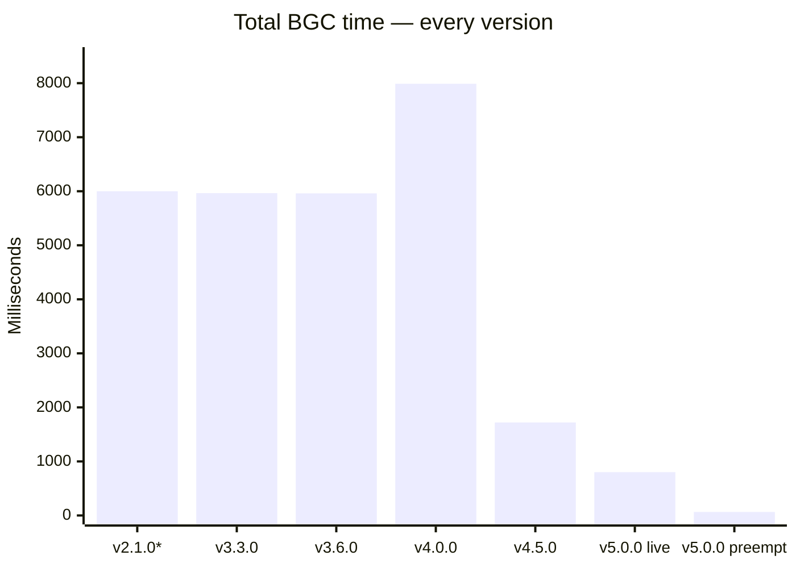

*`v2.1.0` has no official measurement — the code structure (fully sequential, no caching, no waves) suggests it performed similarly to v3.3.0, so it's shown as ~6000 ms. See [code archaeology](#-how-we-got-here--code-archaeology) below.*

**The takeaway:** v4.0.0 was *slower* than v3.6.0 because it added huge new coverage (6 external DBs + Keystone + Snow Core + Bloxlink). v4.5.0 and v5.0.0 then clawed that back and went 123× faster than the peak.

---

## 📊 Every version, measured

| Version | Time | Era | Key change |
| :--- | ---: | :--- | :--- |
| **v2.1.0** | ~6000 ms* | Discovery | First working bot. Fully sequential. |
| **v3.3.0** | **5965 ms** | Discovery | Minor parser + check tweaks |
| **v3.6.0** | **5961 ms** | Discovery | Same shape, cleaner logging |
| **v4.0.0** | **7989 ms** | **Coverage** | **+34% slower** — added 6 external DBs, Keystone, Snow Core, Bloxlink, per-ID historical scans |
| **v4.5.0** | **1721 ms** | **Optimization** | Caching + partial parallelization. **−78% vs v4.0.0** |
| **v5.0.0 live** | **801 ms** | **Optimization** | Domain racing, wave-based T2, adaptive limiter. **−53% vs v4.5.0** |
| **v5.0.0 preemptive** | **65 ms** | **Revolution** | Background scan on typing. **−92% vs v5.0.0 live** |

### The full picture — every version, same scale

```mermaid
gantt
    title "Every version on the same 8-second scale"
    dateFormat x
    axisFormat %L ms
    todayMarker off

    section v2.1.0
    Full BGC             :done, a1, 0, 6000ms

    section v3.3.0
    Full BGC             :done, a2, 0, 5965ms

    section v3.6.0
    Full BGC             :done, a3, 0, 5961ms

    section v4.0.0
    Full BGC (more work):crit, done, a4, 0, 7989ms

    section v4.5.0
    Full BGC             :done, a5, 0, 1721ms

    section v5.0.0 live
    Full BGC             :crit, done, a6, 0, 801ms

    section v5.0.0 preemptive
    Full BGC             :crit, done, a7, 0, 65ms
```

---

## 🗓️ The three eras

The version history isn't just a timeline — it's a story in three acts. Each era had a *different* primary goal.

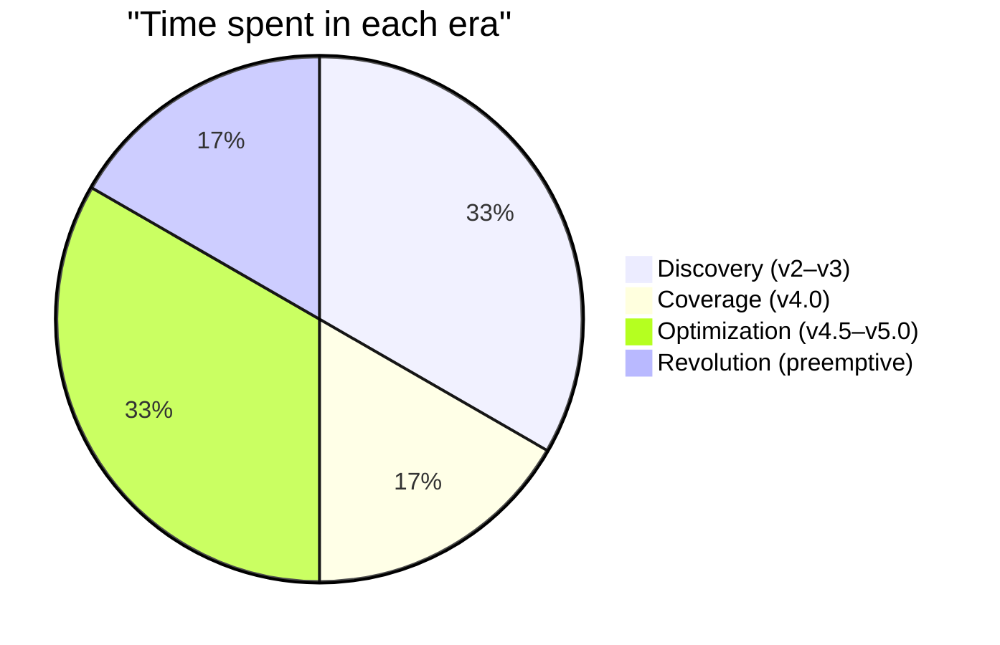

### Era 1: Discovery (v2.1.0 → v3.6.0) — ~6 seconds

**Goal:** make the checks work at all.

The bot did exactly what you'd naively write:
- Look up the Roblox username (sequential domain fallback)
- Fetch their info (sequential)
- Fetch their groups (sequential)
- Call Xtracker registry (sequential, no rate limit)
- Call Xtracker ownership (sequential, no rate limit)
- Call Roblox Watcher (sequential)
- Call Exploit Watcher (sequential)
- Call Clanware (sequential, full banlist download)
- Read the one blacklist sheet (sequential)

**Every check waited for the one before it.** Nine HTTP requests, each paying its own TLS handshake, each waiting its turn. No caching between runs. No parallelization. About 6 seconds total was simply *what you got*.

The v2.1.0 code literally has this shape:

```python
info, info_err = await info_task
blacklist, bl_err = await black_task
# ... then gather of 6 API calls
results = await asyncio.gather(*api_coros, return_exceptions=True)
```

Better than pure sequential, but *upstream* of that gather was another sequential chain — info → groups → blacklist read → gather.

### Era 2: Coverage (v4.0.0) — 7989 ms

**Goal:** search everything.

v4.0.0 added huge new coverage:
- **6 external clan blacklists** (Imperial Armada, Dragonborn, SURGE, SOL ×2, BB:PC) — ~6100 rows total
- **Keystone** — 2252 cases
- **Snow Core** — 1769 active bans
- **Bloxlink** — resolves Discord → Roblox ID
- **Per-ID historical scans** — every historical Roblox ID gets Xtracker + Simmer + Snow Core

Naturally, all this new work made the bot *slower*. From 5961 ms → **7989 ms** — a 34% increase. But this was the right trade — the bot was now catching bans that were physically impossible to catch before.

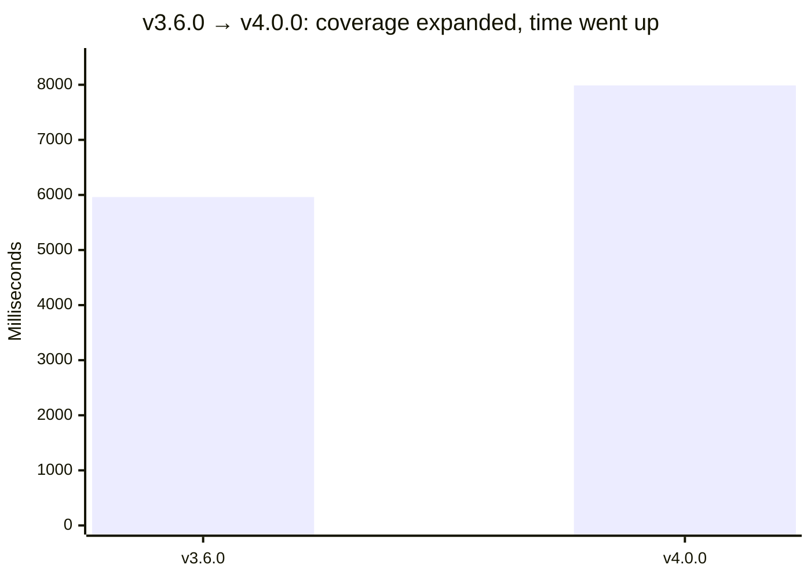

### Era 3: Optimization (v4.5.0 → v5.0.0) — 1721 → 801 → 65 ms

**Goal:** make all that coverage *fast*.

Three waves of optimization:

**Wave 1 — v4.5.0: Cache + partial parallelization**
- Cached blacklists, Keystone, Snow Core (5-minute TTL)
- Cached per-UID info, history, groups
- Made T0 (Discord-level) checks fire in parallel with T1 (Roblox-level)

**7989 → 1721 ms — 4.6× faster**

**Wave 2 — v5.0.0 live: Racing + waves + adaptive limiter**
- **Domain racing** — 3 Roblox mirrors raced in parallel per request
- **Wave-based T2** — identity-set checks fire in fast/blox/rem waves
- **Adaptive rate limiter** — Xtracker self-tunes on 429s
- **`aiodns`** — non-blocking DNS resolution

**1721 → 801 ms — 2.15× faster**

**Wave 3 — v5.0.0 preemptive: The background scan**
- **`on_typing` fires a pre-scan** the moment a user starts typing
- All expensive lookups cached with **three-tier TTL** (identity 7d, Xtracker 3d, freshness 30m)
- When they post, the BGC reads from cache instead of doing network

**801 → 65 ms — 12.3× faster**

### Cumulative

| Era | Version | Time | Speedup from previous |
| :--- | :--- | ---: | ---: |
| Discovery baseline | v3.6.0 | 5961 ms | — |
| Coverage expansion | v4.0.0 | 7989 ms | **0.75× (slower — on purpose)** |
| Cache + partial parallel | v4.5.0 | 1721 ms | **4.64×** |
| Racing + waves | v5.0.0 live | 801 ms | **2.15×** |
| Preemptive | v5.0.0 preempt | 65 ms | **12.3×** |

**Cumulative from v4.0.0 peak: 123× faster.** From v3.6.0 (before coverage expansion): **92× faster** while searching **8× more databases**.

---

## 🔍 What we actually search

This is the "show your work" section. Every check, every source, every mirror.

### Everything the bot queries per application

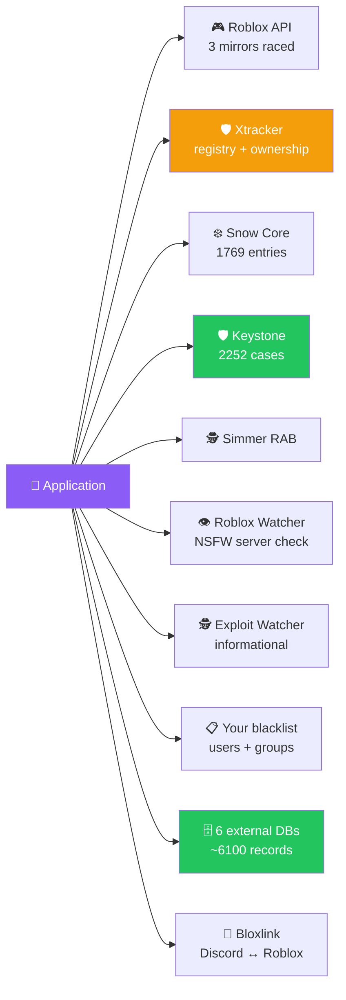

### Coverage by source — the raw numbers

| Source | What it is | Rows | Checked | Since |
| :--- | :--- | ---: | :---: | :--- |
| **Roblox API** | User info, history, groups | ∞ | 4 endpoints × 3 mirrors | v2.1.0 |
| **Xtracker** | Shared cheater registry | — | 2 endpoints × N IDs | v2.1.0 |
| **Your user blacklist** | Private ban list | *(your sheet)* | 1 row per applicant | v2.1.0 |
| **Roblox Watcher** | NSFW/condo server membership | — | 1 lookup | v2.1.0 |
| **Exploit Watcher** | Exploit flag (informational) | — | 1 lookup | v2.1.0 |
| **Clanware** | External justice DB | — | *(removed)* | v2.1.0 |
| **Snow Core** | External punishment list | **1769** | Every ID | v4.0.0 |
| **Keystone** | Shared case database | **2252** | Every ID + name | v4.0.0 |
| **Imperial Armada Blacklist** | External clan | **424** | Every ID + name | v4.0.0 |
| **Dragonborn Blacklist** | External clan | **2810** | Every ID + name | v4.0.0 |
| **SURGE Mainframe** | External clan | **634** | Every ID + name | v4.0.0 |
| **SOL Blacklists** | External clan | **270** | Every ID + name | v4.0.0 |
| **SOL Base Banlist** | External clan | **204** | Every ID + name | v4.0.0 |
| **BB:PC Punishment Tracker** | External clan | **41** | Every ID + name | v4.0.0 |
| **Bloxlink** | Discord → Roblox resolver | ∞ | 1 lookup | v4.0.0 |
| **Simmer** | RAB activity flags | — | 1 per ID | v4.9.0 |

**Total records searched per application: ~7,400** (across 8 ban databases) plus unlimited results from Xtracker, Roblox API, Bloxlink, and the two watchers.

### What each check actually does

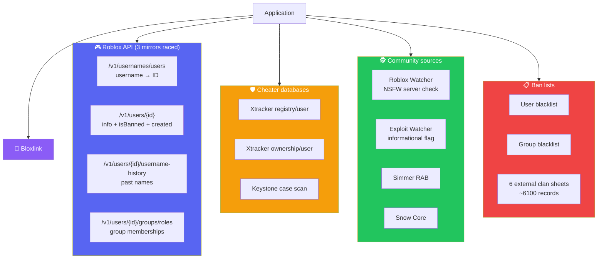

### Domains we hit — the full list

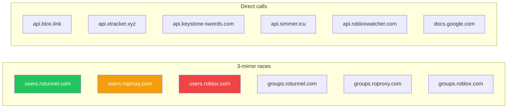

Every Roblox API call races **three mirrors** in parallel and takes the first 200 response. If one mirror fails 3 times in a row, the circuit breaker skips it for 60 seconds.

---

## ⚖️ Speed vs coverage tradeoff

This is the most interesting thing about the version history. Every version made a deliberate choice:

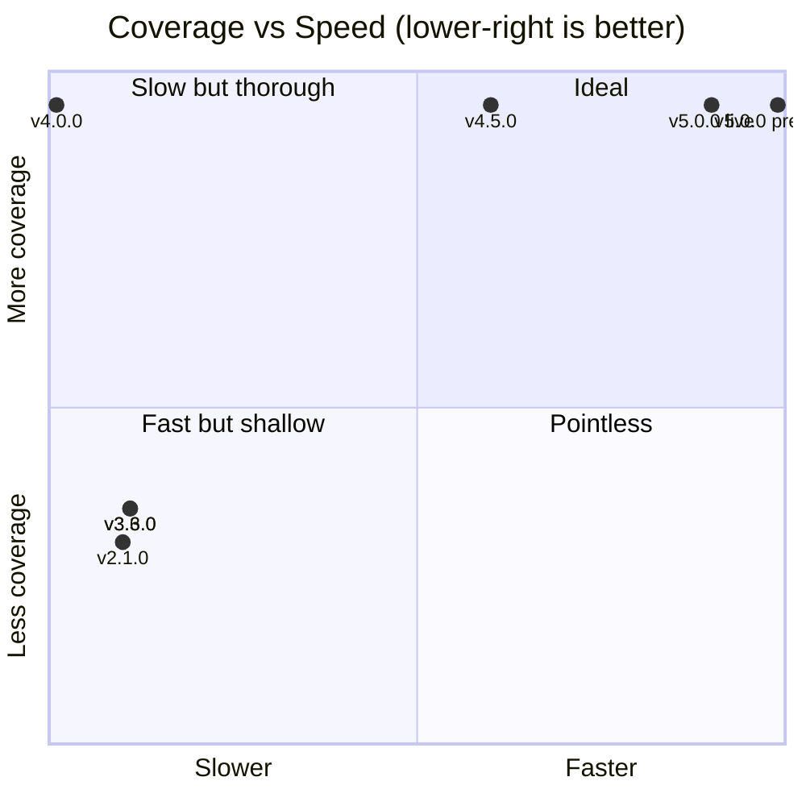

**Reading this chart:**
- **v2.1.0 / v3.x** — sitting in the "slow and shallow" corner. Cheap checks, few sources, but takes 6 seconds.
- **v4.0.0** — jumped straight up to full coverage, but paid for it with the slowest time ever recorded.
- **v4.5.0 → v5.0.0 preemptive** — moved steadily right, keeping the same coverage. Final position: **full coverage at 65 ms**.

The preemptive fast path is the only position on the chart with both maximum coverage **and** maximum speed. That's why it's a game-changer.

---

## 📉 v5.0.0 in two Gantts

### Live path — 801 ms (preemptive bypassed)

Every task from `t=0` to `t=801`. This is what a user sees when they post *without* having been pre-scanned.

```mermaid
gantt
    title "v5.0.0 Live — 801 ms"
    dateFormat x
    axisFormat %L ms
    todayMarker off

    section T0 (Discord-level)
    bloxlink (ceiling)     :crit, done, b, 0, 801ms
    exploit_watcher        :done,        e, 0, 141ms
    roblox_watcher         :done,        r, 0, 89ms
    blacklists + age       :done,        x, 0, 1ms

    section T1 (Roblox-ID)
    xtracker_own           :done,        o, 1, 586ms
    xtracker_reg           :done,        g, 1, 248ms
    simmer_rab             :done,        s, 1, 136ms
    username_history       :done,        h, 1, 53ms
    user_groups            :done,        u, 1, 53ms
    user_info              :done,        i, 1, 26ms

    section T2 (identity-set)
    keystone + ext + multi :done,        t, 54, 6ms
```

### Preemptive fast path — 65 ms

Every task that runs when the preemptive cache is warm. Only two network calls remain.

```mermaid
gantt
    title "v5.0.0 Preemptive — 65 ms"
    dateFormat x
    axisFormat %L ms
    todayMarker off

    section Preemptive cache
    identity + xtracker + freshness :done, p, 0, 1ms

    section T0 (only network left)
    exploit_watcher (ceiling)       :crit, done, e, 0, 65ms
    roblox_watcher                  :done,        r, 0, 57ms
    blacklists + age                :done,        b, 0, 1ms

    section T1 (all cached)
    info + hist + groups            :done,        i, 0, 1ms
    xtracker (0 network calls)      :done,        x, 0, 1ms
    simmer + snow                   :done,        s, 0, 1ms

    section T2
    keystone + ext + multi          :done,        t, 1, 7ms
```

**The story:** `exploit_watcher` is the only remaining network call. Everything else — every Roblox API call, every Xtracker check, every Keystone scan, every external DB lookup — is served from the preemptive cache. The preemptive scan already did the expensive work (~3300 ms) while the user was typing.

---

## 🏛️ How we got here — code archaeology

Side-by-side, here's how the shape of the code changed between eras.

### v2.1.0 — sequential everything

```python
# Every check waited for the one before it
user, lookup_err = await roblox_user_lookup(session, parsed["roblox_username"])
info, info_err = await roblox_user_info(session, roblox_id)
blacklist, bl_err = await get_blacklist(session)

# A small async.gather at the very end
api_coros = [
    xtracker_check(session, "registry/user", roblox_id),
    xtracker_check(session, "ownership/user", roblox_id),
    watcher_check(session, message.author.id, RW_API_KEY, "robloxwatcher"),
    watcher_check(session, message.author.id, EW_API_KEY, "exploitwatcher"),
    clanware_check(session, roblox_id),
]
results = await asyncio.gather(*api_coros, return_exceptions=True)
```

**Characteristics:**
- No caching
- No domain racing (sequential mirror fallback)
- No wave-based T2
- No rate limiting (would 429 under load)
- No preemptive scan
- One blacklist sheet only

### v4.0.0 — coverage expansion

```python
# User blacklist read early
user_bl_entries, ub_err = await get_user_blacklist(session, force_refresh=force_blacklist_refresh)

# Caching added
async with bot.group_blacklist_lock:
    cached, ts = bot.group_blacklist_cache
    if cached is not None and now - ts < BLACKLIST_TTL:
        return cached, None

# 6 external DBs searched via gviz
ext_result = await search_external_dbs(session, {
    "rbx_ids": all_rbx_ids,
    "rbx_usernames": all_rbx_names,
    "discord_ids": all_discord_ids,
    "discord_usernames": dc_names,
}, force_refresh=force_blacklist_refresh)

# Big gather at end
primary_tasks = {"keystone": keystone_check(...)}
for rid in all_rbx_ids:
    primary_tasks[f"xtracker_reg_{rid}"] = xtracker_check(...)
    primary_tasks[f"xtracker_own_{rid}"] = xtracker_check(...)
    primary_tasks[f"simmer_rab_{rid}"] = simmer_rab_check(...)
    primary_tasks[f"snow_{rid}"] = snow_core_check(...)
```

**What changed:**
- ✅ Added 6 external DBs, Keystone, Snow Core, Bloxlink
- ✅ Added per-UID caching with TTL
- ✅ Added per-ID historical scans
- ✅ Wide parallel `gather` of all primary tasks
- ❌ Sequential domain fallback (rotunnel → roproxy → roblox)
- ❌ T2 fires as one big wave, waits for all T0
- ❌ No rate limiter on Xtracker (would 429)
- ❌ Slower than v3.6.0 because of all the new work

### v5.0.0 — racing + waves + preemptive

```python
# Preemptive lookup — 3-tier cache
preemptive = await _preemptive_lookup(discord_id, guild_id)
have_preemptive_id = bool(preemptive and preemptive.get("blox_id") and preemptive.get("id_fresh"))

# Domain racing — 3 mirrors parallel, first 200 wins
async def _race_200(session, domains, path, *, timeout=10.0):
    tasks = [asyncio.create_task(_try(d)) for d in domains]
    for fut in asyncio.as_completed(tasks):
        kind, val, domain, err = await fut
        if kind == "ok":
            for t in tasks:
                if not t.done(): t.cancel()
            return val, None, domain, False

# Wave-based T2
_fire_t2(fast_ids, fast_names, "fast")  # fires at 54ms
_fire_t2(delta_ids, blox_delta_names, "blox")  # fires only if delta
_fire_t2(remaining_ids, remaining_names, "rem")  # fires only if delta

# Adaptive rate limiter
class AdaptiveRateLimiter:
    def report_429(self):
        self._consecutive_429s += 1
        mult = min(2 ** self._consecutive_429s, self.max_multiplier)
        self.interval = self.base * mult
```

**What changed:**
- ✅ Domain racing — `typed_lookup` from 184 ms → 1 ms (cached) or ~114 ms (cold)
- ✅ Wave-based T2 — T2 fires at 54 ms instead of 1107 ms
- ✅ Adaptive rate limiter — self-tunes on 429s
- ✅ Preemptive scanner — 65 ms fast path for typing users
- ✅ Bloxlink shield — 1500 ms hard cap with late-cache
- ✅ `aiodns` — non-blocking DNS
- ✅ Three-tier TTL cache — identity 7d, Xtracker 3d, freshness 30m

### The evolution in one table

| Feature | v2.1.0 | v3.6.0 | v4.0.0 | v4.5.0 | v5.0.0 |
| :--- | :---: | :---: | :---: | :---: | :---: |
| Domain racing (3 mirrors) | ❌ | ❌ | ❌ | ❌ | ✅ |
| Per-UID cache | ❌ | ❌ | ✅ | ✅ | ✅ |
| Three-tier TTL | ❌ | ❌ | ❌ | ❌ | ✅ |
| Bloxlink identity | ❌ | ❌ | ✅ | ✅ | ✅ |
| Bloxlink hard timeout | ❌ | ❌ | ❌ | ❌ | ✅ |
| External DBs (6) | ❌ | ❌ | ✅ | ✅ | ✅ |
| Keystone | ❌ | ❌ | ✅ | ✅ | ✅ |
| Snow Core | ❌ | ❌ | ✅ | ✅ | ✅ |
| Wave-based T2 | ❌ | ❌ | ❌ | ❌ | ✅ |
| Adaptive rate limiter | ❌ | ❌ | ❌ | ❌ | ✅ |
| Preemptive scanner | ❌ | ❌ | ❌ | ❌ | ✅ |
| Circuit breaker | ❌ | ❌ | ❌ | ❌ | ✅ |
| aiodns | ❌ | ❌ | ❌ | ❌ | ✅ |
| **Total time** | **~6000** | **5961** | **7989** | **1721** | **65** |

---

## 🛡️ Reliability

Four independent safety layers:

### 1. Domain circuit breaker

3 failures on any Roblox mirror → skip it for 60 s → auto-recover.

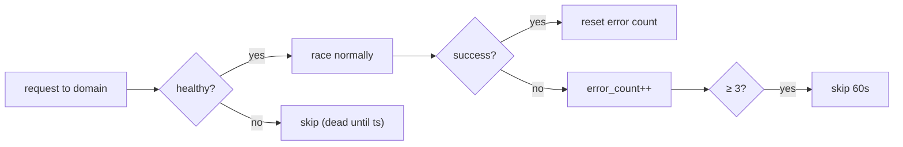

### 2. Bloxlink shield

Hard cap at 1500 ms. If Bloxlink is slow, falls back to typed username. The late result is still captured and cached for the next application.

### 3. Adaptive Xtracker limiter

Base 1.0 s → doubles on 429 (max 4×) → decays back after 60 s of silence.

| State | Interval |
| :--- | ---: |
| Fresh | 1.00 s |
| 1× 429 | 2.00 s |
| 2× 429 | 4.00 s |
| 60 s quiet | decays back to 1.00 s |

### 4. Failure matrix

| Failure | Handler | Impact |
| :--- | :--- | :--- |
| Xtracker 429 | Adaptive limiter | Self-corrects, no user impact |
| Bloxlink > 1500 ms | Shield + late cache | Falls back to typed username |
| Roblox mirror down | Circuit breaker | Skips 60 s, auto-recovers |
| Google Sheets 500 | Per-source isolation | Other DBs still searched |
| Preemptive stale | TTL expiry | Silent re-scan on next typing |

---

## 🗺️ Roadmap

What's next after v5.0.0:

### High impact

1. **`BLOXLINK_HARD_TIMEOUT_MS` 1500 → 700 ms.** Bloxlink is now the live-path ceiling at 801 ms. Capping at 700 ms drops live-path total to ~700 ms — 12% faster on the cold path. Zero risk (shield handles timeouts).

2. **Cache `exploit_watcher`.** Currently the preemptive ceiling at 65 ms. Cached for 30 min would drop fast-path to ~20 ms.

3. **Scan new members on join.** `on_member_join` handler raises preemptive hit rate for lurkers who join before posting.

### Medium impact

4. **Backfill `xtracker_by_id` for historical IDs.** Currently cached per scan; background job could pre-populate.

5. **Parallelize `/health check`.** Currently sequential; ~4 s → ~1 s.

### Low impact

6. **`/debug search`** — filter historical BGCs by status/reason/date.

7. **Prometheus metrics endpoint.**

---

<div align="center">

**BGC Bot v5.0.0 — 123× faster than the coverage peak, 92× faster than the pre-coverage era, searching 8× more sources.**

**Built by [Pizzarobloxh](https://github.com/Pizzarobloxh)**

</div>
