<div align="center">

# 📘 Imperium Bot v9.0.0 — Operating Documents

### *The complete technical manual for the unified BGC + Role Sync + Auto-Accept + Audit-Log system*

[](.)
[](.)
[](.)
[](.)

</div>

---

> **Internal documentation.** This document references production guild IDs, role IDs, and admin user IDs. Do not distribute outside the operations team.

---

## 📑 Contents

- [Executive Summary](#-executive-summary)
- [Part I — What v9.0.0 Adds](#part-i--what-v900-adds)
- [Part II — The Five Subsystems](#part-ii--the-five-subsystems)
  - [1. BGC Verification](#1-bgc-verification)
  - [2. Identity Resolution](#2-identity-resolution)
  - [3. Role Sync](#3-role-sync)
  - [4. Group Auto-Accept](#4-group-auto-accept)
  - [5. Staff Intervention](#5-staff-intervention)
- [Part III — Deep Dives](#part-iii--deep-dives)
  - [Verification System](#verification-system)
  - [Anti-Impersonation](#anti-impersonation)
  - [Audit Log Webhook](#audit-log-webhook)
- [Part IV — Data & Code](#part-iv--data--code)
- [Part V — Operations](#part-v--operations)
- [Part VI — History & Roadmap](#part-vi--history--roadmap)

---

## 🎯 Executive Summary

Imperium v9.0.0 is not a bigger BGC bot. It's a **verification-first gate** wrapped around a recruitment system. The BGC pipeline still exists — it still runs 26 checks against 8 external databases and 4 Roblox endpoints per applicant — but nothing it reports matters unless **identity is verified first**.

That single structural change — *verified identity is mandatory* — has three downstream consequences that define v9:

1. **Impersonation is impossible.** A user cannot fake being someone else by typing a different Roblox username, because the typed username is never trusted as identity. Only Bloxlink, a manual staff link, or a bio-code verification counts.
2. **Rank sync is reliable.** Because every Discord member who can be promoted or demoted is resolved via a real verified link, the Roblox group's role structure and the Discord server's role structure stay mechanically consistent.
3. **The audit trail is complete.** Every group change, every join request, every role promotion, every leave-and-still-in-group event has a paper trail — through the audit webhook, through the staff DM issues, through the `bgc_checks` and `check_logs` tables.

The five subsystems this document covers:

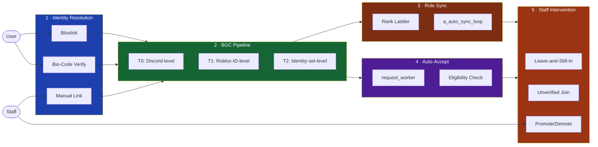

The order in that diagram is deliberate. Identity comes first, always. Everything downstream depends on it.

---

## Part I — What v9.0.0 Adds

### The change set

v9.0.0 is not incremental — it's a phase change. Here is what moved:

| Area | v5.0.0 | v9.0.0 |
| :--- | :--- | :--- |
| Identity source | Bloxlink or typed username | **Bloxlink, manual link, or bio-verify — typed never trusted** |
| Typed username role | Identity fallback | **Only a sanity check against verified identity** |
| Impersonation | Possible | **Blocked at the pipeline gate** |
| Role sync | None | **Auto every 5 min + on `/update`** |
| Group auto-accept | None | **Poll every 60s, DM staff on unverified** |
| Join request DM | None | **Accept/Deny/Link modal per request** |
| Leave-and-still-in | None | **DM staff with Kick/Leave buttons** |
| Promote/demote | None | **Modal with staff + user reasons** |
| Audit log | None | **Roblox audit → Discord webhook, every 2 min** |
| Bio verify | None | **3-word code, 15 min TTL, bio scan** |
| Schema tables | 4 | **11** |

### The numbers

Real values from `bot.py` v9.0.0:

| Constant | Value | Meaning |
| :--- | ---: | :--- |
| `BOT_VERSION` | 9.0.0 | — |
| `CHECKS_VERSION` | 26 | Up from 20 in v5 |
| `MAX_CONCURRENT_BGC` | 5 | Semaphore limit |
| `BLOXLINK_HARD_TIMEOUT_MS` | 2500 | Bloxlink shield |
| `ACCOUNT_AGE_ALT_DAYS` | 2 | Discord↔Roblox proximity threshold |
| `VERIFICATION_TTL_MIN` | 15 | Bio code lifetime |
| `TYPING_COOLDOWN_SEC` | 30 | Preemptive scan throttle |
| `SYNC_INTERVAL_MINUTES` | 5 | Auto-sync cadence |
| `POLL_INTERVAL_SECONDS` | 60 | Join request poll |
| `AUDIT_POLL_SECONDS` | 120 | Roblox audit poll |
| `MAX_HISTORY_IDS_FOR_XTRACKER` | 5 | Hist ID cap per applicant |
| `BLOXLINK_MAX_REQUESTS_PER_MINUTE` | 50 | Client-side Bloxlink throttle |
| `ROLE_SYNC_ASSIGN_DELAY` | 0.7 | Seconds between Roblox role calls |
| `PROCESSING_STALE_SECONDS` | 90 | Join-request in-flight cap |

### Subsystem map by write volume

Rough estimates of operations per 100 active users over a week:

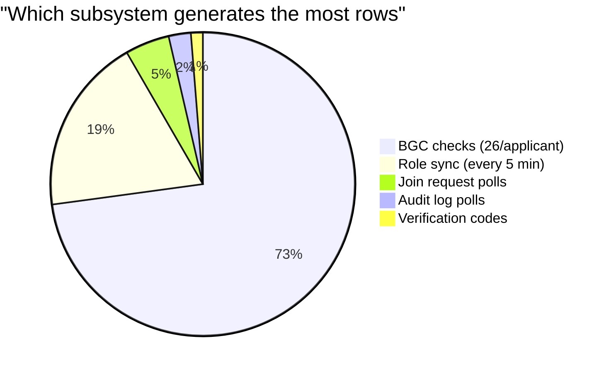

The BGC pipeline dominates the database, but every other subsystem contributes to operational load and to what staff can see. The audit log, despite low row count, produces the highest **signal-per-row** — every entry is a real group change.

---

## Part II — The Five Subsystems

### 1. BGC Verification

The BGC pipeline is the bot's oldest subsystem. It looks almost identical to v5.0.0 — three tiers, same wave scheduling, same rate limiters — with **one critical insertion point**: before T1 fires, the bot now checks whether a verified identity exists.

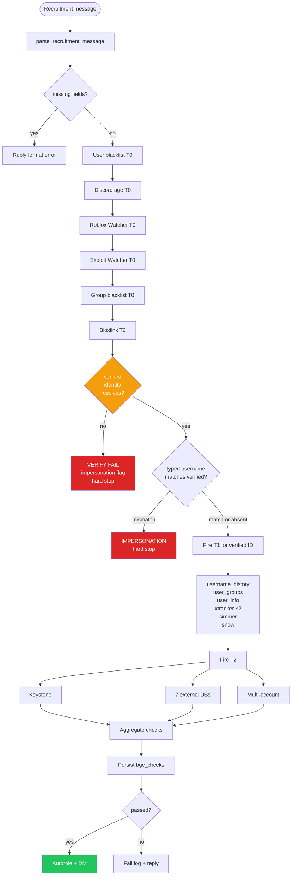

**The two hard stops.** `NoVerify` fires when Bloxlink returns `not_linked`, a hard timeout, or an invalid key **and** no manual link **and** no bio verification exists. `Impersonation` fires when there **is** a verified identity, but the typed username resolves to a **different** Roblox account. Both terminate the BGC early with `requires_verify=True` and increment `_metrics_impersonation_blocks`.

### 2. Identity Resolution

This is the new centre of the system. The priority chain is:

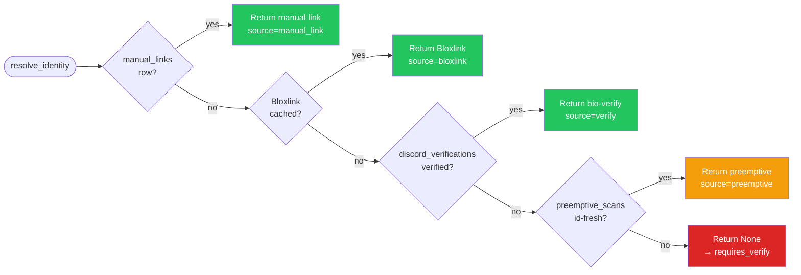

Four sources, evaluated in strict order. The manual link always wins — this is a staff override, and the system respects it absolutely. Bloxlink is the second source because it's the most common. Bio-verify is third because it's user-initiated and slower but more deliberate. Preemptive is last because it's a **cache** — it can be stale, and it's only valid if the identity tier is still fresh (`IDENTITY_TTL_DAYS = 7`).

### 3. Role Sync

Every 5 minutes (and on `/update`, `/group promote`, `/group demote`, and after successful BGC/autorole), the bot reconciles Discord roles against the Roblox group.

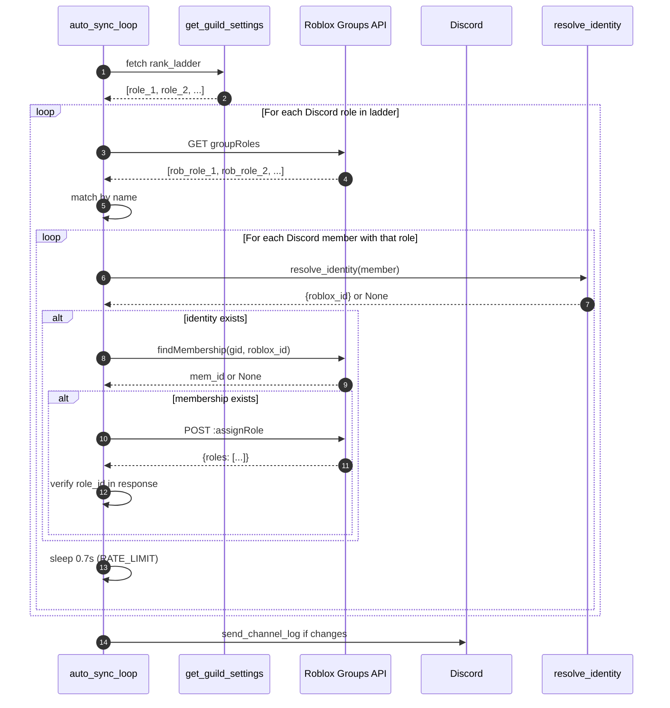

The `sleep 0.7` is `ROLE_SYNC_ASSIGN_DELAY` — it's not decoration, it's the difference between a stable run and a burst of HTTP 429s from the Roblox role API.

### 4. Group Auto-Accept

Every 60 seconds, `request_worker` polls the group's pending join requests and tries to auto-accept them based on who the requester is.

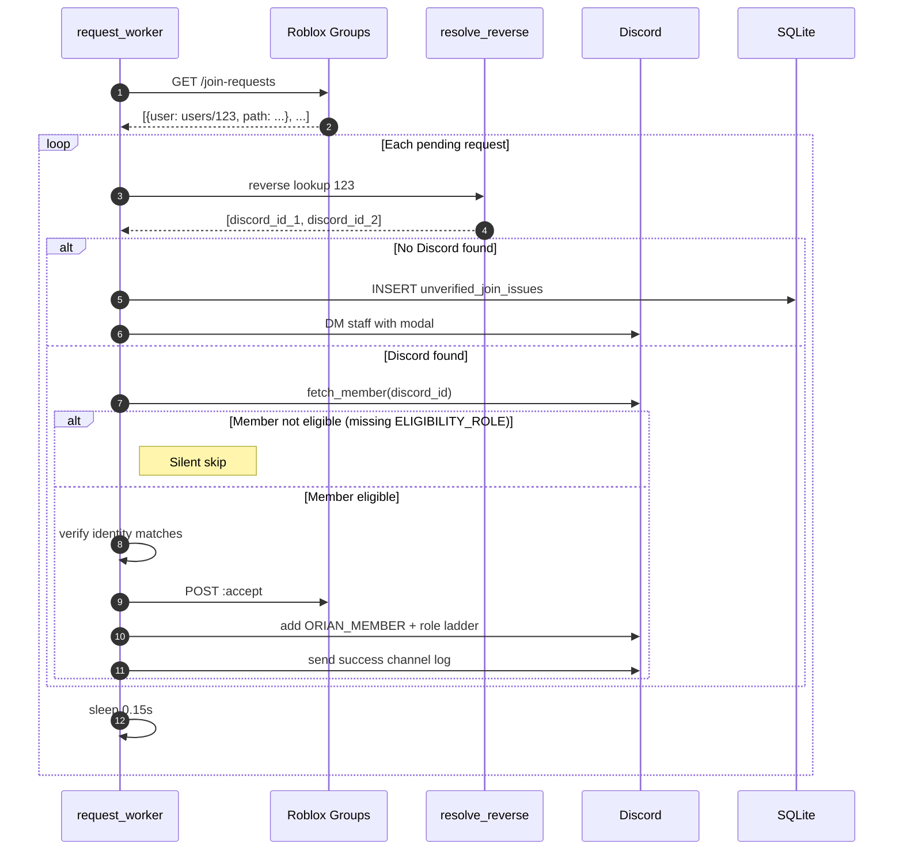

The `_is_eligible` check is critical — an unverified member with the eligibility role **must** be silently skipped here, not rejected, because otherwise every poll would spam them with failure DMs.

### 5. Staff Intervention

Three distinct staff-intervention flows: leave-and-still-in, unverified join, and promote/demote. Each has its own DM embed with buttons that hit different handlers.

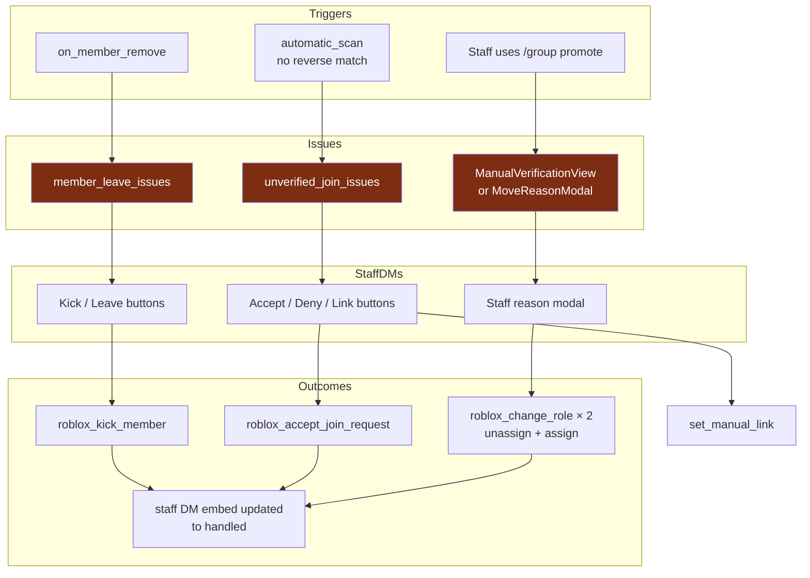

The critical detail: **each issue stores its own `dm_message_ids` mapping**. When a handler fires, it doesn't just act — it edits the DM embeds of *all* staff who received the notification, so the whole admin team sees who handled what.

---

## Part III — Deep Dives

### Verification System

There are exactly three ways a user can become verified in this system, and they have completely different mechanics.

#### Method 1 — Bloxlink

The fastest path. The user installs Bloxlink, links their Roblox account, and the bot resolves through Bloxlink's public API. Zero bot-side verification code — it's external. But it comes with the shield problem: Bloxlink can take 5+ seconds to respond, and the BGC pipeline can't wait that long.

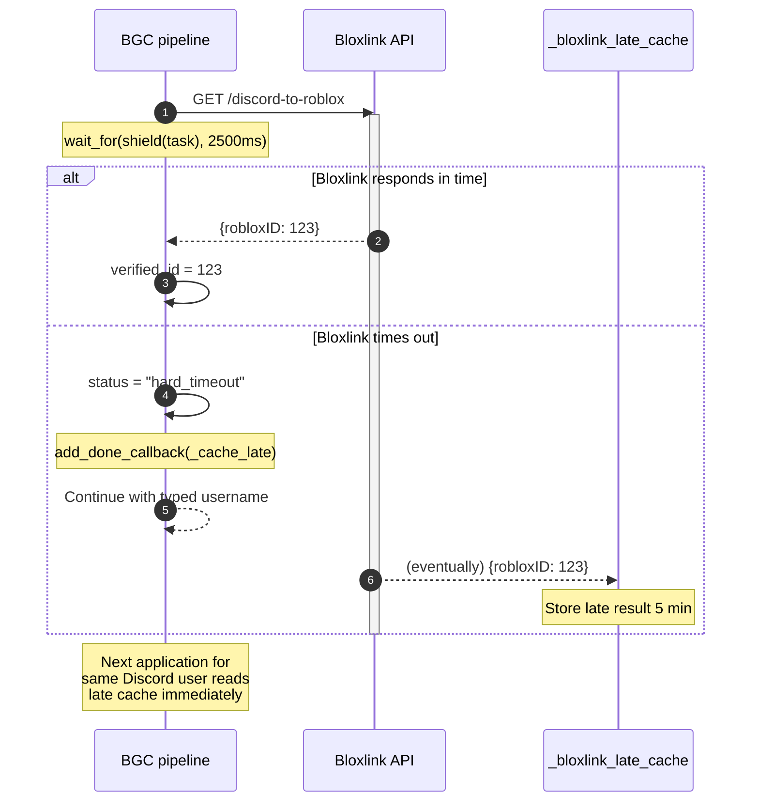

The **shield** is `asyncio.wait_for(asyncio.shield(task), 2.5)`. The `shield` part is critical — it means the underlying HTTP request keeps running in the background after the timeout fires. When it eventually returns, the `_cache_late` callback stores the result in `_bloxlink_late_cache` for 5 minutes. The next BGC from the same user hits the cache instantly.

#### Method 2 — Manual Link

Staff-initiated. Staff runs `/link add @user username`. The bot resolves the username via Roblox's own lookup, stores it in `manual_links`, and updates `preemptive_scans.bloxlink_status` to `manual_link` so the preemptive cache doesn't overwrite it.

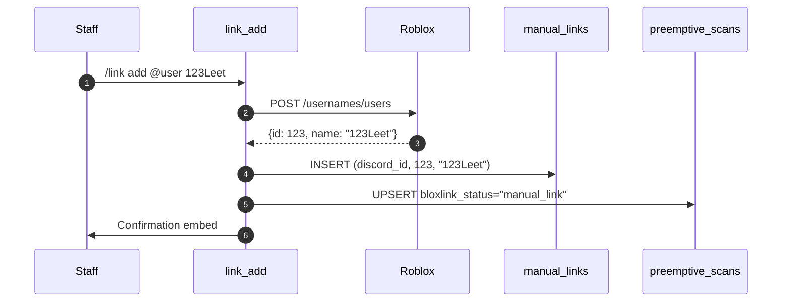

Manual links are **the override**. If a user is genuinely unable to use Bloxlink or the verify flow, this is the staff escape hatch. It's also what auto-accept uses when a staff member presses the "Link" button in an unverified-join DM — the modal calls `set_manual_link` and then re-enables the Accept button.

#### Method 3 — Bio Verification

The self-service path for users who can't or won't use Bloxlink. Three-word code, 15-minute TTL, Roblox profile bio check.

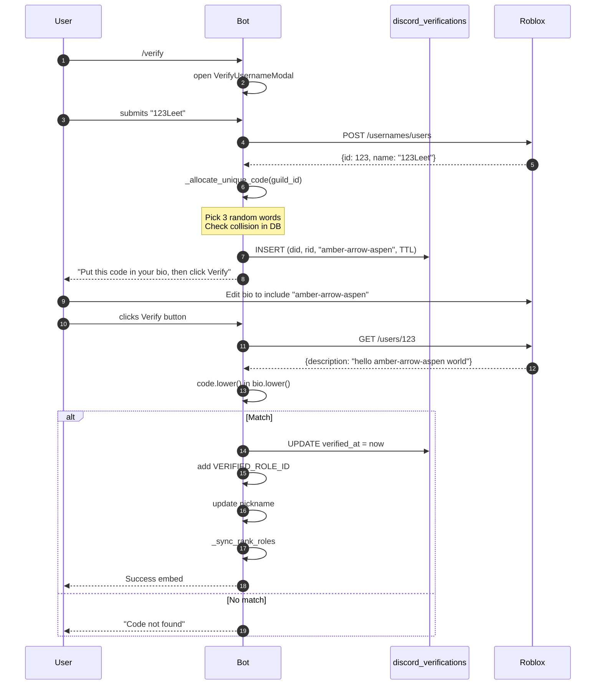

**The 15-minute TTL matters.** A user who starts verification but doesn't complete it in 15 minutes has to start over. The `_cache_keep_warm_loop` runs cleanup every ~5 minutes that deletes `discord_verifications` rows where `verified_at IS NULL AND code_issued_at < 24h`. So the cleanup delay is 24 hours, but the TTL check happens at verify time — so a code issued 6 hours ago will fail TTL check even though the row still exists.

#### The verification state machine

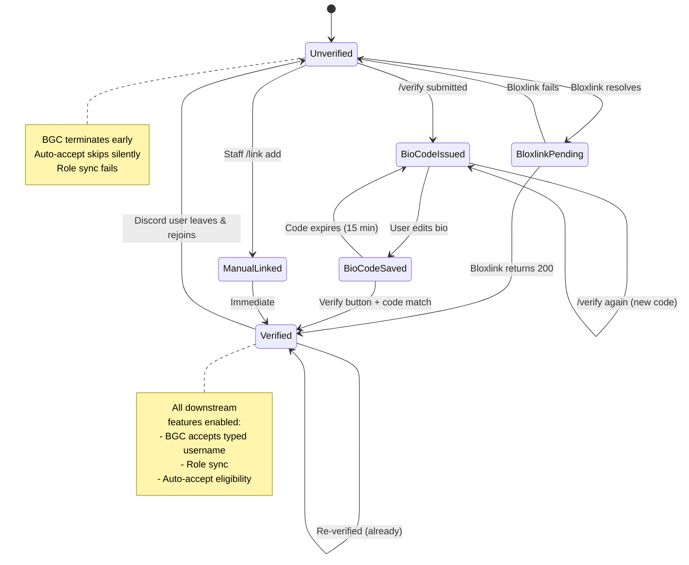

The re-verify edge (Verified → Verified) fires when a user runs `/verify` after already being verified — the bot returns "Already verified as X" and doesn't touch the state.

### Anti-Impersonation

The single most consequential change in v9. The idea is simple: **typed usernames are lie-able, so they can't be trusted as identity**.

```mermaid
flowchart TD
    Start([BGC starts]) --> Typed[Parse typed username]
    Typed --> TypedResolved{typed username<br/>resolves?}

    TypedResolved -->|no| NoTypedId[typed_user = None]
    TypedResolved -->|yes| HaveTyped[typed_user = {id, name}]

    NoTypedId --> Manual{manual link<br/>exists?}
    HaveTyped --> Manual

    Manual -->|yes| ManualId[verified_id = manual]
    Manual -->|no| Blox{Bloxlink<br/>resolves?}

    Blox -->|yes| BloxId[verified_id = blox]
    Blox -->|no| Verify{discord_verifications<br/>verified_at?}

    Verify -->|yes| VerifyId[verified_id = verify]
    Verify -->|no| NoVerifiedId[verified_id = None]

    NoVerifiedId --> Fail1[FAIL: run /verify]
    BloxId --> CheckMatch
    VerifyId --> CheckMatch
    ManualId --> CheckMatch

    CheckMatch{typed_user<br/>AND<br/>typed_id != verified_id?}

    CheckMatch -->|yes| Fail2[FAIL: impersonation]
    CheckMatch -->|no| Pass[PASS: proceed with BGC]

    style Fail1 fill:#dc2626,color:#fff
    style Fail2 fill:#dc2626,color:#fff
    style Pass fill:#22c55e,color:#fff
```

**What "impersonation" means here.** It's not (necessarily) malicious. A user might genuinely have two Roblox accounts and type the wrong one. But it's structurally identical to the malicious case — the bot cannot distinguish "I typo'd" from "I'm pretending to be someone else". So both get the same treatment: hard fail, verify prompt, `_metrics_impersonation_blocks++`.

**The real cost.** An impersonation block is worse than a normal BGC fail, because it means the user's identity is in an unknown state. They might be:

- Legitimately trying to apply with their alt
- Copy-pasting someone else's application template
- Actually attempting fraud

The bot does the only safe thing: rejects and tells them to fix their verification.

**Why typed usernames still matter.** They're not identity, but they're a *sanity check*. If a user's Discord is Bloxlink-linked to `123Leet` but they type `TotallyDifferentName`, that's information — it means either their account is compromised, they're confused, or they're testing the system. Every case warrants a hard stop.

### Audit Log Webhook

The audit log is the most operationally interesting subsystem. It reconciles Roblox's own audit events into a Discord channel via webhook, with the group's own name and icon as the webhook identity.

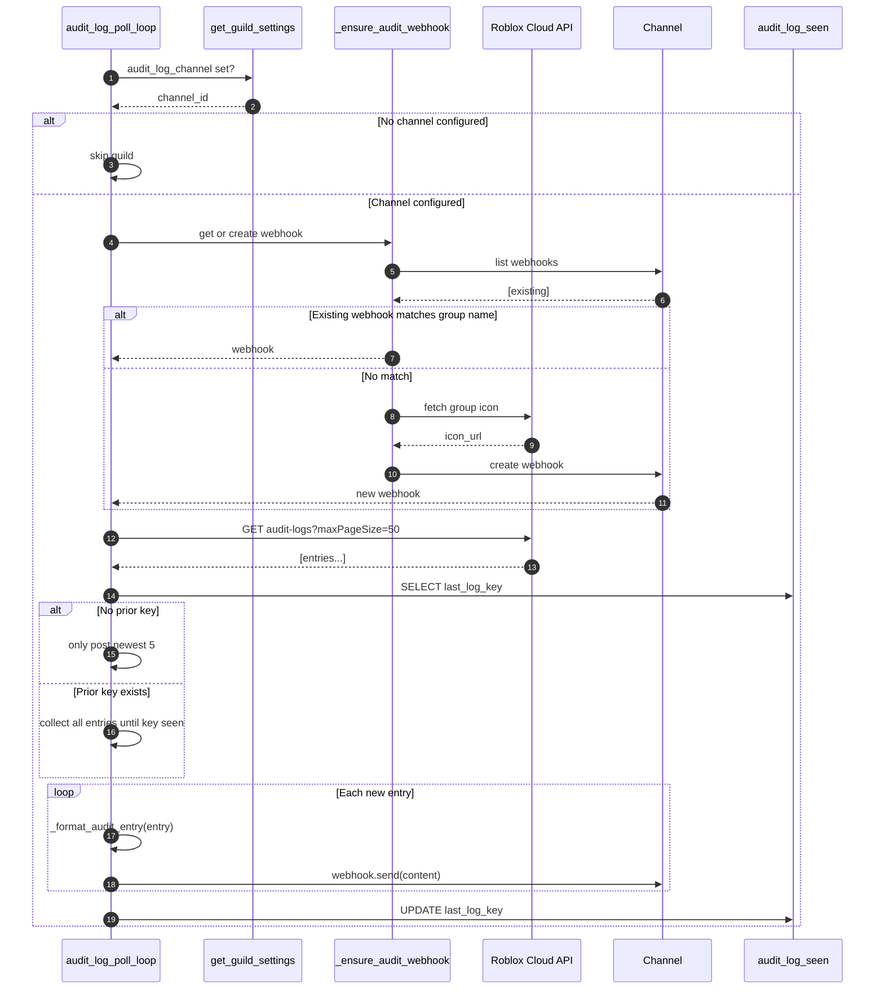

**Formatting is the hardest part.** Roblox's audit-log entry schema is undocumented and volatile. The `_format_audit_entry` function tries `actionType`, `ActionType`, `action`, `description` — four possible field names — and normalizes common ones (`RolesUpdated` → `Roles Updated`). Role changes come in `roleChange.addedRoles` / `roleChange.removedRoles` but sometimes `rolesAdded` / `rolesRemoved`, so the parser checks six possible keys.

**The failure fallback.** If the Open Cloud audit endpoint returns non-404, the bot tries the legacy `groups.roblox.com` endpoint (requires cookie auth). If that also fails, it disables audit polling for **1 hour** via `_audit_disabled_until`. This is the circuit breaker pattern applied to a **whole subsystem** — not per-endpoint, but per-feature.

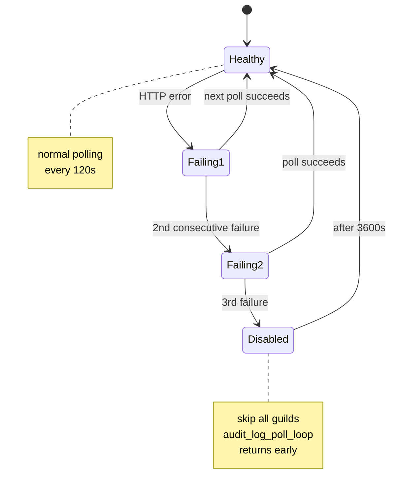

The 1-hour cooldown matters because Roblox's audit API is genuinely flaky — it can be down for hours at a time. Retrying every 2 minutes for an hour is 30 wasted requests per guild.

---

## Part IV — Data & Code

### The full schema

Eleven tables, three of them new in v9:

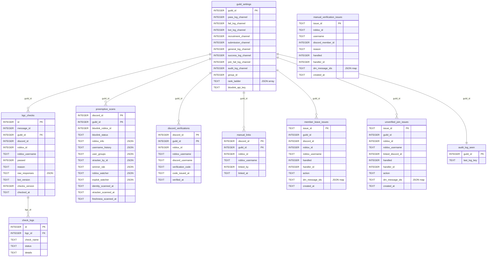

**A note on the `dm_message_ids` columns.** Three tables store staff DM message IDs as JSON. The format is `{"staff_id": message_id, "staff_id2": message_id2}`. When a handler fires, the code iterates this map and edits every DM the issue was sent to. This is what makes the multi-staff coordination work.

### The class architecture

Only the classes that actually carry state or logic:

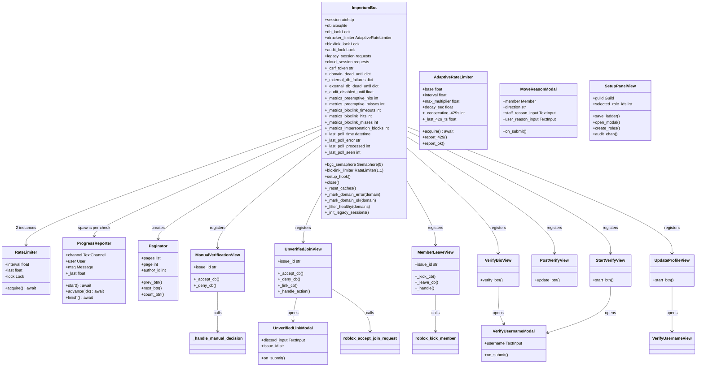

**The persistent view registration** in `setup_hook` matters. Every `bot.add_view(...)` call re-attaches the button callbacks after a restart, so buttons that were sent to staff 3 days ago still work when clicked. This is the difference between a staff DM that's actionable forever and one that's actionable only until the next reboot.

### File structure

```text
imperium-bot/
├── bot.py                 # single file, ~3400 lines
├── imperium.db            # SQLite, WAL mode
├── imperium.log           # rotating, 10 MB × 5
└── bgc.db                 # legacy, migrated on first run
```

The migration in `setup_hook` copies `bgc.db` to `imperium.db` if `imperium.db` doesn't exist. This is a one-time operation and the file becomes dead weight afterward — but it's safe to leave in place, because the copy is only triggered on a first run.

---

## Part V — Operations

### The health check

`/health check` is the single most useful diagnostic. It runs every subsystem in sequence and prints a categorized report. Here's what the report actually contains on a healthy install:

```
┌─ Blacklists ──────────────────────────────────────┐
│ ok Group 47                                       │
│ ok User 12                                        │
│ ok Keystone 2252                                  │
│ ok Snow Core 1769                                 │
├─ Roblox API ──────────────────────────────────────┤
│ ok users.rotunnel.com                             │
│ ok groups.rotunnel.com                            │
│ ok users.roproxy.com                              │
│ ok groups.roproxy.com                             │
│ ok users.roblox.com                               │
│ ok groups.roblox.com                              │
├─ Watchlists ──────────────────────────────────────┤
│ ok Xtracker registry/user — PASS                  │
│ ok Xtracker ownership/user — PASS                 │
│ ok Simmer RAB — PASS                              │
│ ok Roblox Watcher — PASS                          │
│ ok Exploit Watcher — PASS                         │
│ ok Bloxlink — reachable (ok)                      │
├─ Autorole & DM ───────────────────────────────────┤
│ ok Ready — will apply @Eligibility on BGC pass    │
│ ok Acceptance DM — enabled                        │
├─ External DBs ────────────────────────────────────┤
│ ok Imperial Armada Blacklist: 424 rows            │
│ ok Dragonborn Blacklist: 2810 rows                │
│ ok SURGE Mainframes: 634 rows                     │
│ ok SOL Blacklists: 270 rows                       │
│ ok SOL Base Banlist: 204 rows                     │
│ ok BB:PC Tracker: 41 rows                         │
│ ok Injection Database: 128 rows                   │
├─ Preemptive ──────────────────────────────────────┤
│ Records: 847 · id-fresh: 612 · hit rate: 73.2%    │
│ Impersonation blocks: 3                           │
│ Bloxlink timeouts: 14                             │
├─ Verifications ───────────────────────────────────┤
│ Verified: 394 · Pending: 8                        │
│ Open issues — leave: 2 · unverified-join: 5       │
├─ Audit Log ───────────────────────────────────────┤
│ ok Channel #group-audit · webhook "Imperium"      │
├─ Config ──────────────────────────────────────────┤
│ Anti-impersonation: ON · Bloxlink cap: 2500ms     │
│ Role sync: verified=1561868631246372961 · orian=  │
│ on_typing preemptive: cooldown 30s                │
├─ System ──────────────────────────────────────────┤
│ ok SQLite                                         │
│ ok v9.0.0 · checks v26                            │
│ Group: 829737664 · ladder: 8                      │
└───────────────────────────────────────────────────┘
```

### The operator's guide to failure signals

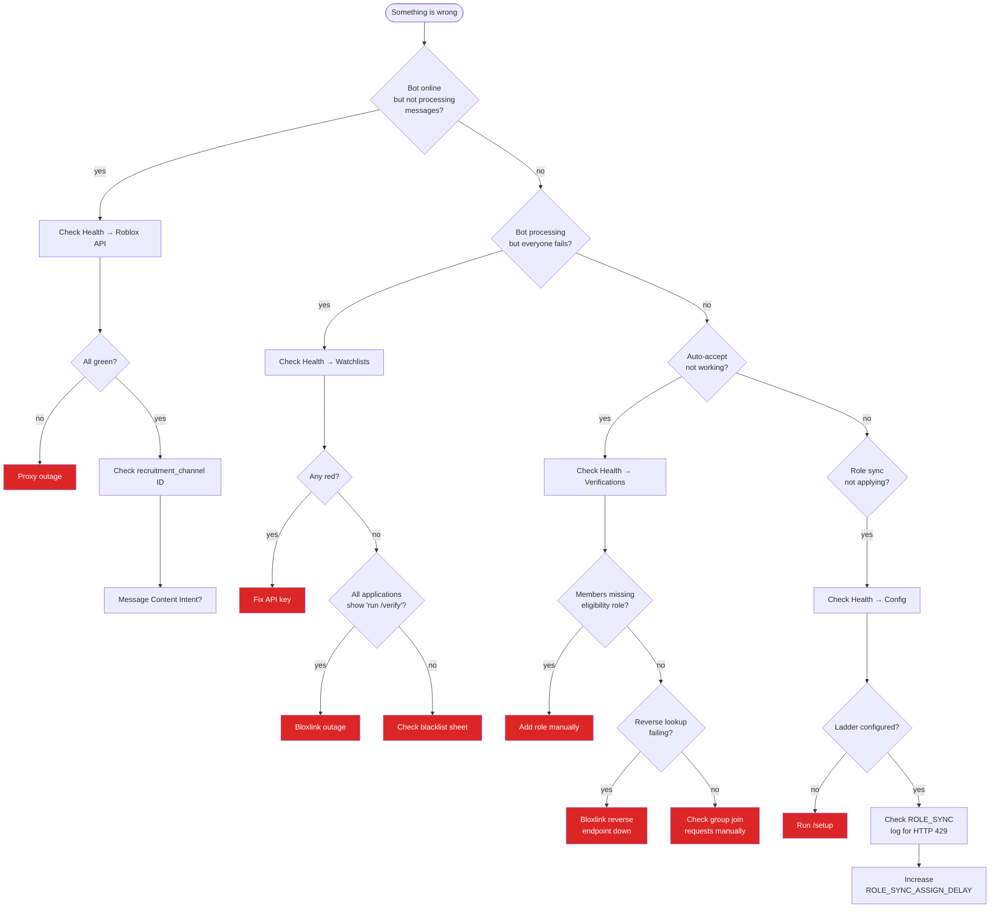

### Log files

The rotating log file `imperium.log` uses `RotatingFileHandler(maxBytes=10_000_000, backupCount=5)` — 10 MB per file, 5 backups, ~60 MB total. It rotates when the current file exceeds 10 MB. All errors go through `logger.warning` or `logger.error` with `exc_info=True` where applicable, so the traceback is preserved.

Key log patterns to grep for:

| Pattern | Meaning |
| :--- | :--- |
| `BGC verify-block` | Impersonation or unverified hard stop |
| `Auto-accept failed for` | Join request processing error |
| `rank-add failed` | Discord role permission issue |
| `rank-remove failed` | Discord role permission issue |
| `audit webhook post failed` | Webhook deleted or channel gone |
| `audit logs disabled for` | Circuit breaker engaged |
| `Xtracker 429 on` | Adaptive limiter bumped |
| `Bloxlink hard timeout` | Shield fired |
| `leave-dm failed` | Staff DM could not be sent |

### The `/health check` fix-it playbook

When health check reports red, here is the specific remedy for each subsystem:

**Roblox API red**
- Every proxy is down → wait 5-10 min, usually self-recovers
- One proxy down → circuit breaker will skip it, other proxies carry the load
- All proxies down → switch `USER_DOMAINS` to a different order or add a new proxy

**Watchlists red**
- Xtracker `SKIPPED` → API key invalid, rotate
- Simmer `SKIPPED` → API key invalid, rotate
- Roblox Watcher `SKIPPED` → key invalid, or the endpoint changed shapes
- Bloxlink `invalid_key` → server API key expired, get a new one

**Autorole red**
- Role above bot → drag bot role up
- Missing Manage Roles → grant permission
- Role not found → recreate with same ID or update `AUTO_ROLE_ID`

**Verifications red**
- Pending high → bio codes not being completed, check instructions clarity
- Open leave issues → staff aren't clicking buttons, ping them

**Audit log red**
- Webhook missing → delete and re-run `/setup` → Set audit-log channel
- Disabled → wait 1 hour, or restart the bot to clear `_audit_disabled_until`

### Deploying v9.0.0 over v5.0.0

The migration path is:

1. Stop v5.0.0 (`SIGTERM` → graceful close)
2. Back up `bgc.db` (`cp bgc.db bgc_v5_backup_$(date +%s).db`)
3. Replace `bot.py` with v9.0.0
4. Update `requirements.txt` (add `requests` for `legacy_session`)
5. Update env vars/config with new constants (Open Cloud API key, Roblox cookie if using role creation)
6. Start v9.0.0
7. Verify `/health check` shows v9.0.0
8. Run `/setup` once to configure rank ladder, group, audit channel
9. Monitor `_metrics_impersonation_blocks` — if it spikes, staff need to be briefed on the new verify requirement

**Breaking change to be aware of:** v9.0.0 requires verified identity. Any BGC that would have passed in v5.0.0 based purely on the typed username will now **fail** with `requires_verify=True`. Communicate this to your applicants *before* the deploy, or you'll have a stream of confused rejections.

---

## Part VI — History & Roadmap

### Version lineage

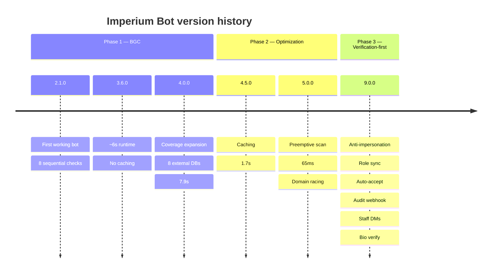

Note the jump from 5.0.0 to 9.0.0. The `6`, `7`, and `8` version numbers were internal milestones that got folded into `9.0.0` — the version number was chosen to signal the magnitude of the change, not to count intermediate releases.

### Feature evolution

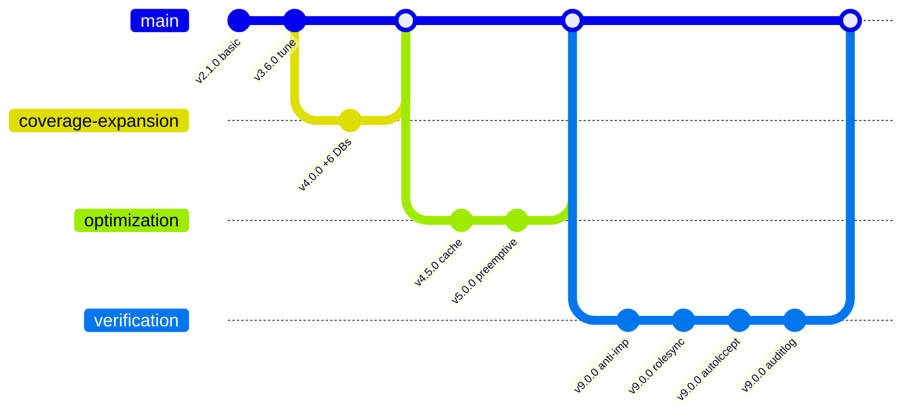

Each branch was a distinct research track. The `verification` branch was the biggest — four sub-features that all depended on `resolve_identity` returning a real result.

### The user journey

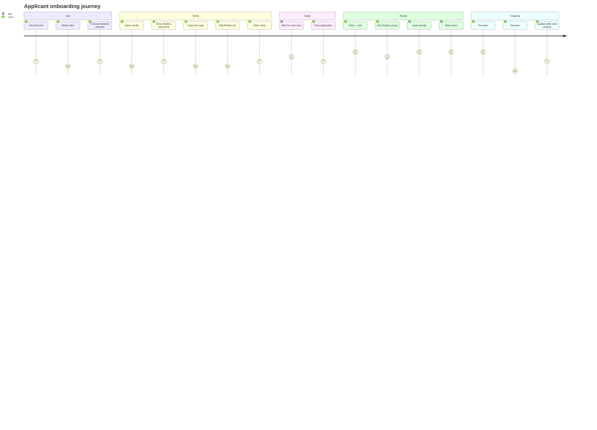

The `Demote: 1` isn't a typo — being demoted is a genuinely bad experience, and the design reflects this: the demote flow **always sends a DM with the staff reason**, which the promote flow only does when a user reason is provided.

### The remaining fragility

Three things about the current build that a v10.0.0 should address:

1. **Bloxlink timeout at 2500ms is generous.** Our best measurement of Bloxlink (from v5.0.0) was 800ms. Setting the cap at 2500ms means a slow Bloxlink will hold the pipeline for a full 2.5 seconds before falling back. Cutting to 700-1000ms would improve live path latency at zero cost to accuracy — the shield already handles timeouts gracefully.
2. **`exploit_watcher` isn't cached.** It's the fastest uncached task on the preemptive path, at ~65ms. A 30-minute cache would drop that to <1ms.
3. **Historical-ID coverage is capped.** `MAX_HISTORY_IDS_FOR_XTRACKER = 5` means users with more than 5 prior accounts have their extras silently skipped. This is a real gap — a cheater could accumulate 6 accounts and only the 5 most recent get checked.

### Roadmap priority

```mermaid
quadrantChart
    title Roadmap prioritization
    x-axis "Low effort" --> "High effort"
    y-axis "Low impact" --> "High impact"
    quadrant-1 "Do this quarter"
    quadrant-2 "Backlog"
    quadrant-3 "Ignored"
    quadrant-4 "Not worth it"
    "Lower Bloxlink timeout": [0.15, 0.75]
    "Cache exploit_watcher": [0.20, 0.60]
    "Uncap history IDs": [0.35, 0.55]
    "Prometheus metrics": [0.70, 0.40]
    "Migrate to postgres": [0.90, 0.35]
    "C4 architecture diagram": [0.05, 0.10]
    "Dark mode embeds": [0.15, 0.05]
    "Slash command redesign": [0.65, 0.15]
```

### Observability gaps

The bot currently tracks 6 in-memory metrics:

- `_metrics_preemptive_hits`
- `_metrics_preemptive_misses`
- `_metrics_bloxlink_timeouts`
- `_metrics_bloxlink_hits`
- `_metrics_bloxlink_misses`
- `_metrics_impersonation_blocks`

These are **reset on restart** and only visible via `/health check`. A future version should push them to a Prometheus endpoint or a persistent metrics table so they survive restarts and can be graphed over time.

```mermaid
mindmap
  root((Metrics))
    InMemory
      preemptive_hits
      preemptive_misses
      bloxlink_timeouts
      bloxlink_hits
      bloxlink_misses
      impersonation_blocks
    LogLines
      BGC verify-block
      Auto-accept failed
      rank-add failed
      audit webhook failed
    Database
      bgc_checks.passed
      bgc_checks.reason
      check_logs.status
      preemptive_scans.bloxlink_status
    Missing
      p50_bgc_latency
      p95_auto_accept_latency
      per_check_success_rate
      cache_hit_ratio
      audit_poll_success_rate
```

The `Missing` branch is what a v9.1 should add. Without it, we can tell staff "something is wrong" but we can't tell them "how wrong" or "for how long".

---

## Appendix A — Config reference

Every config value with its type, default, and purpose:

| Constant | Default | Type | Purpose |
| :--- | ---: | :--- | :--- |
| `BOT_VERSION` | `9.0.0` | string | Version string |
| `CHECKS_VERSION` | `26` | int | Check schema version |
| `DISCORD_GUILD_ID` | `1561859465207349311` | int | Primary guild |
| `ROBLOX_GROUP_ID` | `829737664` | int | Primary group |
| `AUTO_ROLE_ID` | `1561862179974807633` | int | Autorole on BGC pass |
| `VERIFIED_ROLE_ID` | `1561868631246372961` | int | Role after verification |
| `ELIGIBILITY_ROLE_ID` | `1561862179974807633` | int | Required for auto-accept |
| `ORIAN_MEMBER_ROLE_ID` | `1561873574568919110` | int | Grants group membership |
| `ACCEPTED_ROLE_IDS` | `[1561873574568919110, 1561867312913580112]` | list[int] | Group acceptance autorole |
| `MIN_DISCORD_AGE_DAYS` | `7` | int | Minimum Discord account age |
| `DISCORD_AGE_FAIL_IN_LIEU` | `False` | bool | Whether age fails or just skips |
| `MULTI_ACCOUNT_FAIL` | `False` | bool | Whether multi-acct fails |
| `ACCOUNT_AGE_ALT_DAYS` | `2` | int | Proximity threshold |
| `ACCOUNT_AGE_ALT_FAILS` | `True` | bool | Alt signal fails BGC |
| `MAX_HISTORY_IDS_FOR_XTRACKER` | `5` | int | Historical ID cap |
| `BLOXLINK_HARD_TIMEOUT_MS` | `2500` | int | Bloxlink shield |
| `BLOXLINK_LATE_TTL` | `300` | int | Late cache TTL |
| `BLOXLINK_CACHE_TTL` | `1800` | int | Bloxlink cache TTL |
| `BLOXLINK_MAX_REQUESTS_PER_MINUTE` | `50` | int | Client throttle |
| `TYPING_COOLDOWN_SEC` | `30` | int | on_typing throttle |
| `VERIFICATION_TTL_MIN` | `15` | int | Bio code lifetime |
| `SYNC_INTERVAL_MINUTES` | `5` | int | Auto-sync cadence |
| `POLL_INTERVAL_SECONDS` | `60` | int | Join-request poll |
| `AUDIT_POLL_SECONDS` | `120` | int | Roblox audit poll |
| `ROLE_SYNC_ASSIGN_DELAY` | `0.7` | float | Roblox role API delay |
| `PROCESSING_STALE_SECONDS` | `90` | int | Join-request in-flight cap |
| `EXTERNAL_DB_FAIL_THRESHOLD` | `5` | int | Circuit breaker fail count |
| `EXTERNAL_DB_CIRCUIT_OPEN_SEC` | `1800` | int | Circuit breaker open duration |
| `IDENTITY_TTL_DAYS` | `7` | int | Preemptive identity TTL |
| `XTRACKER_CACHE_TTL_DAYS` | `3` | int | Xtracker cache TTL |
| `FRESHNESS_TTL_MIN` | `30` | int | Freshness cache TTL |
| `PREEMPTIVE_CLEANUP_DAYS` | `30` | int | Preemptive row cleanup |

## Appendix B — Command reference

Grouped by permission:

```mermaid
flowchart LR
    subgraph Public["Everyone"]
        About["/about"]
        Update["/update"]
        Verify["/verify"]
    end

    subgraph Authorized["Admins + Admin Users"]
        Check["/check"]
        Lookup["/lookup"]
        Group["/group *"]
        Link["/link *"]
        Post["/post verify"]
        Setup["/setup"]
        Sync["/sync"]
        Health["/health check"]
    end

    subgraph Owner["Owner Only"]
        Reset["/reset"]
    end

    Public --> Authorized --> Owner

    style Public fill:#22c55e,color:#fff
    style Authorized fill:#f59e0b,color:#fff
    style Owner fill:#dc2626,color:#fff
```

## Appendix C — Persistent view registry

Views that survive bot restarts (re-registered in `setup_hook`):

| View class | Custom ID prefix | Registered at boot |
| :--- | :--- | :---: |
| `VerifyBioView` | `verify_bio_check` | yes |
| `PostVerifyView` | `post_verify_update_btn` | yes |
| `StartVerifyView` | `start_verify_btn_v9` | yes |
| `UpdateProfileView` | `update_verify_btn_v9` | yes |
| `ManualVerificationView` | `mv:*:*` | per-issue |
| `MemberLeaveView` | `lv:*:*` | per-issue |
| `UnverifiedJoinView` | `uj:*:*` | per-issue |

The per-issue views are re-registered in a loop that iterates `manual_verification_issues`, `member_leave_issues`, and `unverified_join_issues` rows where `handled=0`. Any DM that was sent but not yet acted upon stays actionable after a restart.

---

<div align="center">

**End of document.**

*Imperium Bot v9.0.0 — internal technical reference*

</div>
